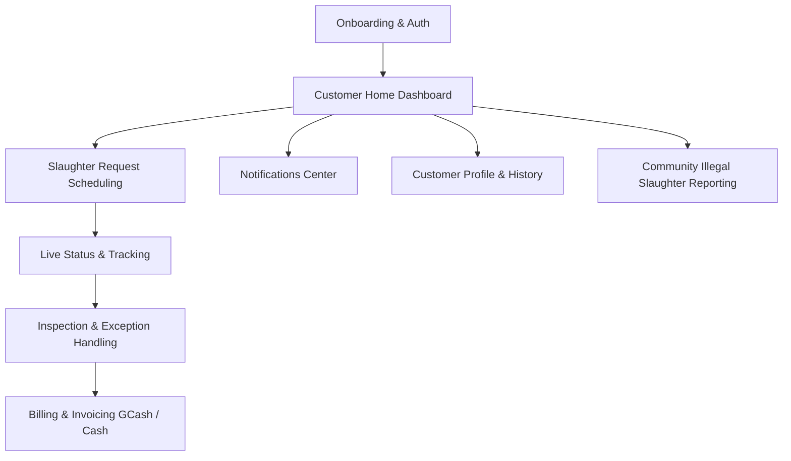
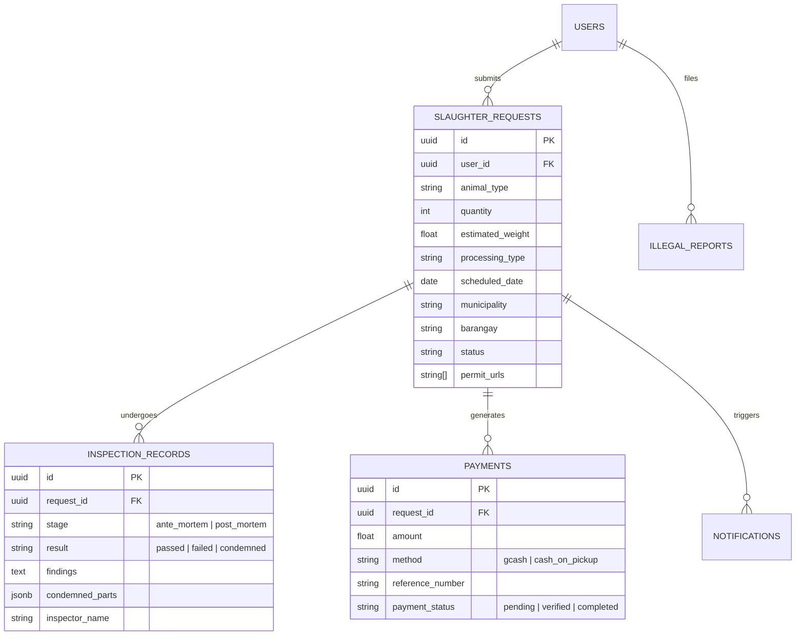

# 📋 Customer-Side Implementation Plan & Workload Roadmap

**Project:** Tabaco City "AA" Slaughterhouse Management System — Customer Mobile Application  
**Target Platform:** Flutter (Android & iOS)  
**Backend:** Supabase (Auth, Postgres DB, Storage, Realtime, Edge Functions)  
**Design Reference:** [Figma: CUSTOMER SIDE (File Key: `M0f7qaM8Byq3tKXorCWGXC`)](https://www.figma.com/design/M0f7qaM8Byq3tKXorCWGXC/CUSTOMER-SIDE?node-id=0-1)  
**Last Updated:** October 2026  

---

## 📑 Table of Contents
1. [Executive Summary & Scope](#1-executive-summary--scope)
2. [Design Tokens & UI Component System](#2-design-tokens--ui-component-system)
3. [Screen & Feature Inventory (Figma Breakdown)](#3-screen--feature-inventory-figma-breakdown)
4. [Architecture & Backend Integration](#4-architecture--backend-integration)
5. [Phased Implementation Roadmap](#5-phased-implementation-roadmap)
6. [Workload Allocation Matrix (By Role)](#6-workload-allocation-matrix-by-role)
7. [Testing, Compliance & Verification Strategy](#7-testing-compliance--verification-strategy)

---

## 1. Executive Summary & Scope

The **Customer-Side Mobile Application** allows citizens, meat vendors, and livestock owners in Tabaco City and surrounding Albay municipalities to:
- Browse livestock slaughter pricing and guidelines.
- Schedule slaughter requests with required municipal and veterinary documentation.
- Monitor inspection and slaughter stages in real-time.
- Handle ante-mortem / post-mortem exceptions (condemnation slips, quarantine, force release).
- Pay via GCash or Cash on Pickup and view digital receipts.
- Receive push and in-app notifications.
- Report illegal slaughter activities in the community.



---

## 2. Design Tokens & UI Component System

### 🎨 Color Palette
- **Primary Brand Green:** `#008000` / `#1E855A`
- **Secondary Mint / Accents:** `#81DF75` / `#90C4AA` / `#C0EABE` / `#DBFDDC`
- **Primary Action Blue:** `#003BD2` / `#0CACE2`
- **Alert / Danger Red:** `#E21B1B` / `#5C0A0A` / `#FCE8E8`
- **Warning / Pending Orange:** `rgba(240, 126, 45, 0.54)`
- **Surface / Background:** `#FFFFFF` / `#F7F7F7` / `#F4F4F4`
- **Typography Colors:** `#000000` (Main), `#161616` (Headings), `rgba(0,0,0,0.5)` (Subtitles)

### 🔤 Typography Hierarchy
- **Font Families:** `Inter`, `Roboto`, `Open Sans`
- **Headers:** 18px–24px (Bold / Semi-Bold)
- **Body & Captions:** 10px–14px (Regular / Medium / Light)

---

## 3. Screen & Feature Inventory (Figma Breakdown)

| Module | Screen / Frame | Description & Core UI Elements |
| :--- | :--- | :--- |
| **M1: Auth** | `LANDING PAGE` | Hero graphics, city banner, "Get Started" and "Log In" CTAs. |
| **M1: Auth** | `SIGN UP` | Full name, phone/email, password fields, terms, login redirect. |
| **M1: Auth** | `LOG IN` | Authentication via Email or Phone, password visibility toggle. |
| **M1: Auth** | `FORGET PASSWORD (1)` | Account lookup by Mobile Number or Email. |
| **M1: Auth** | `FORGET PASSWORD (2)` | 6-digit OTP code verification. |
| **M1: Auth** | `FORGET PASSWORD (3)` | New password input and confirmation. |
| **M2: Home** | `home` | Welcome banner, animal price cards (Pig, Cow, Goat, Sheep, Carabao), Hints, About Slaughterhouse, dynamic Gallery, bottom nav. |
| **M2: Home** | `how it works` | 4-step modal: 1. Send Request $\rightarrow$ 2. Get Approval $\rightarrow$ 3. Make Payment $\rightarrow$ 4. Pickup Ready. |
| **M2: Home** | `Gallery` | Filterable photo categories: Facility, Team, Livestock. |
| **M3: Requests** | `Submit New Request` | Animal selector, counter (1–5+), weight, date, Albay municipality & barangay pickers, file uploader. |
| **M3: Requests** | `review.dart` | Summary sheet of request details before final submission. |
| **M4: Tracking** | `View Status Update` | 6-stage status timeline with timestamps and stage-dependent badges. |
| **M5: Exceptions**| `Ante-Mortem Failed` | Health inspection diagnosis + Vet findings + Decision options: *Take Livestock Back* vs *Confine*. |
| **M5: Exceptions**| `Condemnation Slip` | Post-mortem condemned parts list, causes of condemnation, inspector notes. |
| **M5: Exceptions**| `Operation Failed` | Technical/operational failure notice + retry schedule. |
| **M5: Exceptions**| `Force Release Warning` | Legal liability waiver, lack of MIC disclaimer, fee breakdown with ₱500 penalty. |
| **M5: Exceptions**| `Reschedule Request` | Date picker for rebooking rejected or rescheduled requests. |
| **M6: Payments** | `PAYMENT` | History/tabs: *Pending Payment*, *Paid*, *Pickup Scheduled*. |
| **M6: Payments** | `Select Payment Method` | Selection modal: GCash online vs Cash on Pickup. |
| **M6: Payments** | `PAYMENT GCASH` | GCash number copy, 13-digit reference number submission. |
| **M6: Payments** | `PAYMENT CASH` | Cash pickup confirmation and instructions. |
| **M6: Payments** | `Receipt Detail` | Itemized invoice breakdown, status badge, download receipt. |
| **M7: Alerts** | `NOTIFICATION` | Filter tabs (*All*, *Unread*), action cards (*View Receipt*, *Reschedule*, *View Findings*). |
| **M8: Profile** | `PROFILE` | Avatar, verified badge, personal details, account statistics, sign out. |
| **M8: Profile** | `EDIT PROFILE` | Edit avatar, update name, phone, address fields with validation. |
| **M9: Community**| `Report Illegal Slaughter` | Incident location, description, photo evidence upload, anonymous toggle. |

---

## 4. Architecture & Backend Integration



---

## 5. Phased Implementation Roadmap

```
Phase 1: Design System & Auth  ──►  Phase 2: Home & Profile  ──►  Phase 3: Scheduling & Tracking
                                                                             │
Phase 6: Integration & QA     ◄──  Phase 5: Payments & Notifs ◄── Phase 4: Exceptions & Slips
```

### 🔹 Phase 1: Design System, Architecture & Authentication
- [ ] **1.1 Design Tokens:** Centralize color schemes, typography, paddings, and shadows in `lib/theme/`.
- [ ] **1.2 Common Widgets:** Build reusable custom buttons (`DefaultButton`, `GhostButton`), custom text input fields, top header bar, and standard navigation scaffold.
- [ ] **1.3 Landing Screen:** Pixel-perfect implementation of `LANDING PAGE` frame.
- [ ] **1.4 Customer Registration & Login:** Implement `SIGN UP` and `LOG IN` screens connected to Supabase Auth.
- [ ] **1.5 Forgot Password & OTP Flow:** Build phone/email lookup, 6-digit OTP code entry, and new password confirmation.

### 🔹 Phase 2: Home Dashboard, Discovery & Profile
- [ ] **2.1 Home Screen:** Hero welcome banner, dynamic livestock pricing cards (Pig, Cow, Goat, Sheep, Carabao), and Hints banner.
- [ ] **2.2 How It Works Modal:** Interactive 4-step process guide popup.
- [ ] **2.3 Facility & Livestock Gallery:** Tab-based gallery viewer (Facility, Team, Livestock) with responsive image grids.
- [ ] **2.4 Customer Profile Screen:** Profile card with Verified badge, phone number, address, and account summary stats.
- [ ] **2.5 Edit Profile Screen:** Form to update personal information and upload profile avatar to Supabase storage.

### 🔹 Phase 3: Slaughter Scheduling & Real-Time Tracking
- [ ] **3.1 Request Form:** Animal type picker, counter (1–5+), weight field, date picker, and processing type selector.
- [ ] **3.2 Location Engine:** Cascading dropdowns for Albay municipalities (Bacacay, Camalig, Daraga, Guinobatan, Jovellar, Libon, Malilipot, Malinao, Manito, Oas, Pio Duran, Polangui, Rapu-Rapu, Santo Domingo, Tiwi, Tabaco City, Ligao City, Legazpi City) and their respective barangays.
- [ ] **3.3 Document Uploads:** Multi-file picker for veterinary permits and barangay clearance certificates with progress indicator.
- [ ] **3.4 Review & Confirm Screen:** Order summary review before final submission.
- [ ] **3.5 Real-Time Status Tracker:** Vertical progress stepper (6 stages) listening to Supabase Realtime changes on `slaughter_requests`.

### 🔹 Phase 4: Inspection Outcomes, Condemnations & Exceptions
- [ ] **4.1 Ante-Mortem Failed Handler:** Alert modal presenting veterinary findings with action buttons: *Take Livestock Back* vs *Confine in Slaughterhouse*.
- [ ] **4.2 Post-Mortem Condemnation Slip:** Formal condemnation slip screen displaying condemned organs/parts, reason codes, and inspector signature.
- [ ] **4.3 Force Release Flow:** Legal liability modal with ₱500 penalty auto-computation and waiver agreement.
- [ ] **4.4 Reschedule Request Modal:** Date selection dialog for rejected or rescheduled slots.

### 🔹 Phase 5: Billing, Payments, Invoicing & Notifications
- [ ] **5.1 Payment Center:** Payment list tabbed by status (*Pending Payment*, *Paid*, *Pickup Scheduled*).
- [ ] **5.2 Payment Method Selection:** Choice between GCash Online and Cash on Pickup.
- [ ] **5.3 GCash Payment Gateway:** Copy GCash number helper, payment instruction list, and 13-digit transaction reference submission.
- [ ] **5.4 Cash on Pickup Confirmation:** Agreement screen with cash-only reminders and receipt reference generation.
- [ ] **5.5 Digital Receipt & PDF Export:** Detailed transaction receipt with printable/shareable format.
- [ ] **5.6 Notification Hub:** Real-time push and in-app alerts with filter chips (*All*, *Unread*) and contextual deep-linking buttons.
- [ ] **5.7 Community Reporting:** Anonymous/identified incident report submission with photo evidence upload.

### 🔹 Phase 6: End-to-End QA, Polish & Production Release
- [ ] **6.1 Role Integration Testing:** Validate end-to-end sync between Customer App, Inspector App, and Admin Panel.
- [ ] **6.2 Security & RLS Audit:** Validate Supabase Row-Level Security policies to prevent unauthorized data access.
- [ ] **6.3 Device Compatibility & Responsive Layout:** Test across diverse screen densities, tablets, and small phone screens.
- [ ] **6.4 Offline Resilience:** Provide friendly offline state banners and local cache for tracking history.

---

## 6. Workload Allocation Matrix (By Role)

| Role | Primary Responsibilities | Deliverables |
| :--- | :--- | :--- |
| **Flutter Frontend Lead** | • Implement Figma UI components<br>• State management (Riverpod/Provider/Bloc)<br>• Form validations & navigation flows | High-fidelity UI matching Figma specs, responsive mobile layouts. |
| **Backend & Supabase Dev** | • Database schema & RLS policies<br>• Realtime triggers & Edge Functions<br>• File storage buckets (permits, evidence, avatars) | Secure API endpoints, automated notification triggers, storage buckets. |
| **QA / Testing Specialist** | • End-to-end scenario validation<br>• Edge cases (failed inspection, network loss)<br>• Form validation & document upload testing | Test test cases, bug tracking tickets, acceptance sign-off. |
| **Product / Regulatory Lead** | • Alignment with NMIS ("AA" standards)<br>• Review condemnation & penalty terms<br>• Municipal permit requirements review | Regulatory compliance approval, legal text verification. |

---

## 7. Testing, Compliance & Verification Strategy

1. **Pixel-Fidelity Verification:**
   - Compare rendered Flutter views against Figma reference screenshots.
   - Verify font weights, colors, paddings, and button corner radii (`borderRadius`).

2. **Functional Test Scenarios:**
   - **Happy Path:** Register $\rightarrow$ Schedule Pig Slaughter $\rightarrow$ Upload Permit $\rightarrow$ Approved $\rightarrow$ Pay via GCash $\rightarrow$ Receive Receipt $\rightarrow$ Pickup.
   - **Ante-Mortem Rejection:** Request fails inspection $\rightarrow$ Customer selects "Confine" $\rightarrow$ Status updates across devices.
   - **Force Release Waiver:** Customer triggers force release $\rightarrow$ ₱500 penalty appended $\rightarrow$ Waiver logged $\rightarrow$ No MIC flagged.

3. **Data Integrity & Security:**
   - Every file uploaded to Supabase Storage must be scoped via RLS to authenticated user IDs.
   - Sensitive personal phone numbers and payment references must be validated with regular expressions.
