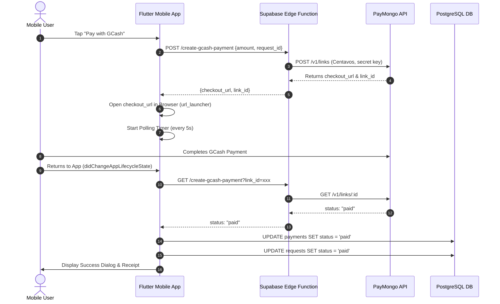

# Flutter Mobile App Architecture

The **Mobile Client Application** (`tc_aa_slaughterhouse`) provides meat dealers, farmers, market stall operators, and the general public with a native mobile gateway (Android/iOS) to interface with Tabaco City Slaughterhouse operations.

---

## Source Code Structure (`mobile_app/lib`)

```
mobile_app/lib/
├── main.dart                               # Entry point, Supabase init, .env loading
├── auth/
│   ├── auth_gate.dart                      # Auth state stream listener (Welcome vs Home)
│   └── auth_server.dart                    # Profile loading & session management
├── pages/
│   ├── home_page.dart                      # Main dashboard, quick actions, status stream
│   ├── login_page.dart                     # Email/Password authentication
│   └── signup_page.dart                    # Registration & initial profile creation
├── screen/
│   ├── requests.dart                       # New slaughter request booking form
│   ├── review.dart                         # Customer review & ratings submission
│   ├── payment.dart                        # Payment history & active invoice list
│   ├── select_payment_screen.dart          # GCash (PayMongo) / Cash checkout screen
│   ├── receipt_detail_screen.dart          # Digital official receipt with barcode/details
│   ├── condemnation_slip_screen.dart       # Veterinary condemnation notification & slip
│   ├── report_illegal_slaughter_screen.dart# Whistleblower reporting with photo evidence
│   ├── notify.dart                         # Realtime notifications center
│   ├── profile.dart                        # User profile management & avatar upload
│   ├── gallery.dart                        # Slaughterhouse facility gallery & info
│   ├── welcome.dart                        # Splash & intro onboarding screen
│   └── dashed_line.dart                    # Custom UI receipt divider widget
└── otp_screen.dart                         # OTP verification dialog
```

---

## Authentication & Session Lifecycle

1. **Authentication Gate (`AuthGate`)**:
   - Uses `Supabase.instance.client.auth.onAuthStateChange` to listen to token refreshes and login/logout events.
   - If an active session exists, mounts `HomeScreen()`. Otherwise, mounts `WelcomeScreen()`.
2. **Profile Synchronization**:
   - `AuthServer` loads the corresponding row from the `profiles` table matching `auth.uid()`.
   - Manages user metadata such as full name, phone number, and avatar URL.

---

## Payment & Polling Architecture



---

## Code Smells & Architectural Insights

1. **Direct Database Updates from Client**:
   - As noted in the audit, the mobile app writes directly to the `payments` and `requests` tables when confirming transactions instead of relying on a secure webhook or database trigger.
2. **Missing State Management Library**:
   - State across screens is managed via local `StatefulWidget` `setState()` calls. While lightweight, shared application state (such as live badge counts) requires repeated manual queries.
3. **Hardcoded URLs**:
   - In `select_payment_screen.dart`, URL manipulation `supabase.rest.url.replaceAll('/rest/v1', '')` is used to construct edge function URLs. Recommended to use `supabase.functions.invoke()` directly for cleaner integration.

---

## Related Knowledge Links
- [[PayMongo Payment Gateway Integration]]
- [[Mobile - Client Request Booking]]
- [[Mobile - GCash & Cash Checkout]]
- [[Comprehensive System Audit Report]]
