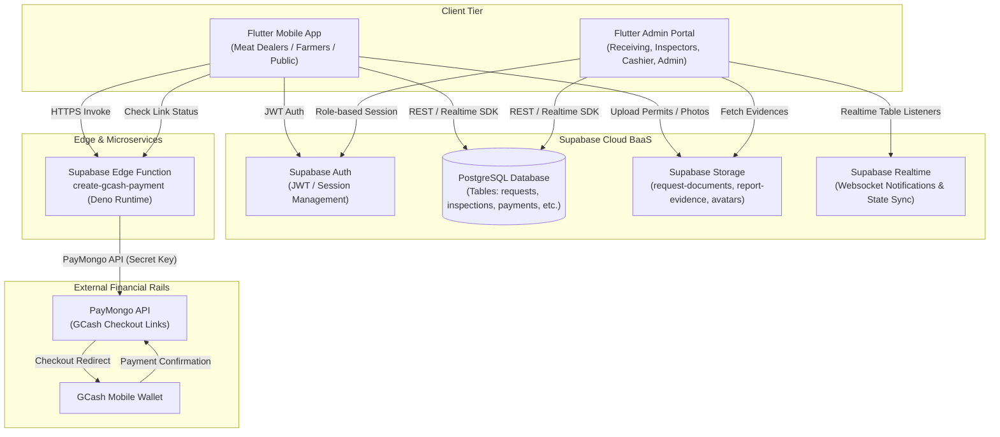

# High-Level System Architecture

The **Tabaco City "AA" Slaughterhouse Management System** is a distributed, multi-client, cloud-synchronized municipal platform engineered to regulate, automate, and monitor livestock slaughtering operations within the jurisdiction of the City Government of Tabaco, Albay, Philippines.

The architecture comprises three primary tiers:
1. **Client Applications (Flutter Multiplatform)**: Citizen mobile client (`mobile_app`) and Staff/Inspector Admin web & desktop console (`admin_panel`).
2. **Cloud Backend & Data Tier (Supabase BaaS)**: PostgreSQL database, Auth engine, Storage buckets, and Realtime websocket event broadcasting.
3. **Edge Compute & External Services**: Deno-based Supabase Edge Functions communicating with the **PayMongo Payment Gateway** for GCash transactions and local PDF rendering engines.

---

## Architectural Topology Diagram

---

## Architectural Component Matrix

| Tier | Technology | Component Name | Primary Responsibility |
| :--- | :--- | :--- | :--- |
| **Mobile Client** | Flutter 3.11+ / Dart | `tc_aa_slaughterhouse` | Citizen request intake, permit uploads, slaughter tracking, condemnation slips, digital checkout, whistleblower reporting |
| **Admin Client** | Flutter 3.11+ / Dart | `admin_panel` | Master management shell, request triage (Barangay/Market), document validation, ante/post-mortem inspection tagging, cashiering, legal PDF reports |
| **Database** | PostgreSQL (Supabase) | `TCAASlaughterhouse DB` | Structured data persistence, relational foreign keys, row auditing, transactional status transitions |
| **Authentication** | Supabase Auth | `GoTrue Auth` | User identities, credential hashing, JWT token issuance, session persistence via `SharedPreferences` |
| **File Storage** | Supabase Storage (S3 API) | `Storage Buckets` | Secure storage and public URL resolution for inspection documents, whistleblower evidence, and avatar photos |
| **Serverless Edge** | Deno TypeScript | `create-gcash-payment` | Secure gateway communication with PayMongo API to generate and verify payment links without exposing secret keys |
| **Payment Gateway**| PayMongo REST API | `PayMongo v1` | GCash online payment processing, digital checkout sessions, reference tracking |
| **Reporting** | Dart `pdf` & `printing` | `ReportPdfGenerator` | Government-standard legal size Daily Slaughterhouse Production Reports and print pipelines |

---

## Cross-System Interaction Patterns

1. **Intake to Completion Data Pipeline**:
   - Data originates from citizens on `mobile_app` as `requests`.
   - Admin verifies and triggers state transitions on `admin_panel` through `slaughter_inspection` and `payments`.
   - Both clients read and write to the shared PostgreSQL schema via the `supabase_flutter` SDK.
2. **Notification Dispatching**:
   - State updates in `admin_panel` trigger programmatic inserts into the `notifications` table targeting the citizen's `user_id`.
   - The `mobile_app` listens via periodic queries and stream listeners to surface alerts.
3. **Decoupled Financial Execution**:
   - The mobile client invokes the edge function with the computed fee total.
   - The edge function communicates securely with PayMongo using the environment secret `PAYMONGO_SECRET_KEY`.
   - Payment links are opened via `url_launcher`, and payment confirmation resolves back into the `payments` and `requests` database records.

---

## Related Knowledge Links
- [[End-to-End Workflow State Machine]]
- [[Flutter Mobile App Architecture]]
- [[Flutter Admin Panel Architecture]]
- [[Supabase Backend & Edge Runtime]]
- [[PayMongo Payment Gateway Integration]]
- [[Master Entity Relationship Diagram (ERD)]]
