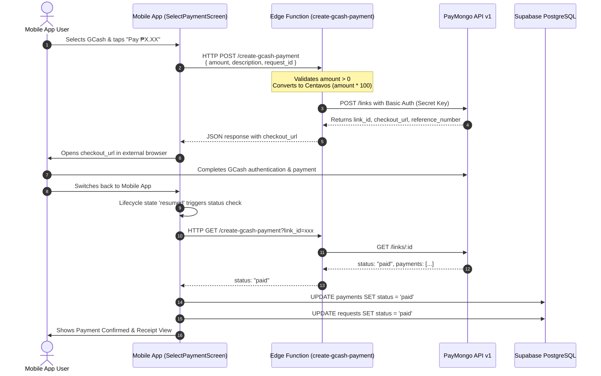

# PayMongo Payment Gateway Integration

The **PayMongo Integration** enables meat dealers and slaughterhouse clients to settle slaughtering, ante/post-mortem inspection, corral, and facility fees directly via GCash, Maya, and credit/debit channels.

---

## Complete Transaction Lifecycle



---

## Edge Function Implementation Highlights

1. **Amount Normalization**:
   ```typescript
   // PayMongo API requires currency amounts in centavos integer format
   const amountInCentavos = Math.round(amount * 100);
   ```
2. **Metadata Tracking**:
   ```typescript
   body: JSON.stringify({
     data: {
       attributes: {
         amount: amountInCentavos,
         description: description || `Slaughter Service Payment - Request #${request_id}`,
         remarks: `request_id:${request_id}`,
       },
     },
   })
   ```
3. **CORS Security**:
   - Headers explicitly define `Access-Control-Allow-Origin: *` to permit Flutter Web and Mobile preflight options requests.

---

## Security Vulnerabilities & Best Practices

1. **Absence of Server-to-Server Webhook**:
   - Currently, payment verification relies on **Client-Side Polling** (`didChangeAppLifecycleState` and periodic timer).
   - If a customer completes the GCash payment but closes the browser or loses internet connection before returning to the app, the database will remain in an `unpaid` or `payment_pending` state!
   - **Recommendation**: Implement a dedicated PayMongo Webhook listener (`POST /paymongo-webhook`) in Supabase Edge Functions that updates `payments` and `requests` atomically upon receiving `payment.paid` event. See [[Security & Vulnerability Assessment]].

---

## Related Knowledge Links
- [[Flutter Mobile App Architecture]]
- [[Supabase Backend & Edge Runtime]]
- [[Security & Vulnerability Assessment]]
