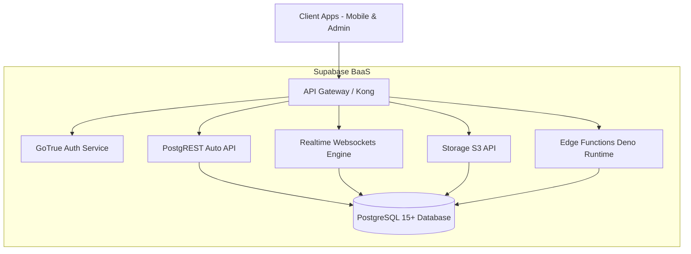

# Supabase Backend & Edge Runtime

The **Supabase Backend** serves as the cloud infrastructure for the entire application, handling relational persistence, identity verification, binary document storage, and serverless edge functions.

---

## Architecture Breakdown

---

## PostgreSQL Database Schemas

The database structure revolves around the following primary relations:
1. **`requests`**: Primary intake record containing customer metadata, livestock counts, schedule preferences, and top-level processing status.
2. **`slaughter_inspection`**: 1-to-1 extension table recording veterinary examination parameters (ante-mortem findings, scalding/bleeding stage, post-mortem status, carcass weight, condemnation reasons).
3. **`payments`**: Financial transactions, calculated fee breakdowns, GCash reference identifiers, and official receipt timestamps.
4. **`profiles`**: User details (full name, phone, role) linked 1-to-1 with `auth.users.id`.
5. **`notifications`**: Targeted user alerts with read flags and message payloads.
6. **`reports`**: Whistleblower illegal slaughter complaints with GPS coordinates and evidence media links.
7. **`reviews`**: Public ratings and feedback for slaughterhouse service quality.

---

 Edge Functions: `create-gcash-payment`

Located at `supabase/functions/create-gcash-payment/index.ts`. Built with TypeScript running on the Deno Edge Runtime.

 Function Capabilities:
- **`POST /create-gcash-payment`**: Accepts `{ amount, description, request_id }`. Calculates centavo amount (`Math.round(amount * 100)`), encodes `PAYMONGO_SECRET_KEY` in HTTP Basic Auth header, calls `https://api.paymongo.com/v1/links`, and returns the `checkout_url` and `link_id`.
- **`GET /create-gcash-payment?link_id={id}`**: Queries PayMongo API for link status (`unpaid`, `paid`, `archived`) and payments array.

 Environment Secrets Required:
- `PAYMONGO_SECRET_KEY`: Private API key starting with `sk_live_...` or `sk_test_...`.

---

 Supabase Storage Buckets

| Bucket Name | Access Policy | Used For |
| :--- | :--- | :--- |
| `request-documents` | Public Read / Authenticated Write | Veterinary Health Certificates, Shipping Permits, Barangay Clearance |
| `report-evidence` | Public Read / Authenticated Write | Photographic evidence submitted by citizens for illegal slaughter reports |
| `avatars` | Public Read / Authenticated Write | User and staff profile pictures |

---

## Related Knowledge Links
- [[PayMongo Payment Gateway Integration]]
- [[Master Entity Relationship Diagram (ERD)]]
- [[Database Security & RLS Policy Audit]]
