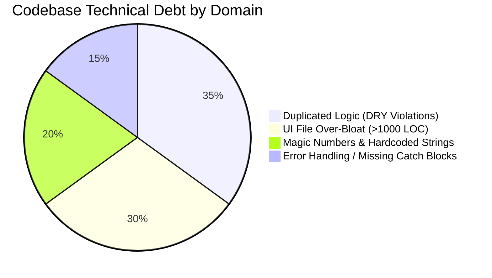

# Code Quality & Technical Debt Matrix

A comprehensive review of the codebases (`admin_panel` and `mobile_app`), highlighting opportunities for refactoring, modularization, and adherence to clean architecture principles.

---

## Code Health Index



---

## Specific Code Smells & Refactoring Opportunities

 1. Massive View Files (>1,000 LOC per file)
- **Examples**:
  - `admin_panel/lib/screens/slaughter_inspection_page.dart` (1,830 lines)
  - `admin_panel/lib/screens/receiving_requests_page.dart` (1,441 lines)
  - `admin_panel/lib/screens/payment_cashiering_page.dart` (1,152 lines)
- **Issue**: Complex dialogs, table formatters, filter states, and networking logic are bundled directly into single widget files.
- **Refactoring Strategy**: Extract subcomponents into dedicated widget files (`widgets/process_update_dialog.dart`, `widgets/inspection_table.dart`, `widgets/cashier_receipt_dialog.dart`).

---

 2. Duplication of Fee Rate Constants (DRY Violation)
- **Issue**: Slaughterhouse rates are declared locally inside separate files in both apps.
- **Refactoring Strategy**: Create a shared business logic module or maintain the tariff table inside Supabase so updates reflect in real-time across all platforms without client redeployment.

---

 3. Magic Number Heuristics in PDF Generation
- In `admin_panel/lib/services/report_pdf_generator.dart`:
  ```dart
  if (type.contains('hog') || type.contains('pig')) {
    totalHogs += count;
  } else if (type.contains('cow') || type.contains('cattle')) {
    totalCow += count;
  }
  ```
- **Refactoring Strategy**: Standardize livestock species using a strict database enum (`hog`, `cattle`, `carabao`, `goat`) rather than substring heuristics.

---

## Related Knowledge Links
- [[Comprehensive System Audit Report]]
- [[Flutter Admin Panel Architecture]]
- [[Flutter Mobile App Architecture]]
