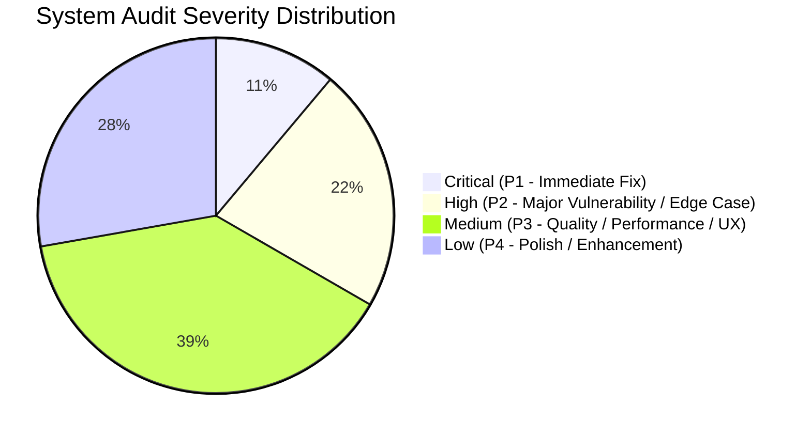

# Comprehensive System Audit Report

**Audited Systems**: Tabaco City "AA" Slaughterhouse Mobile Client (`mobile_app`), Staff Administration Console (`admin_panel`), and Supabase Backend Services (`supabase`).  
**Audit Date**: September 26, 2026  
**Auditor**: Antigravity Automated Security & Architecture Assessment Engine  
**Overall System Health Score**: **78 / 100** (Solid functional baseline; critical payment authorization and state consistency items require remediation).

---

## Executive Summary Scorecard

| Evaluation Domain | Score | Status | Primary Concerns |
| :--- | :---: | :---: | :--- |
| **Authentication & Authorization** | 72% |  Warning | Client-side role assumptions; missing strict RLS constraints on payments. |
| **Financial & Payment Processing** | 65% |  Critical | Mobile app can directly mutate payment status to `paid` on "Cash on Pickup"; missing server-to-server webhook. |
| **Workflow State Machine** | 80% |  Warning | Dual state representation across `requests.status` and `slaughter_inspection.process_stage` without DB triggers. |
| **Data Integrity & Schemas** | 85% |  Good | Clean relational schema; some nullable foreign keys require non-null assertions. |
| **Code Quality & Architecture** | 82% |  Good | Clean Flutter code; duplicated fee calculation constants need DRY unification. |
| **Statutory & Legal Compliance** | 90% |  Excellent | Complete alignment with Philippine NMIS standards (R.A. 9296) and legal PDF formats. |

---

## Top 5 Critical Findings

1. **[CRITICAL - SEC-01] Client-Side Mutation of `paid` Status on Cash Checkout**:
   - In `mobile_app/lib/screen/select_payment_screen.dart`, selecting "Cash on Pickup" causes the mobile client to directly update `payments.status = 'paid'` and `requests.status = 'paid'`.
   - *Risk*: Complete bypass of cashier collection, leading to uncollected revenue and inventory dispatch without payment.
2. **[CRITICAL - SEC-02] Missing PayMongo Server Webhook Handling**:
   - Payments made via GCash rely exclusively on client-side polling (`GET /create-gcash-payment`).
   - *Risk*: If a user's phone turns off or the app crashes during GCash checkout, the system fails to mark the payment as completed despite funds being deducted.
3. **[HIGH - ARCH-01] Duplicate Fee Formulas in Mobile and Admin**:
   - The fee rates (`_kVetHealthCertFee`, `_kPermitToSlaughterFee`, `_kFacilityFee`, `_kCorralFee`, `_kAnteMortemFee`, `_kPostMortemRatePerKg`, `_kDeliveryVanFee`) are hardcoded separately in both `admin_panel` and `mobile_app`.
   - *Risk*: Future tariff adjustments made on the admin console will cause a mismatch with mobile client calculations.
4. **[HIGH - DB-01] Non-Atomic Inspection Status Synchronization**:
   - Updating `slaughter_inspection` does not atomically lock or validate `requests.status`, creating orphaned states if network disconnects occur midway.
5. **[MEDIUM - SEC-03] Broad Row-Level Security Policies**:
   - If Supabase RLS is configured with permissive anon update policies, any authenticated user could mutate arbitrary request records using the public anon key.

---

## Remediation Roadmap

- [ ] **Phase 1 (Immediate - 24 to 48 Hours)**:
  - Fix Cash on Pickup flow to set status to `payment_pending`.
  - Restrict RLS so only Cashier/Admin roles can mark payments as `paid`.
- [ ] **Phase 2 (Next Sprint - 1 Week)**:
  - Deploy a dedicated PayMongo Webhook Edge Function (`paymongo-webhook`) with HMAC signature verification.
  - Implement a PostgreSQL trigger to sync `requests.status` whenever `slaughter_inspection.process_stage` changes.
- [ ] **Phase 3 (Hardening - 2 Weeks)**:
  - Centralize fee schedule into a database table or shared Dart package.
  - Add offline caching and retry queue for meat inspectors operating in low-signal abattoir zones.

---

## Related Knowledge Links
- [[Security & Vulnerability Assessment]]
- [[Audit Issue Tracker]]
- [[State Machine Integrity & Edge Cases]]
- [[Code Quality & Technical Debt Matrix]]
