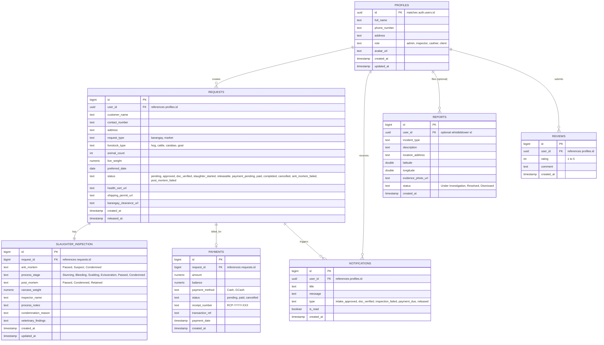

# Master Entity Relationship Diagram (ERD)

The complete data model supporting the Tabaco City "AA" Slaughterhouse Application ecosystem.

---

## Relational Entity Diagram

---

## Related Knowledge Links
- [[Table - requests]]
- [[Table - slaughter_inspection]]
- [[Table - payments]]
- [[Table - profiles]]
- [[Storage Buckets & Asset Management]]
