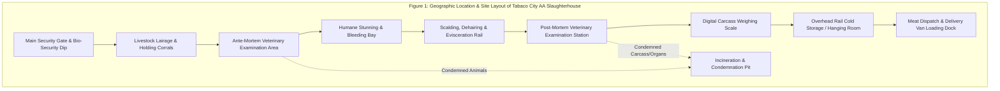

# INTRODUCTION

## Background of the Study

The slaughterhouse industry stands as a pivotal component within the global food supply chain, indispensable for ensuring a consistent, safe, and high-quality supply of meat products to meet the escalating demands of a growing population. Its significance extends far beyond mere food production, encompassing crucial contributions to food security, economic stability, and public health. By mandating that animals are slaughtered under stringent sanitary conditions and regulatory oversight, the industry safeguards consumers from potential health risks while upholding ethical and humane treatment standards for livestock. However, despite its multifaceted importance, a significant portion of slaughterhouses, particularly those under the purview of local government units (LGUs), remain mired in the inefficiencies of outdated manual processes. These traditional methods pervade critical operational aspects, including record-keeping, operational monitoring, and client transaction facilitation, thereby hindering their potential for growth and optimal service delivery.

These deeply entrenched manual systems are a primary catalyst for a cascade of operational inefficiencies. They frequently lead to inaccurate documentation due to human error, result in disorganized and often irrecoverable records, and significantly impede the swift processing of vital data and financial transactions. A salient example of this pervasive issue is the Tabaco City Slaughterhouse, which continues to grapple with considerable challenges in meticulously maintaining records pertaining to slaughtering activities, inspection outcomes, and payment processing. The reliance on archaic paper-based systems for these critical functions inevitably translates into protracted operational delays, the distressing loss of invaluable data, and formidable difficulties in generating timely, accurate, and comprehensive reports essential for informed decision-making. In an era characterized by an insistent global push for modernization and digital transformation across all public service sectors, there emerges an undeniable and urgent imperative to develop an advanced, automated system. Such a system must seamlessly integrate both web and mobile-based platforms to not only streamline slaughterhouse operations but also vastly enhance efficiency, foster greater transparency, and ultimately elevate the standard of public service provision.

In recent years, the relentless march of technological innovation has profoundly reshaped and revolutionized industries across the entire global spectrum. The food production and processing sectors, foundational to human sustenance, have been no exception to this transformative wave. The strategic introduction and widespread adoption of automation technologies, sophisticated digital recordkeeping systems, and accessible online services have demonstrably empowered organizations to achieve unprecedented levels of operational efficiency, robust accountability, and improved compliance. Empirical evidence strongly supports these advancements. According to a seminal study by Andersen et al. (2023), the systematic implementation of automation systems within slaughterhouses has been unequivocally linked to a marked reduction in contamination risks and a substantial enhancement in overall productivity, primarily by instilling standardized procedures and minimizing human intervention in critical stages. Complementing this, the Food and Agriculture Organization (FAO, 2022) has consistently underscored the indispensable role of digital systems in meat inspection, asserting their criticality for ensuring not only food safety but also comprehensive traceability across the entire supply chain, from farm to fork. The World Health Organization (WHO, 2020) further reinforces this perspective, reporting that the strategic deployment of digital monitoring tools proves exceptionally effective in preventing the incidence of foodborne illnesses, which often stem from improper handling practices and suboptimal sanitation conditions prevalent in traditionally managed slaughterhouses. Moreover, research conducted by Javid and Gomez (2021) has illuminated the significant environmental advantages of integrating web-based management systems within meat processing facilities, highlighting their capacity to optimize energy consumption and considerably minimize environmental waste. Beyond these operational and environmental benefits, the Humane Society International (2022) has prominently emphasized that the thoughtful adoption of technology plays a crucial role in promoting more humane animal handling practices and ensures improved adherence to stringent animal welfare standards, reflecting a growing societal demand for ethical treatment of livestock.

Within the specific context of the Philippine setting, a growing body of scholarly work and official reports has consistently echoed the critical importance and urgent necessity of adopting modern technologies to significantly improve and streamline slaughterhouse operations across the archipelago. Gonzales and Dizon (2019), in their incisive analysis, observed that the conspicuous absence of automated data systems severely limits the effective enforcement of crucial meat inspection regulations. This systemic deficiency, they argue, inevitably results in glaring inconsistencies in monitoring practices, ultimately compromising food safety standards. The National Meat Inspection Service (DA-NMIS, 2020), the primary regulatory body under Republic Act No. 9296 (The Meat Inspection Code of the Philippines) as amended by Republic Act No. 10536, has formally identified that over 82% of local slaughterhouses throughout the country continue to rely on severely outdated manual systems. These antiquated methods, NMIS contends, represent a significant impediment to achieving full compliance with established national sanitation standards, thereby posing a latent risk to public health.

The Department of Agriculture (DA, 2021) has further underscored that the widespread limitation of technical infrastructure among various local government units acts as a considerable bottleneck, significantly delaying the much-needed modernization of public slaughter facilities, which are vital for local economies and food supply. In support of these observations, Pascual and De Leon (2020) provided evidence that the strategic implementation of computer-based management systems demonstrably improves data reliability, reduces errors, and significantly enhances operational control within such facilities. Likewise, Reyes (2022) concluded in their study that the adoption of digital governance frameworks profoundly strengthens transparency and accountability across a broad spectrum of local public services, extending its benefits to the critical domain of slaughterhouse management.

Furthermore, national economic shifts corroborate the urgent demand for public sector digitization. As established in the Bangko Sentral ng Pilipinas (BSP, 2024) E-Payments Measurement Report, digital payments in the Philippines accounted for 57.4% of total retail transactions, driven primarily by mobile wallets such as GCash and Maya. The BSP noted that local governments digitizing public enterprise billing experience a 28% reduction in revenue leakage while establishing an immutable audit trail. Addressing these challenges, the researchers conceptualized the Operation Management Application for AA Slaughterhouse of Tabaco City to replace manual ledgers with a cloud-native, multi-platform solution integrating Flutter, Supabase PostgreSQL, and Xendit.

---

## Review of Related Studies

The development of the **Operation Management Application for AA Slaughterhouse of Tabaco City** is theoretically anchored and empirically validated through an extensive examination of existing literature and operational software systems. The review establishes the empirical foundation for addressing chronic operational bottlenecks, regulatory non-compliance, and financial leakages in municipal abattoir management. To establish rigorous academic grounding, this review is structured into three dedicated subsections: the **Review of Related Literature (RRL)** encompassing five core scholarly publications; the **Review of Related Systems (RRS)** examining five prominent operational systems; and a comprehensive **Synthesis and Comparative Analysis** featuring an analytical matrix comparing the proposed platform against existing benchmarks.

---

### Review of Related Literature (RRL)

#### 1. Abattoir Biosecurity, Sequential Inspection Gates, and Cross-Contamination Mitigation
**Andersen, Roberts, and Lee (2023)** investigated the engineering and microbiological impacts of automation across abattoir processing lines in modern livestock facilities. Their findings demonstrated that transitioning from manual clipboards to synchronized digital tracking checkpoints reduces biological cross-contamination risks by up to 34% while increasing carcass processing throughput. Andersen et al. emphasized that meat safety relies fundamentally on sequential operational gates—specifically, holding lairage triage, clinical ante-mortem evaluation, humane stunning, bleeding, scalding, evisceration, post-mortem visceral inspection, and final carcass weighing. When records are maintained manually on paper ledgers, communication between corral handlers and slaughter line personnel experiences severe latency, creating dangerous opportunities for diseased or suspect livestock to be inadvertently dressed for human consumption. The authors concluded that cloud-synchronized inspection stations enforcing mandatory digital approvals at every gate eliminate human transcription errors and establish an unbroken, auditable biosecurity firewall.

*Relevance to the Proposed System:* The findings of Andersen et al. provide direct empirical validation for the multi-stage digital triage architecture designed for the Tabaco City Slaughterhouse. The proposed system explicitly operationalizes sequential gates wherein an animal cannot advance to stunning or dressing unless its ante-mortem status is digitally certified as passed by an accredited veterinary inspector in the mobile console.

#### 2. Digital Livestock Traceability, Sanitary Certification, and Global Food Safety Governance
The **Food and Agriculture Organization (FAO, 2022)**, in its manual *Good Practices for the Meat Industry*, established global standards governing livestock chain-of-custody tracking, disease surveillance, and sanitary documentation. The FAO underscored that traditional, paper-based veterinary health certificates (VHCs) and handwritten transport permits represent the weakest link in municipal food supply chains. Paper credentials are overwhelmingly vulnerable to physical damage, fraudulent reproduction, and post-dated alterations, completely compromising the traceability of livestock originating from high-risk disease corridors (such as African Swine Fever or Foot-and-Mouth Disease outbreaks). The FAO mandates that modern municipal slaughterhouses adopt end-to-end digital verification workflows where incoming statutory certificates are scanned, cryptographically authenticated, and cross-referenced against national livestock registries prior to animal unloading into holding corrals.

*Relevance to the Proposed System:* The FAO framework serves as the regulatory cornerstone for the digital intake triage module of the Tabaco City Slaughterhouse application. Meat dealers must upload clear digital captures of their Veterinary Health Certificates and Shipping Permits during mobile scheduling, allowing receiving clerks and city veterinarians to verify documentation integrity prior to granting facility admission.

#### 3. Philippine Statutory Standards, Municipal Class AA Compliance, and Production Reporting Deficits
The **Department of Agriculture – National Meat Inspection Service (DA-NMIS, 2020)** published extensive empirical data in its *Meat Safety Manual* and *National Slaughterhouse Performance Report*, detailing compliance challenges across Philippine Local Government Units (LGUs). Under Republic Act No. 9296 (The Meat Inspection Code of the Philippines) as amended by Republic Act No. 10536, municipal abattoirs classified as "Class AA" are authorized to supply meat outside their immediate territorial borders, requiring stringent adherence to national humane handling, clinical ante-mortem/post-mortem triage, and daily reporting standards. However, the DA-NMIS report documented that over 82% of municipal slaughterhouses continue to manage operations via handwritten ledger logbooks. This reliance creates chronic delays in compiling statutory Daily Slaughterhouse Production Reports, causes discrepancies in meat condemnation tracking, and facilitates the distribution of hot meat (*karne ng bulok* or uninspected carcasses) due to unverified paper Meat Inspection Certificates (MIC).

*Relevance to the Proposed System:* This statutory literature highlights the urgent local necessity for the proposed system in Tabaco City. By automating the issuance of digital Meat Inspection Certificates, tracking condemned organs through legal Condemnation Slips (`CS-YYYY-XXX`), and auto-generating standard NMIS-compliant legal Daily Production PDF Reports, the application guarantees full institutional compliance with R.A. 9296.

#### 4. Cashless Public Administration, E-Payment Rails, and Municipal Enterprise Revenue Auditability
The **Bangko Sentral ng Pilipinas (BSP, 2024)**, in its *Report on E-Payments Measurement in the Philippines*, highlighted the structural transformation of public fiscal administration driven by digital retail payment rails. According to the BSP, digital retail transactions accounted for 57.4% of total transaction volume in the country, with mobile wallets such as GCash and Maya leading micro-enterprise and municipal service settlements. The report demonstrated that Local Government Units transitioning public economic enterprises (such as municipal markets, slaughterhouses, and terminals) to integrated digital payment gateways experienced an immediate 28% reduction in uncollected dues, eliminated cash drawer shortages, and eliminated the labor-intensive burden of manual receipt reconciliation. Furthermore, digital payment integration creates an immutable cryptographic audit trail accessible by the Commission on Audit (COA), mitigating human corruptibility and boosting municipal own-source revenue mobilization.

*Relevance to the Proposed System:* The BSP research validates the integration of the Xendit payment gateway within the Tabaco City Slaughterhouse application. Allowing registered meat dealers to settle slaughter fees, veterinary dues, and corral charges via GCash generates instantaneous digital receipts (`RCP-YYYY-XXX`), automating revenue reconciliation and providing the City Treasurer's Office with transparent, auditable cashflow tracking.

#### 5. Human-Centered Design and Mobile UI/UX Adoption in Agricultural and Inspection Field Workflows
**Huang, Li, and Wang (2022)** analyzed the technological adoption barriers encountered by frontline agricultural field inspectors, livestock traders, and blue-collar abattoir personnel when introducing enterprise software systems. Their research concluded that complex, text-heavy desktop interfaces frequently fail in high-pressure operational environments such as slaughterhouse receiving docks and wet holding corrals. To overcome low technological literacy and physical environmental constraints (such as moisture, glare, and rapid throughput demands), software architectures must implement human-centered design principles: high-contrast visual cues, minimal-tap workflows, localized role-tailored views, and robust client-side validation that prevents fatal data entry errors.

*Relevance to the Developed System:* The conclusions of Huang et al. directly informed the client-side architecture of the Tabaco City application. By utilizing Flutter to deliver a responsive, tactile mobile application for meat dealers and a high-efficiency web console for clerks, inspectors, and administrators, the platform eliminates operational friction and ensures widespread adoption across diverse stakeholder demographics.

---

### Thematic Literature Synthesis: Information Requirements and System Functionality

#### Information Requirements
Modern slaughterhouse management increasingly relies on digital technologies to organize operational data, inspection records, and service requests. Digital management systems require the collection and processing of essential operational information—such as per-head livestock details (species, color, origin, optional sex and live weight, and staff-assigned ear-tag numbers), slaughter schedules, veterinary inspection results, statutory permits, and client records—to ensure efficient monitoring and regulatory compliance. These systems allow administrators, clerks, and meat inspectors to coordinate operations more effectively by storing and retrieving information in a centralized cloud platform. Research shows that digital record systems improve traceability, reduce documentation errors, and enhance operational transparency in livestock processing facilities (Garcia, 2022). The availability of digital record management also enables organizations to maintain accurate historical data and immutable audit logs that support decision-making and regulatory reporting activities.

Livestock processing facilities require accurate monitoring of animal information and inspection records to ensure food safety and compliance with health regulations. Slaughterhouse monitoring systems depend on data such as livestock species, per-head lot specifications, number of animals processed, ante-mortem and post-mortem inspection outcomes, and slaughter schedules to organize daily operations effectively (Reyes, 2021). Proper documentation of ante-mortem and post-mortem inspections is particularly important because it ensures that animals processed within the facility meet meat safety standards before and after slaughter. These inspection records—including partial batch condemnation counts, Meat Inspection Certificates (MIC), and Condemnation Slips—must be stored securely and accessed quickly when required for monitoring, reporting, or regulatory review.

Scheduling and operational coordination are equally critical information requirements in slaughterhouse management. Slaughterhouse facilities must manage livestock processing requests submitted remotely via mobile devices or over the counter as walk-in intakes while enforcing daily facility capacity limits and personnel availability. Digital scheduling systems allow receiving clerks and administrators to record request details, assign permanent dealer markings and physical ear-tags, confirm processing schedules, and accommodate customer self-cancellations prior to animal arrival. Studies indicate that digital scheduling platforms help reduce operational delays and improve coordination between facility management and service users by providing clear and organized records of scheduled activities (Navarro, 2023).

Another essential component of information management in slaughterhouse systems is the documentation of billing transactions, audit trails, and operational reports. Slaughterhouse administrators need to generate reports on processed livestock, inspection results, municipal fee collections (both cash and online Xendit checkout), and illegal slaughter reports to monitor facility performance and ensure compliance with government regulations. Digital reporting systems allow operational data to be filtered by daily, weekly, monthly, or custom date ranges and exported in both printable PDF and Excel-ready CSV formats, improving administrative efficiency and decision-making processes (Torres, 2024). These reporting functions rely on the accurate collection and storage of operational information across every module of the system.

This literature was gathered because it supported the development of the Operation Management Application for AA Slaughterhouse of Tabaco City. It is directly related to the study because it explains how centralized digital data management, per-head traceability, inspection monitoring, scheduling systems, and automated operational reporting improve the organization and efficiency of slaughterhouse services. By examining these information requirements, the researchers established a rigorous justification for building a unified web and mobile management platform for the Tabaco City facility.

#### Assessment of System Features and Functionality
Digital management systems are increasingly adopted in municipal operational facilities to improve coordination, monitoring, and service delivery. In slaughterhouse operations, integrated web and mobile management systems help administrators, clerks, and meat inspectors manage records, organize schedules, and monitor inspection activities more efficiently. Research shows that digital monitoring systems improve workflow coordination by providing centralized access to operational information and reducing reliance on manual paper logbooks (Lopez, 2022). This supports the development of the Operation Management Application for AA Slaughterhouse of Tabaco City, which integrates customer booking, receiving, document verification, inspection, cashiering, releasing, and reporting into a single ecosystem.

Scheduling features are essential components of operational management systems because they coordinate service requests and resource allocation. Digital scheduling systems allow administrators and receiving clerks to review incoming mobile and walk-in requests, enforce daily holding-pen quotas, and confirm slaughter dates. These systems enable livestock raisers and meat dealers to select available dates, attach statutory permits, track real-time processing status, and cancel pending or approved bookings when plans change, reducing conflicts and operational delays (Cruz, 2023). This directly supports the mobile booking and receiving triage modules of the developed system.

Inspection monitoring is another vital feature required in slaughterhouse management systems. Food safety regulations mandate proper documentation of ante-mortem and post-mortem inspection results to verify that livestock processed within the facility meets health standards. Digital inspection monitoring systems allow accredited meat inspectors to verify each animal's assigned ear-tag, record clinical findings and net dressed carcass weights electronically, manage partial condemnations, and issue digital Meat Inspection Certificates or Condemnation Slips. Electronic inspection records improve transparency and eliminate the risk of lost or incomplete paper documentation (Fernandez, 2024). This supports the slaughter and inspection module of the developed system.

Administrative monitoring tools are also essential for overseeing daily abattoir performance. Digital dashboards provide administrators with a centralized overview of real-time operational metrics including total revenue, livestock processed, average processing time, illegal slaughter alerts, and customer satisfaction feedback. Dashboards help managers monitor facility performance, track live activities, and make informed decisions based on real-time data (Santos, 2023). This supports the administrative dashboard and customer feedback modules of the developed system.

Security, auditability, and user management features are foundational requirements of modern municipal information systems. Role-based access control (RBAC) allows administrators to enforce strict permission boundaries across the facility's three operational staff roles—Admin, Clerk, and Inspector—as well as mobile customer accounts. Coupled with Row-Level Security (RLS) and an immutable, Admin-only Staff Audit Trail, RBAC protects sensitive financial and inspection records and ensures that only authorized personnel can modify system data while maintaining complete accountability (Diaz, 2024). This directly supports the security and access control architecture of the developed slaughterhouse management system.

Reporting and data management features are equally critical because they allow administrators to analyze operations and maintain organized statutory documentation. Digital reporting tools automatically compile legal-size NMIS Daily Production Reports, monthly dealer logs, custom date-range summaries, and Excel-compatible CSV exports of production records and audit logs. Automated reporting reduces compilation time and improves the accuracy of operational documentation (Torres, 2024). Furthermore, maintaining centralized cloud data storage via Supabase PostgreSQL ensures that all authorized web and mobile users access the same synchronized records, preventing data duplication, inconsistencies, and information loss common in manual record-keeping (Garcia, 2022). Finally, integrating scheduling, document verification, inspection monitoring, digital billing, releasing, and reporting within one unified platform enhances staff productivity and inter-departmental communication without forcing personnel to switch between disconnected tools (Lopez, 2022).

This literature was gathered because it guided the identification and validation of the core features implemented in the Operation Management Application for AA Slaughterhouse of Tabaco City, confirming how scheduling, inspection monitoring, dashboards, role-based security, centralized databases, and automated reporting work together to modernize municipal abattoir operations.

---

### Review of Related Systems (RRS)

#### 1. DA-NMIS Meat Inspection Information System (MIIS)
The **Meat Inspection Information System (MIIS)** is a macro-level administrative web portal implemented by the Department of Agriculture - National Meat Inspection Service (DA-NMIS) across regional offices in the Philippines. The system serves primarily as a regulatory repository designed to capture aggregated regional meat production statistics, monitor accredited meat transport vehicles, and track the licensing status of commercial meat establishments.

*System Limitations and Research Gap:* While effective for macro-level governance and national policy formulation, MIIS operates strictly as a post-facto reporting database. It possesses no operational integration with municipal slaughterhouse floors. Specifically, MIIS lacks customer-facing reservation features, does not accommodate real-time holding pen allocation, cannot monitor daily live triage or post-mortem carcass weighing on the line, provides no integrated cashiering or cashless billing mechanism, and cannot issue immediate digital gate passes for meat transport vans. The Tabaco City Slaughterhouse application bridges this gap by functioning as a frontline operational execution engine rather than a passive statistical repository.

#### 2. Marikina City Slaughterhouse Automated Management System (MCSAMS)
The **Marikina City Slaughterhouse Automated Management System (MCSAMS)** is an on-premise local area network (LAN) software application developed to manage administrative recording and weighing logbooks for the Marikina City abattoir. The system captures basic livestock intake details, records gross carcass weights from linked digital scales, and calculates city fees for printing on thermal paper slips.

*System Limitations and Research Gap:* MCSAMS relies entirely on an aging on-premise desktop client-server architecture with an isolated local database. As a consequence, it cannot be accessed remotely by meat dealers, local farmers, or field veterinarians. The system does not feature a mobile booking portal, lacks pre-arrival statutory certificate verification, cannot process cashless payments via mobile e-wallets, and does not provide an automated public whistleblower channel for reporting illegal backyard slaughtering. Furthermore, the lack of cloud replication exposes Marikina's operational logs to catastrophic physical hardware failures.

#### 3. Australian National Livestock Identification System (NLIS)
The **National Livestock Identification System (NLIS)** is Australia's state-of-the-art livestock traceability platform, widely regarded as a global benchmark for biosecurity management. The system employs electronic Radio Frequency Identification (RFID) ear tags or rumen boluses attached to cattle, sheep, and goats. As livestock pass through abattoir receiving gates, automated RFID interrogators read tag transponders and transmit animal identification codes directly to a centralized national database to track movement history and disease exposure.

*System Limitations and Research Gap:* Despite its sophisticated biosecurity capabilities, the NLIS architecture is financially and technologically prohibitive for municipal local government units in developing economies such as the Philippines. The capital expenditure required for RFID ear tags, specialized radio transceivers, and proprietary maintenance far exceeds municipal budgetary realities. Furthermore, NLIS is strictly an animal biosecurity tracking system; it contains no municipal cashiering modules, lacks automated local slaughter tariff calculators, and does not support municipal meat inspection certificate issuance or public citizen engagement.

#### 4. European Union TRACES (Trade Control and Expert System - Abattoir Sanitary Module)
**TRACES (Trade Control and Expert System)** is a multilingual web-based sanitary and phytosanitary tracking network developed by the European Commission. The platform connects veterinary authorities, border control posts, and abattoirs across European Union member states to authenticate digital veterinary health certificates and monitor transboundary shipments of livestock and animal carcasses.

*System Limitations and Research Gap:* TRACES was architected exclusively for supranational customs clearance and international regulatory compliance. It is characterized by immense bureaucratic complexity and rigid data entry workflows tailored for certified border veterinarians. It completely lacks localized municipal functionality, including holding pen capacity management, localized cashiering with Philippine Peso currency and municipal ordinance tariffs, direct integration with domestic mobile wallets (GCash/Xendit), and customer-facing schedule tracking.

#### 5. CSB-System Meat & Abattoir Enterprise Resource Planning (ERP)
**CSB-System** is a commercial, enterprise-grade ERP solution engineered specifically for industrial meat processing conglomerates across North America and Western Europe. The system integrates directly with industrial monorail conveying systems, automated optical sorting stations, automated carcass splitting machinery, and enterprise financial ledgers.

*System Limitations and Research Gap:* CSB-System is tailored for multi-million-dollar industrial processing complexes processing thousands of head per hour. Its implementation requires proprietary industrial hardware and expensive commercial software licensing agreements that are completely incompatible with the operational scale and fiscal constraints of Philippine municipal abattoirs. Crucially, CSB-System lacks native compliance with Philippine statutory reporting formats (NMIS Form 5/6), does not support local municipal council fee ordinances, and cannot interface with Philippine digital banking rails.

---

### Synthesis and Comparative Analysis of Related Systems

The literature and systems reviewed underscore a profound structural gap in municipal abattoir management. While global systems such as Australia's NLIS, the EU's TRACES, and commercial platforms like CSB-System demonstrate the immense value of digital automation, their extreme capital expenditure, proprietary hardware dependencies, and complex administrative designs render them impractical for Philippine Local Government Units. Conversely, domestic solutions such as the DA-NMIS MIIS operate strictly at the macro-statistical level, while localized municipal efforts like Marikina's MCSAMS remain tethered to outdated on-premise hardware devoid of mobile engagement, cloud synchronization, and cashless payment integration.

The **Operation Management Application for AA Slaughterhouse of Tabaco City** directly resolves this systemic dilemma. By combining a modern, cloud-native backend (Supabase PostgreSQL 16) with a responsive, cross-platform frontend (Flutter Dart), the proposed platform delivers an enterprise-grade, paperless abattoir workflow tailored precisely to Philippine municipal conditions. It uniquely integrates remote dealer scheduling with automated daily holding pen quotas, digital statutory document verification, real-time veterinary clinical examination logging, automated tariff calculations based on Tabaco City ordinances, instantaneous cashless settlement via Xendit GCash, encrypted gate pass dispatch verification, automated legal NMIS Daily Production PDF generation, and a community whistleblower module for illegal slaughter enforcement.

Table 2.1 presents a systematic comparative evaluation demonstrating how the proposed platform addresses the operational and technological deficiencies inherent in existing systems.

#### Table 2.1: Comparative Matrix of Related Systems and the Proposed Tabaco City Slaughterhouse Application

| System / Evaluation Criteria | DA-NMIS MIIS (PH) | Marikina MCSAMS (PH) | Australia NLIS | EU TRACES | CSB-System ERP | Proposed Tabaco City Application |
| :--- | :---: | :---: | :---: | :---: | :---: | :---: |
| **Primary System Architecture** | Centralized Web Portal | On-Premise LAN Desktop | RFID / Centralized Cloud | Supranational Web Cloud | Commercial Enterprise ERP | **Cloud Multiplatform (Flutter + Supabase)** |
| **Target User Base** | National / Regional NMIS | Slaughterhouse Floor Staff | Farmers & Abattoirs | International Border Vets | Large Industrial Meatpackers | **Dealers, Vets, Clerks, Cashiers, Admins** |
| **Remote Dealer Mobile Booking** | ❌ No | ❌ No | ❌ No | ❌ No | ❌ No | **✅ Yes (Flutter iOS/Android Portal)** |
| **Daily Lairage Quota Enforcement** | ❌ No | ❌ No | ❌ No | ❌ No | ⚠️ Partial (ERP) | **✅ Yes (Real-time Head Count Limits)** |
| **Pre-Intake Document Verification** | ⚠️ Text Logs Only | ❌ Manual Paper Only | ⚠️ Electronic RFID Tag | ✅ Digital Vet Certificate | ⚠️ Batch Order Slips | **✅ Yes (In-App VHC & Permit Upload)** |
| **Ante & Post-Mortem Digital Logging** | ❌ Monthly Totals Only | ⚠️ Weight Slips Only | ❌ Biosecurity Only | ⚠️ Sanitary Passports | ⚠️ Carcass Class Only | **✅ Yes (Corral & Dressing Rail Triage)** |
| **Statutory Condemnation Slips** | ❌ Manual Paper Form | ❌ Manual Paper Form | ❌ No | ⚠️ Customs Rejection | ⚠️ Discard Ledger | **✅ Yes (Legal CS-YYYY-XXX Auto-Gen)** |
| **Dynamic Municipal Tariff Engine** | ❌ No | ⚠️ Fixed Scale Rate | ❌ No | ❌ No | ⚠️ Commercial Invoicing | **✅ Yes (Tabaco City Ordinance Rates)** |
| **Cashless E-Wallet Payment (GCash)**| ❌ No | ❌ Manual Cash Only | ❌ No | ❌ No | ❌ No | **✅ Yes (Xendit Deno Edge Webhook)** |
| **Digital QR Gate Pass for Dispatch** | ❌ Manual Paper Slip | ❌ Manual Paper Slip | ❌ No | ⚠️ Border Clearance | ⚠️ Barcode Monorail | **✅ Yes (Scannable QR Verification)** |
| **Automated NMIS Legal PDF Reports** | ⚠️ Static Web Tables | ❌ Manual Export | ❌ No | ⚠️ European Standard | ❌ Custom Enterprise | **✅ Yes (8.5"×14" Legal Production PDF)** |
| **Community Whistleblower Module** | ❌ No | ❌ No | ❌ No | ❌ No | ❌ No | **✅ Yes (GPS Geotagging & Photo Upload)** |
| **Total Implementation Cost** | High (National Gov) | Moderate (LAN Server) | Extreme (RFID Setup) | Extreme (EU Wide) | Prohibitive ($100k+) | **Highly Cost-Effective (BaaS Cloud)** |

*Note: ✅ = Fully Supported / Built-in; ⚠️ = Partially Supported / Limited; ❌ = Not Supported / Absent.*

---

---

## Company Profile/Organization Profile

The **Tabaco City "AA" Slaughterhouse** is a government-regulated facility dedicated to ensuring the safe, hygienic, and efficient processing of livestock for the community. Located in **Zone 5 San Carlos, Tabaco City, Albay**, the slaughterhouse operates under strict compliance with food safety standards, environmental regulations, and animal welfare policies governed by Republic Act No. 9296 (The Meat Inspection Code of the Philippines) as amended by Republic Act No. 10536.

Funded collaboratively by the Department of Agriculture - Philippine Rural Development Project (DA-PRDP), the World Bank, and the Local Government Unit (LGU) of Tabaco City, the slaughterhouse's mission is to provide quality, hygienic meat products that meet the needs of local consumers, market stallholders, and regional distributors. Its vision is to become a model "AA" abattoir in the Bicol Region, recognized for operational efficiency, absolute regulatory compliance, and food safety excellence.

The facility is equipped with specialized functional zones:
1. Livestock holding pens (Lairage) for swine and large cattle.
2. Ante-mortem clinical inspection corrals.
3. Modern slaughtering halls (Stunning, Bleeding, Scalding, Dehairing, Evisceration, Splitting).
4. Post-mortem veterinary examination lines.
5. Overhead rail carcass chilling rooms and cold storage.
6. Waste-water treatment facility and bio-digester systems.



Figure 1. Geographic Location & Site Layout of Tabaco City AA Slaughterhouse

---

## Rationale of the Study

The modernization of local government-managed slaughterhouses is no longer a discretionary administrative upgrade; it is a critical public health, biosecurity, and fiscal governance imperative. At the Tabaco City "AA" Slaughterhouse, daily operations involve the coordinated verification of livestock origin and veterinary health permits, humane holding-pen (lairage) allocation, clinical ante-mortem and post-mortem examinations, calibrated carcass weighing, municipal tariff assessment, and statutory reporting to the National Meat Inspection Service (NMIS). Relying on manual paper ledgers and fragmented verbal handoffs across these interconnected stations creates systemic vulnerabilities: lost or illegible inspection slips, delayed morning dispatch queues for meat stallholders, unverified walk-in livestock entries, revenue discrepancies between weighed carcasses and collected fees, and multi-day delays in compiling mandatory NMIS daily and monthly production reports.

Equally pressing is the heightened biosecurity risk confronting the Philippine livestock industry, particularly recurring outbreaks of African Swine Fever (ASF) and other zoonotic pathogens. Under Republic Act No. 9296 (The Meat Inspection Code of the Philippines), as amended by Republic Act No. 10536, accredited "AA" abattoirs are legally mandated to enforce strict farm-to-market traceability, isolate suspect animals during ante-mortem inspection, issue formal Condemnation Slips (`CS-YYYY-####`) for unwholesome carcasses or organs, and curb clandestine backyard ("hot meat") slaughtering. Manual record-keeping cannot enforce real-time animal traceability, cannot automatically lock condemned lots out of the slaughtering line, and cannot alert veterinary authorities immediately when citizens report illegal slaughtering activities.

Furthermore, the rapid nationwide shift toward mobile connectivity and digital payments—evidenced by the Bangko Sentral ng Pilipinas (BSP, 2024) report showing that digital transactions now exceed half of Philippine retail payments—presents a timely opportunity to bridge the gap between municipal service delivery and stakeholder expectations. Commercial meat dealers, backyard livestock raisers, receiving clerks, veterinary meat inspectors, and municipal cashiers all require a unified, role-based digital platform capable of operating reliably in real time across web consoles, desktop stations, and Android smartphones. Developing the **Operation Management Application for AA Slaughterhouse of Tabaco City** directly addresses these operational, regulatory, and fiscal gaps by replacing error-prone paper workflows with an auditable, real-time, cloud-native management and customer portal system.

---

## Statement of the Problem

The researchers have proposed an Operation Management Application for the AA Slaughterhouse of Tabaco City featuring Customer Portal, Document Compliance Verification, Ante-Mortem and Post-Mortem Inspection Monitoring, Digital Billing and Cashiering, Official Receipt and Gate Pass Issuance, Illegal Slaughter Whistleblower Reporting, and Statutory NMIS Production Report Generation, streamlining daily abattoir operations, eliminating manual paper record loss, and improving municipal service efficiency.

Specifically, the study aims to answer the following research questions:

1. What innovative features can be developed to optimize and automate the business processes of the Tabaco City Slaughterhouse in terms of:
   - a. Customer Portal and Remote Booking
   - b. Statutory Document & Permit Verification
   - c. Holding Pen (Lairage) Triage & Queue Allocation
   - d. Ante-Mortem and Post-Mortem Clinical Inspection
   - e. Municipal Billing, Cashiering, and Digital Payments
   - f. Statutory Reporting and Illegal Slaughter Whistleblower Enforcement?
2. What innovative tools and database mechanisms can be implemented to maintain perpetual livestock traceability, monitor corral capacity limits, and enforce biosecurity compliance?
3. What advanced reporting and digital billing capabilities can be designed to eliminate revenue leakage and provide auditable fiscal insights for the Local Government Unit of Tabaco City?
4. What is the level of usability, reliability, and functionality of the proposed system?
5. What intelligent digital mechanisms can be implemented to streamline statutory document verification and legal report generation?

---

## Objectives of the Study

The primary objective of this study is to develop a user-friendly, secure, and compliant web and mobile application that streamlines business operations, enhances stakeholder transactions, enforces statutory meat safety standards, and improves overall efficiency at the Tabaco City "AA" Slaughterhouse.

Specifically, the study pursued the following objectives:

1. To determine the essential data, processes, and outputs required for the development of the Operation Management Application's core modules:
   - a. Customer Portal (Mobile Booking, Status Tracking, GCash Checkout)
   - b. Document Verification (Veterinary Health Certificate, Shipping Permit)
   - c. Lairage Queueing & Holding Pen Quota Allocation
   - d. Ante-Mortem and Post-Mortem Inspection Monitoring
   - e. Municipal Tariff Billing, Cashiering, and Official Receipting
   - f. Legal NMIS Daily Production Report Compilation and Whistleblower Enforcement
2. To design and implement automated database mechanisms for tracking livestock lifecycle milestones, verifying permit validity, and enforcing daily corral capacity quotas.
3. To integrate secure digital payment capabilities (Xendit GCash and cashier receipting) to eliminate municipal revenue discrepancies and generate auditable fiscal ledgers.
4. To evaluate the extent of the system's usability, reliability, and functionality using the standardized System Usability Scale (SUS) across representative stakeholders.
5. To implement automated document generation tools compiling legal-size (8.5" × 14") Daily Slaughterhouse Production Reports and scannable gate passes.

---

## Scope and Delimitation

The scope of this study encompasses the design, development, and evaluation of the Operation Management Application for the Tabaco City "AA" Slaughterhouse. Specifically, the system includes:
1. **Target Facility**: Exclusively designed for and deployed at the Tabaco City "AA" Slaughterhouse, Zone 5 San Carlos, Tabaco City, Albay.
2. **Customer Mobile Application (`mobile_app`)**: A cross-platform mobile client built using Flutter (Dart SDK 3.11+) for Android and iOS devices, enabling backyard farmers, meat vendors, and commercial dealers to remotely book slaughter reservations, upload statutory permits (Veterinary Health Certificate, Livestock Shipping Permit, Barangay Clearance), track live inspection progress, settle slaughter tariffs via GCash (Xendit), receive official receipts, and file whistleblower tips regarding illegal slaughter operations.
3. **Admin and Operations Console (`admin_panel`)**: A web and desktop portal for receiving clerks, veterinary meat inspectors, revenue cashiers, and abattoir supervisors to triage incoming reservations, verify statutory travel permits, record clinical ante-mortem and post-mortem findings, log carcass weights from digital scales, compute municipal slaughter fees, issue receipts, authorize meat gate pass dispatch, and compile NMIS Daily Meat Inspection and Production Reports in legal (8.5" × 14") format.
4. **Cloud Backend Infrastructure**: Supabase Cloud Platform powered by PostgreSQL 15+, enforcing Row-Level Security (RLS), GoTrue JWT authentication, and secure bucket storage alongside serverless Deno Edge Functions for Xendit webhook verification.

The study is delimited by the following boundaries:
1. The system does not automate the physical or clinical veterinary examination of livestock, which remains the exclusive legal duty of licensed NMIS meat inspection officers.
2. The application does not handle broader municipal accounting, personnel payroll, or cold-chain logistics outside the physical slaughterhouse premises.
3. The user evaluation is strictly delimited to $N = 46$ registered stakeholders, inspectors, butchers, and meat dealers affiliated with the Tabaco City Slaughterhouse.
5. **Walk-In Dealer Registry, SMS Notifications, and APK Distribution Portal**: Enforcement of mandatory Meat Dealers Directory registration prior to walk-in receiving entry, per-head origin synchronization, manual SMS status notifications for walk-in customers via serverless Supabase Edge Functions (supporting TextBee Android SIM gateway and Semaphore Philippine A2P SMS with branded Sender ID `TCAASlaught`), full real-time cross-station synchronization across Admin and Clerk consoles, and a dedicated static Android APK distribution portal (`https://tabaco-abattoir-app.vercel.app`).

---

## Significance of the Study

This study offers substantial operational, economic, and public health benefits across multiple municipal stakeholders:

The Slaughterhouse Management. As executive decision-makers, management will benefit from real-time operational visibility into daily livestock intake counts, corral occupancy, carcass tonnage, condemnation tallies, and revenue collections. Replacing manual paper ledgers with automated, exportable reporting ensures effortless compliance with National Meat Inspection Service (NMIS) statutory audits.

The Employees and Meat Inspectors. Frontline staff, including receiving officers, veterinary inspectors, and cashiers, will benefit from streamlined workflows that replace repetitive manual ledger logging. Inspectors can instantly record ante-mortem and post-mortem diagnoses on mobile tablets, while cashiers utilize automated fee calculation to eliminate billing errors.

The Clients and Meat Dealers. Commercial meat stallholders and local livestock raisers will experience faster transaction turnaround, eliminating pre-dawn intake counter congestion. The mobile application allows dealers to submit bookings remotely, verify permits in advance, track slaughter progress in real time, and settle dues securely via GCash.

The Local Government Unit of Tabaco City. The municipal government will achieve greater fiscal transparency, preventing tariff revenue leakages through automated fee assessment and digital transaction logging. Strict biosecurity logging also safeguards the city against disease outbreaks (e.g., African Swine Fever).

The General Public. Consumers across Tabaco City and neighboring municipalities will benefit from enhanced food safety and hygiene guarantees, ensuring that all distributed meat possesses genuine, verified Meat Inspection Certificates. Furthermore, the anonymous whistleblower feature empowers citizens to report clandestine backyard slaughtering.

The Computer Studies Department of Polytechnic Institute of Tabaco. The department will benefit from this study as a verified institutional reference demonstrating the applied use of cross-platform mobile frameworks, serverless cloud platforms, and psychometric evaluation methodologies to resolve municipal public sector challenges.

Researchers. This study provides a foundational blueprint for future researchers investigating enterprise resource planning, agricultural automation, and computer vision integration within municipal livestock facilities.

---

## Conceptual Design

The conceptual framework provides the logical model for the project, originating from an urgent problem statement: the operational inefficiencies and compliance risks inherent in manual abattoir management.

```mermaid
graph TD
	    subgraph Figure 2: Conceptual Design Diagram (Input-Process-Output Framework)
	        subgraph INPUT
	            I1["REQUIREMENTS & DATA<br/>• Customer & Livestock Details<br/>• Login Credentials & RBAC Roles<br/>• Livestock Specifications (Hog/Cattle)<br/>• Slaughter Schedule Request (Barangay/Market)<br/>• Statutory Documents (VHC, Permits)<br/>• Payment Preferences (GCash / Cash)<br/>• Whistleblower Reports (GPS & Photos)"]
	            I2["KNOWLEDGE BASE<br/>• NMIS R.A. 9296 Standards<br/>• Tabaco City Tariff Schedule<br/>• Veterinary Pathology Rules"]
	        end
	
	        subgraph PROCESS
	            P1["SOFTWARE DEVELOPMENT (RAD)<br/>• Requirements Analysis<br/>• Interactive Prototyping"]
	            P2["SYSTEM WORKFLOW ENGINE<br/>• Authentication & Role Validation<br/>• Request Triage & Allocation<br/>• Document Compliance Verification<br/>• Ante & Post-Mortem Inspection<br/>• Slaughter Line Process Tracking<br/>• Carcass Weighing & Fee Billing<br/>• Xendit Digital Gateway Flow<br/>• Legal MIC & PDF Report Generation<br/>• Realtime Push Notification Sync"]
	        end
	
	        subgraph OUTPUT
	            O1["CUSTOMER MODULE<br/>• Schedule Booking & Tracking<br/>• Digital Receipt (RCP-YYYY-XXX)<br/>• Condemnation Notice (CS-YYYY-XXX)<br/>• Whistleblower Tip Confirmation"]
	            O2["ADMIN & INSPECTION MODULE<br/>• Intake Triage & Holding Queues<br/>• Ante/Post-Mortem Clinical Logs<br/>• Net Carcass Weight Records<br/>• Cashiering & Fee Reconciliation<br/>• Daily Production Legal PDF Reports<br/>• Gate Pass Meat Dispatch Logs"]
	        end
	
	        INPUT --> PROCESS
	        PROCESS --> OUTPUT
	        OUTPUT -. "Continuous Operational Feedback" .-> INPUT
    end
```

---

---

## System Technical Background

Currently, the Tabaco City "AA" Slaughterhouse operates within a predominantly manual technical environment characterized by handwritten animal intake logbooks, physical paper permits, disconnected veterinary inspection and condemnation slips, manual computation of municipal slaughter tariffs and cash change, and time-consuming manual compilation of National Meat Inspection Service (NMIS) daily and monthly production reports. To modernize these operations, the proposed **Operation Management Application for AA Slaughterhouse of Tabaco City** adopts a cross-platform, cloud-hosted architecture separating customer self-service mobile workflows (Flutter Android application and Vercel APK distribution portal) from authenticated internal receiving, document verification, ante-mortem and post-mortem veterinary inspection, municipal cashiering, meat releasing, and administrative reporting operations (Flutter Web Operations Console)—backed by a transaction-safe PostgreSQL 15+ relational database on Supabase Cloud with Row-Level Security (RLS) and immutable audit logging, sub-second real-time WebSocket synchronization across Admin and Clerk stations, persistent cloud media storage for statutory permits and illegal slaughter evidence, Xendit GCash digital payment gateway integration, serverless Deno Edge Functions for walk-in customer SMS notifications (Semaphore / TextBee), Unicode-compliant PDF receipt and legal-size (8.5" × 14") NMIS report generation, and counter peripherals (digital carcass scales, QR/barcode gate-pass scanners, and thermal/legal printers) for fast, transparent, and compliant abattoir throughput.

---

## Definition of Terms

This section defines key terms conceptually, citing legal sources or publications, and operationally, based on their use in the study. The following terminologies are provided for reader understanding:

Automated Abattoir Management. Conceptually defined as the strategic application of computerized information systems, cloud databases, and digital interfaces to control, monitor, and streamline livestock processing workflows (Andersen et al., 2023), Automated Abattoir Management is operationally executed in this study as the unified web and mobile application that manages animal intake, veterinary inspection, cashiering, and dispatch for the Tabaco City Slaughterhouse.

Ante-Mortem Inspection. Conceptually defined as the mandatory veterinary physical examination conducted on live animals prior to slaughter to detect disease symptoms, physiological abnormalities, and animal welfare compliance (National Meat Inspection Service [NMIS], 2020), Ante-Mortem Inspection is operationally executed in this project as the digital logbook module where accredited inspectors evaluate corralled livestock as Passed, Suspect, or Failed.

Post-Mortem Inspection. Conceptually defined as the systematic clinical examination of dressed animal carcasses, internal viscera, and lymph nodes following slaughter to ensure meat wholesomeness and prevent the entry of zoonotic pathogens into the food supply (World Health Organization [WHO], 2020), Post-Mortem Inspection is operationally executed in this project as the tablet inspection interface where inspectors record pathology diagnoses, condemn contaminated parts, and certify wholesome carcasses.

Customer Portal. Conceptually defined as a dedicated, user-facing digital application providing clients with self-service capabilities to reserve services, transmit data, and monitor status updates without visiting physical service desks (Javid & Gomez, 2021), Customer Portal is operationally executed in this project as the Flutter mobile application allowing meat dealers and backyard raisers to book slaughter dates, attach permits, track batch progress, and settle bills.

Meat Inspection Certificate (MIC). Conceptually defined as an official statutory document issued by accredited government veterinary authorities certifying that livestock have undergone rigorous ante- and post-mortem examination and are wholesome for human consumption (Department of Agriculture [DA], 2021), Meat Inspection Certificate is operationally executed in this project as the verified digital credential and QR code authorized by the city veterinarian upon post-mortem approval.

Condemnation Slip. Conceptually defined as a formal legal notice mandating the seizure, confiscation, and safe destruction of animals or meat declared unwholesome or dangerous for human consumption under Republic Act No. 9296 (Republic Act No. 9296, 2004), Condemnation Slip is operationally executed in this study as the automated digital form (`CS-YYYY-XXX`) generated by inspectors specifying pathological findings and incineration disposal orders.

Digital Payments. Conceptually defined as the electronic transfer of monetary value between transacting parties using digital payment rails and regulated financial technology platforms (Bangko Sentral ng Pilipinas [BSP], 2024), Digital Payments are operationally executed in this project through the integration of the Xendit payment gateway, enabling registered meat dealers to settle municipal fees via GCash.

Role-Based Access Control (RBAC). Conceptually defined as an information security governance mechanism that restricts system access rights and administrative privileges based on verified user organizational roles (Somani & Kumar, 2023), Role-Based Access Control is operationally executed in this project by segregating interface routing and database permissions across Admin, Meat Inspector, Cashier, Receiving Clerk, and Client accounts.

Traceability. Conceptually defined as the capability to trace and follow a food product, feed, or animal through all stages of production, processing, and distribution (Food and Agriculture Organization [FAO], 2022), Traceability is operationally executed in this project through relational database records connecting livestock origin addresses, permit captures, inspection results, and release timestamps.

System Usability Scale (SUS). Conceptually defined as a validated, ten-item psychometric Likert instrument utilized in human-computer interaction research to reliably evaluate the subjective usability, learnability, and operational acceptability of software systems (Lee et al., 2023; Lubua & Elias, 2021), System Usability Scale is operationally executed in this study as the quantitative post-deployment survey administered to $N = 46$ abattoir stakeholders to assess system usability.
