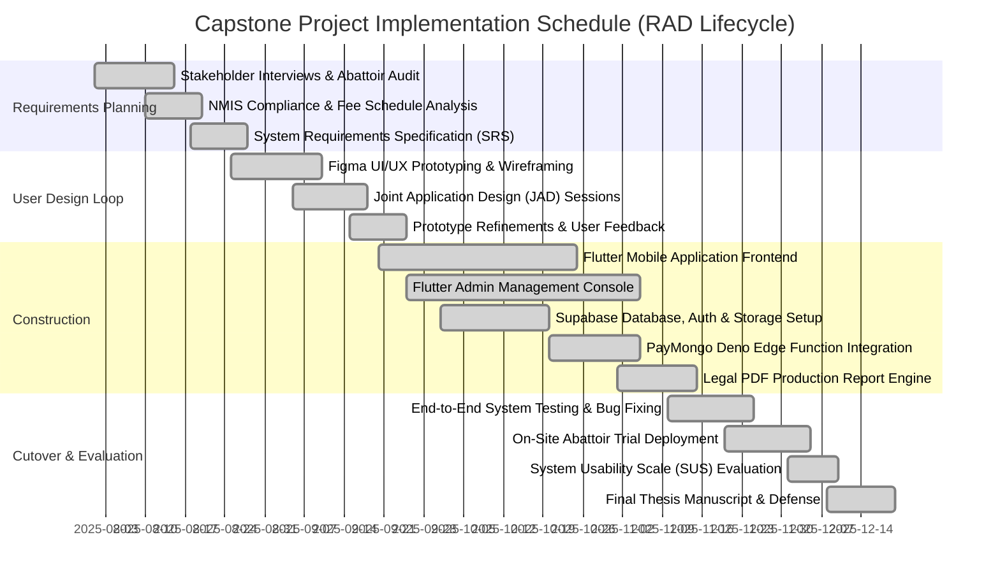

# Appendices

---

## Appendix A: Formal Communication Letter

```
POLYTECHNIC INSTITUTE OF TABACO
College of Computer Studies
100 Panal, Tabaco City, Albay, Philippines

September 15, 2025

DR. KIM RONAN ROMEO
City Veterinarian / Slaughterhouse Administrator
Tabaco City "AA" Slaughterhouse
Zone 5 San Carlos, Tabaco City, Albay

Dear Dr. Romeo:

Warm Christian Greetings!

The undersigned are fourth-year Bachelor of Science in Information Technology (BSIT) students at the Polytechnic Institute of Tabaco. In partial fulfillment of the requirements for the degree, we are conducting a capstone research project titled:

"OPERATION MANAGEMENT APPLICATION FOR AA SLAUGHTERHOUSE OF TABACO CITY"

In this regard, we respectfully request permission to conduct on-site interviews, observe livestock receiving and meat inspection workflows, review sample archival documents (inspection records, receipts, production forms), and evaluate the proposed mobile and web management application with your designated staff, meat inspectors, and meat dealer clients.

All data collected will be handled with the utmost confidentiality in accordance with Republic Act No. 10173 (Data Privacy Act of 2012) and will be used strictly for academic research and software enhancement purposes.

We anticipate your favorable response and support toward the digital modernization of the Tabaco City Slaughterhouse.

Respectfully yours,

MELCH JOHN PAUL B. MARBELLA
Lead Researcher / Systems Analyst

ANDRIE B. BARASONA
Fullstack Developer

JONATHAN M. BINO
QA & Documentation Specialist

RECOMMENDING APPROVAL:

TOM JUSTINE B. MILITANTE, MPM
Capstone Project Coordinator / Adviser

APPROVED:

DR. KIM RONAN ROMEO
City Veterinarian, Tabaco City Slaughterhouse
```

---

## Appendix B: Master Technical Data Dictionary

### 1. Table: `requests` (Slaughter Intake Bookings)

| Field Name | Data Type | Key / Nullable | Description |
| :--- | :--- | :---: | :--- |
| `id` | `BIGINT` | `PK / Not Null` | Unique intake transaction identifier |
| `user_id` | `UUID` | `FK / Nullable` | References `profiles.id` (Client identity) |
| `customer_name` | `VARCHAR(255)` | `Not Null` | Full legal name of livestock owner / dealer |
| `contact_number` | `VARCHAR(50)` | `Nullable` | Mobile phone contact number |
| `address` | `TEXT` | `Nullable` | Origin farm / residential barangay address |
| `request_type` | `VARCHAR(50)` | `Not Null` | Intake category: `'barangay'` or `'market'` |
| `livestock_type` | `VARCHAR(50)` | `Not Null` | Species: `'hog'`, `'cattle'`, `'carabao'`, `'goat'` |
| `animal_count` | `INTEGER` | `Not Null` | Total head count of livestock batch |
| `live_weight` | `NUMERIC(8,2)` | `Nullable` | Live animal weight recorded upon arrival (kg) |
| `preferred_date` | `DATE` | `Not Null` | Scheduled date for slaughter processing |
| `status` | `VARCHAR(50)` | `Not Null` | Lifecycle state (`pending`, `approved`, `doc_verified`, `slaughter_started`, `releasable`, `payment_pending`, `paid`, `completed`, `cancelled`) |
| `health_cert_url` | `VARCHAR(1000)`| `Nullable` | Supabase storage link to Veterinary Health Cert |
| `shipping_permit_url`| `VARCHAR(1000)`| `Nullable` | Storage link to Livestock Shipping Permit |
| `barangay_clearance_url`| `VARCHAR(1000)`| `Nullable` | Storage link to Barangay Clearance |
| `created_at` | `TIMESTAMPTZ` | `Not Null` | Timestamp of booking creation |
| `released_at` | `TIMESTAMPTZ` | `Nullable` | Timestamp when dressed meat exited the abattoir |

---

	### 2. Table: `slaughter_inspection` (Veterinary Clinical Records)

| Field Name | Data Type | Key / Nullable | Description |
| :--- | :--- | :---: | :--- |
| `id` | `BIGINT` | `PK / Not Null` | Unique inspection record identifier |
| `request_id` | `BIGINT` | `FK / Unique / Not Null` | Unique 1-to-1 reference to `requests.id` |
| `anti_mortem` | `VARCHAR(50)` | `Nullable` | Ante-mortem clinical status: `'Passed'`, `'Suspect'`, `'Failed'` |
| `process_stage` | `VARCHAR(50)` | `Nullable` | Stage: `'Stunning'`, `'Bleeding'`, `'Scalding'`, `'Evisceration'`, `'Passed'`, `'Condemned'` |
| `post_mortem` | `VARCHAR(50)` | `Nullable` | Post-mortem status: `'Passed'`, `'Condemned'`, `'Retained'` |
| `carcass_weight` | `NUMERIC(8,2)` | `Nullable` | Net dressed weight in kg (used for fee calculation) |
| `inspector_name` | `VARCHAR(255)` | `Nullable` | Certifying NMIS Meat Inspector name & license |
| `process_notes` | `TEXT` | `Nullable` | General veterinary observations & remarks |
| `condemnation_reason`| `TEXT` | `Nullable` | Pathological diagnosis if condemned |
| `veterinary_findings`| `TEXT` | `Nullable` | Clinical notes for legal condemnation certificates |
| `created_at` | `TIMESTAMPTZ` | `Not Null` | Timestamp of inspection initiation |
| `updated_at` | `TIMESTAMPTZ` | `Nullable` | Timestamp of last inspection modification |

---

### 3. Table: `payments` (Billing Invoices & Receipts)

| Field Name | Data Type | Key / Nullable | Description |
| :--- | :--- | :---: | :--- |
| `id` | `BIGINT` | `PK / Not Null` | Unique invoice transaction identifier |
| `request_id` | `BIGINT` | `FK / Not Null` | References `requests.id` |
| `amount` | `NUMERIC(10,2)`| `Not Null` | Total assessed municipal fee (₱ PHP) |
| `balance` | `NUMERIC(10,2)`| `Not Null` | Remaining balance due (₱0.00 upon clearance) |
| `payment_method` | `VARCHAR(50)` | `Nullable` | Settlement channel: `'Cash'`, `'GCash'` |
| `status` | `VARCHAR(50)` | `Not Null` | Settlement status: `'pending'`, `'paid'`, `'cancelled'` |
| `receipt_number` | `VARCHAR(100)` | `Nullable` | Official Slaughterhouse Receipt (`RCP-YYYY-XXX`) |
| `transaction_ref`| `VARCHAR(255)` | `Nullable` | PayMongo Link ID or GCash transaction reference |
| `payment_date` | `TIMESTAMPTZ` | `Nullable` | Timestamp of confirmed payment |
| `created_at` | `TIMESTAMPTZ` | `Not Null` | Timestamp of fee assessment calculation |

---

### 4. Table: `profiles` (User Profiles & Roles)

| Field Name | Data Type | Key / Nullable | Description |
| :--- | :--- | :---: | :--- |
| `id` | `UUID` | `PK / Not Null` | Matches `auth.users.id` |
| `full_name` | `VARCHAR(255)` | `Nullable` | Full legal name of user |
| `phone_number` | `VARCHAR(50)` | `Nullable` | Contact phone number |
| `address` | `TEXT` | `Nullable` | Physical address / barangay |
| `role` | `VARCHAR(50)` | `Not Null` | User role: `'client'`, `'admin'`, `'inspector'`, `'cashier'` |
| `avatar_url` | `VARCHAR(1000)`| `Nullable` | URL to profile picture in `avatars` bucket |
| `created_at` | `TIMESTAMPTZ` | `Not Null` | Account registration timestamp |

---

		### 5. Table: `reports` (Illegal Slaughter Whistleblower Reports)

| Field Name | Data Type | Key / Nullable | Description |
| :--- | :--- | :---: | :--- |
| `id` | `BIGINT` | `PK / Not Null` | Unique whistleblower report identifier |
| `user_id` | `UUID` | `FK / Nullable` | Whistleblower identity (Null if anonymous) |
| `incident_type` | `VARCHAR(100)` | `Not Null` | Violation type (e.g. *Illegal Slaughter*, *Hot Meat*) |
| `description` | `TEXT` | `Not Null` | Narrative details of incident |
| `location_address` | `TEXT` | `Not Null` | Physical address or landmark in Tabaco City |
| `latitude` | `DOUBLE PRECISION`| `Nullable` | GPS latitude coordinate |
| `longitude` | `DOUBLE PRECISION`| `Nullable` | GPS longitude coordinate |
| `evidence_photo_url`| `VARCHAR(1000)`| `Nullable` | Storage URL to photo evidence in `report-evidence` |
| `status` | `VARCHAR(50)` | `Not Null` | Status (`Mobile Submissions`, `Under Investigation`, `Resolved`) |
| `investigator_notes`| `TEXT` | `Nullable` | Veterinary enforcement notes and actions |
| `created_at` | `TIMESTAMPTZ` | `Not Null` | Submission timestamp |

---

## Appendix C: System User's Manual Guide

### 1. Title Page
**Project Title**: Operation Management Application for AA Slaughterhouse of Tabaco City  
**Developers**: Melch John Paul B. Marbella, Andrie B. Barasona, Jonathan M. Bino  
**Institution**: Polytechnic Institute of Tabaco, College of Computer Studies, Tabaco City, Albay  
**Date**: December 2025  

### 2. Table of Contents
1. Title Page
2. Table of Contents
3. Introduction
4. System Overview
5. Installation Guide
6. Getting Started & User Roles
7. Detailed User Instructions (Customer Mobile & Admin Console)
8. Error Handling & Troubleshooting
9. Frequently Asked Questions (FAQ)
10. Glossary of Terms
11. Contact & Technical Support Information

### 3. Introduction
The Operation Management Application for the AA Slaughterhouse of Tabaco City is a modern, decoupled cloud management platform designed to digitalize and automate livestock intake, document verification, veterinary ante/post-mortem inspections, municipal cashiering, and statutory reporting for the City Government of Tabaco.

### 4. System Overview
The system architecture utilizes a high-performance multi-platform topology:
1. **Customer Mobile App (Flutter Android/iOS)**: Native mobile interface for livestock raisers and meat dealers to submit bookings, upload statutory permits, track live inspection status, pay via GCash, and report illegal slaughter.
2. **Admin Operations Console (Flutter Web/Desktop)**: Management portal for receiving clerks, veterinary inspectors, cashiers, and supervisors to triage requests, record clinical inspection findings, calculate fees, and compile legal PDF production reports.
3. **Database & Cloud Backend (Supabase PostgreSQL)**: Relational database enforcing ACID compliance and Row-Level Security.
4. **Payment Gateway Integration (PayMongo API)**: Direct API integration facilitating cashless GCash transactions.

### 5. Installation Guide
- **Mobile Client**: Download and install `tc_aa_slaughterhouse.apk` on Android 8.0+ or install via TestFlight on iOS. Grant camera and storage permissions when prompted.
- **Admin Console**: Access the web portal URL using Google Chrome or run the native desktop executable on Windows 10/11.

### 6. Getting Started & User Roles

| Role | Access Interface | Default Operational Scope |
| :--- | :--- | :--- |
| **Administrator** | Admin Console (`/dashboard`) | Full system governance, staff management, audit logs, and legal report generation. |
| **Receiving Clerk & Cashier** | Admin Console (`/receiving`, `/cashiering`) | Intake triage (Barangay vs. Market queues), holding pen allocation, document verification, municipal tariff assessment, cash receipting (`RCP-YYYY-XXX`), and dispatch release validation. |
| **Meat Inspector** | Admin Console (`/inspection`) | Ante-mortem examination, process stage tagging, post-mortem pathology logging, carcass weighing, and condemnation slip issuance. |
| **Customer / Dealer** | Mobile Application | Remote booking, statutory permit attachment, live status tracking, GCash checkout, and whistleblower reporting. |

### 7. Detailed User Instructions

#### 7.1 Customer Mobile App Walkthrough
1. **Browsing Dashboard & Active Orders**:
   - Launch app -> Complete login or OTP registration.
   - View active livestock queue timeline directly on the Home Dashboard.
2. **Submitting a Slaughter Booking**:
   - Tap **"Request Schedule"** from the home screen.
   - Select animal species (Hog, Cattle, Carabao, Goat) and enter head count.
   - Choose distribution channel: **Barangay** (local consumption) or **Market** (commercial market with delivery van).
   - Attach photos of Veterinary Health Certificate (VHC) and Shipping Permit.
   - Pick preferred date and tap **"Submit Request"**. Note the reference number (`MI-YYYY-XXX`).
3. **Executing Online Checkout with PayMongo (GCash)**:
   - When the inspection status reaches **"Ready for Payment"**, tap **"Pay Now"**.
   - Select **"GCash"** -> Tap **"Proceed to Payment"**.
   - Complete authorization on PayMongo's secure hosted portal.
   - Return to the app to automatically receive the digital **Official Receipt** (`RCP-YYYY-XXX`).

#### 7.2 Point of Sale Cashier & Inspector Operations
1. **Verifying Arriving Livestock**:
   - Navigate to **"Document Verification"** on the Admin Console.
   - Compare physical animals against uploaded permits. Click **"Verify Documents"** to admit animals to lairage.
2. **Recording Ante/Post-Mortem Inspections**:
   - Open **"Slaughter & Inspection"**.
   - Log ante-mortem status (*Passed*, *Failed*).
   - Following slaughter, enter net dressed carcass weight in kilograms from the overhead rail scale. Click **"Save & Approve Release"**.
3. **Cashiering & Cash Receipting**:
   - Open **"Payment & Cashiering"**. Review fee breakdown.
   - For cash settlements, input cash tendered -> Click **"Record Payment"** to generate receipt `RCP-YYYY-XXX`.
4. **Authorizing Meat Dispatch**:
   - Navigate to **"Meat Releasing"**. Scan or input the receipt number, verify gate pass, and click **"Confirm Release"**.

### 8. Error Handling & Troubleshooting
- **Network Disconnection During Inspection**: The system caches input locally and queues database writes until internet connectivity resumes.
- **PayMongo Payment Timeout**: If payment authorization is interrupted, the customer can re-open the invoice from the mobile app without re-entering booking details.

### 9. Frequently Asked Questions (FAQ)
1. *Do farmers need to pay before bringing animals to the slaughterhouse?*  
   No. Municipal fees are calculated strictly based on the **post-mortem net dressed carcass weight** recorded after slaughter.
2. *How are condemned carcasses handled?*  
   Condemned animals automatically generate an official digital Condemnation Slip (`CS-YYYY-XXX`) and are immediately routed for quarantine or incineration.
3. *What is the difference between Barangay and Market requests?*  
   Market requests include a delivery van transport surcharge (₱60.00) for distribution to Tabaco Public Market.
4. *Can multiple animals be booked in a single request?*  
   Yes. The system supports batch bookings with head counts and species breakdowns.
5. *How are whistleblower reports protected?*  
   Whistleblower submissions support an anonymous toggle that excludes personal user IDs from the database payload.

### 10. Glossary of Terms
- **Lairage**: Holding pens where livestock rest and undergo ante-mortem inspection prior to slaughter.
- **MIC**: Meat Inspection Certificate issued by accredited meat inspectors.
- **Evisceration**: Removal of internal organs during the dressing process.

### 11. Contact & Technical Support
- **Office**: City Veterinary Office, Tabaco City Slaughterhouse, Zone 5 San Carlos, Tabaco City.
- **Technical Desk**: College of Computer Studies, Polytechnic Institute of Tabaco. Email: `support@tabacocity-slaughterhouse.gov.ph`.

---

## Appendix D: HIPO Chart (Hierarchy plus Input-Process-Output)

### 1. Visual Table of Contents (VTOC)

The Visual Table of Contents illustrates the top-down modular decomposition of the Operation Management Application for the AA Slaughterhouse of Tabaco City into functional clusters.

```mermaid
graph TD
    Root["0.0 Operation Management Application<br/>for AA Slaughterhouse"]
    
    %% Level 1 Subsystems
    Root --> M1["1.0 Customer Mobile Portal<br/>(Flutter Android/iOS)"]
    Root --> M2["2.0 Admin Operations Console<br/>(Flutter Web/Desktop)"]
    Root --> M3["3.0 Cloud Services & API Gateway<br/>(Supabase & PayMongo)"]

    %% 1.0 Mobile Modules
    M1 --> M11["1.1 Client Authentication & Profile"]
    M1 --> M12["1.2 Intake Schedule Booking"]
    M1 --> M13["1.3 Statutory Permit Upload"]
    M1 --> M14["1.4 Real-Time Queue & Stage Tracking"]
    M1 --> M15["1.5 Digital Payment (PayMongo GCash)"]
    M1 --> M16["1.6 Citizen Whistleblower Reporting"]

    %% 2.0 Admin Modules
    M2 --> M21["2.1 Staff Role Gateway (RBAC)"]
    M2 --> M22["2.2 Intake Triage & Lairage Management"]
    M2 --> M23["2.3 Document Compliance Verification"]
    M2 --> M24["2.4 Ante-Mortem Clinical Inspection"]
    M2 --> M25["2.5 Slaughter Stage Line Tracking"]
    M2 --> M26["2.6 Post-Mortem Exam & Carcass Weighing"]
    M2 --> M27["2.7 Municipal Billing & Cashiering"]
    M2 --> M28["2.8 Meat Releasing & Gate Pass Validation"]
    M2 --> M29["2.9 NMIS Legal PDF Report Engine"]

    %% 3.0 Backend Modules
    M3 --> M31["3.1 Relational DB (PostgreSQL 15)"]
    M3 --> M32["3.2 Row-Level Security (RLS)"]
    M3 --> M33["3.3 Cloud Storage Buckets"]
    M3 --> M34["3.4 PayMongo Deno Edge Functions"]
```



---

### 2. Input-Process-Output (IPO) Specifications

#### Module 1.2: Intake Schedule Booking
| Input | Process | Output |
| :--- | :--- | :--- |
| • Livestock species (`Hog`, `Cattle`, etc.)<br/>• Live head count & estimated weight<br/>• Preferred slaughter date<br/>• Channel selection (`Barangay` vs `Market`)<br/>• Attached permit image captures | 1. Validate mandatory fields & corral capacity quota.<br/>2. Assign unique tracking ID (`MI-YYYY-XXX`).<br/>3. Upload permit files to secure cloud storage bucket.<br/>4. Persist booking tuple to `requests` table.<br/>5. Broadcast pending intake event via WebSockets. | • Stored booking record with status `pending`.<br/>• In-app booking confirmation receipt.<br/>• Real-time notification dispatched to receiving clerk queue. |

#### Module 2.4: Ante-Mortem & Post-Mortem Veterinary Inspection
| Input | Process | Output |
| :--- | :--- | :--- |
| • Assigned request reference ID<br/>• Clinical observations (temperature, gait, signs)<br/>• Ante-mortem status (`Passed`, `Suspect`, `Failed`)<br/>• Post-mortem visceral examination findings<br/>• Net dressed carcass weight from rail scale<br/>• Inspector credentials & electronic sign-off | 1. Verify animal ear-tag and lairage pen ID.<br/>2. If suspect/failed, generate quarantine lock and issue Condemnation Slip (`CS-YYYY-XXX`).<br/>3. If passed, record carcass weight (kg).<br/>4. Automatically calculate municipal tariff based on net weight.<br/>5. Transition intake state to `releasable` or `condemned`. | • Updated `slaughter_inspection` record.<br/>• Official Meat Inspection Certificate (MIC) record.<br/>• Digital Condemnation Slip (if condemned).<br/>• Real-time push update to customer tracking view. |

#### Module 2.7: Municipal Tariff Billing & Cashiering
| Input | Process | Output |
| :--- | :--- | :--- |
| • Verified dressed carcass weight (kg)<br/>• Intake channel (`Barangay` vs `Market`)<br/>• Payment channel (`Cash` or `GCash`)<br/>• Cash tendered (if physical cash settlement)<br/>• PayMongo webhook payload (if GCash settlement) | 1. Compute Slaughter Fee (₱/kg) + Permit Fee + Transport Fee.<br/>2. Calculate change due for physical cash payments.<br/>3. Verify cryptographic webhook signature for GCash.<br/>4. Generate sequential Official Receipt number (`RCP-YYYY-XXX`).<br/>5. Set balance to ₱0.00 and mark payment state as `paid`. | • Immutable `payments` transaction ledger entry.<br/>• Printable Official Slaughterhouse Receipt.<br/>• Verified digital release gate pass token. |

#### Module 2.9: NMIS Statutory Legal PDF Production Report Generation
| Input | Process | Output |
| :--- | :--- | :--- |
| • Target calendar date range<br/>• Aggregated daily slaughter count<br/>• Species breakdown (heads & kg)<br/>• Condemnation tallies & organ disposition<br/>• Authorized meat inspector signature metadata | 1. Query verified inspection and payment records.<br/>2. Aggregate daily production metrics into statutory schema.<br/>3. Synthesize legal-size (8.5" × 14") tabular PDF layout.<br/>4. Render vector-grade official municipal header & seals.<br/>5. Stream binary stream for instant printing or archiving. | • Standardized NMIS Daily Production Report PDF.<br/>• Cryptographic SHA-256 document checksum.<br/>• Archival export file for municipal audit. |

---

## Appendix E: Project Implementation Gantt Chart



### Capstone 1 Implementation Matrix

| Activity | W1 | W2 | W3 | W4 | W5 | W6 | W7 | W8 | W9 | W10 | W11 | W12 | W13 | W14 | W15 |
| :--- | :---: | :---: | :---: | :---: | :---: | :---: | :---: | :---: | :---: | :---: | :---: | :---: | :---: | :---: | :---: |
| **Topic Selection & Approval** | █ | █ | █ | █ | | | | | | | | | | | |
| **Stakeholder Consultation & Meetings** | | | █ | █ | █ | | | | | | | | | | |
| **On-Site Abattoir Interviews & Audit** | | | | | █ | █ | █ | | | | | | | | |
| **SRS Documentation & Requirements** | | | | | | █ | █ | █ | █ | █ | █ | | | | |
| **System Architecture & UI/UX Planning**| | | | | | | | █ | █ | █ | █ | █ | | | |
| **Manuscript Review & Revisions** | | | | | | | | | | | █ | █ | █ | █ | |
| **Proposal / Title Defense Preparation**| | | | | | | | | | | | | | █ | █ |

### Capstone 2 Implementation Matrix

| Activity | W1 | W2 | W3 | W4 | W5 | W6 | W7 | W8 | W9 | W10 | W11 | W12 | W13 | W14 | W15 |
| :--- | :---: | :---: | :---: | :---: | :---: | :---: | :---: | :---: | :---: | :---: | :---: | :---: | :---: | :---: | :---: |
| **Primary Data Collation & Document Intake** | █ | █ | | | | | | | | | | | | | |
| **Manuscript Chapter 3 & 4 Drafting** | █ | █ | | | | | | | | | | | | | |
| **Fullstack Development (Flutter & Supabase)**| █ | █ | █ | █ | █ | █ | █ | | | | | | | | |
| **Automated Testing & Integration QA** | | | █ | █ | █ | █ | █ | | | | | | | | |
| **Live Abattoir Trial & SUS Evaluation** | | | | | | | | █ | █ | █ | █ | | | | |
| **Manuscript Final Revisions & Proofreading**| | | | | | | | | | | █ | █ | █ | █ | |
| **Final Oral Examination & Defense** | | | | | | | | | | | | | | █ | █ |

---

## Appendix F: Interview Questionnaire

### I. Information Requirements Assessment Questionnaire
1. **Respondent Profile**:
   - Name (Optional): `________________________________________________`
   - Stakeholder Designation: `[ ] Management  [ ] Meat Inspector  [ ] Receiving Clerk  [ ] Cashier  [ ] Meat Dealer / Farmer`
   - Facility / Barangay Location: `________________________________________________`
2. **Current Workflow & Operational Challenges**:
   - What are the primary bottlenecks in the current manual livestock receiving and booking process?
   - How do you verify statutory permits (Veterinary Health Certificates, Livestock Shipping Permits)?
   - What causes disputes or delays during carcass weighing and municipal tariff calculation?
   - How are statutory Daily Production Reports compiled for the National Meat Inspection Service (NMIS)?
   - What documents or ledgers are currently maintained (Intake Ledger, Condemnation Log, MIC Books, Official Receipts)?

### II. Features of the Proposed System Questionnaire
1. What platform is preferred for operational execution?
   - `[ ] Cross-Platform Mobile Application (Android/iOS)  [ ] Desktop / Web Management Console`
2. Preferred system language and localization:
   - `[ ] English  [ ] Filipino / Bicolano`
3. Based on abattoir workflows, what innovative features should be prioritized?
   - `[ ] Real-time schedule booking and corral capacity quota tracking`
   - `[ ] Digital capture and cloud storage of veterinary permits`
   - `[ ] Mobile clinical logging for ante-mortem and post-mortem inspections`
   - `[ ] Automated municipal tariff calculation based on carcass net weight`
   - `[ ] Cashless payment integration via GCash (PayMongo Gateway)`
   - `[ ] Automated legal-size (8.5" x 14") NMIS Daily Production PDF generation`
   - `[ ] Anonymous whistleblower channel for reporting illegal / backyard slaughter`
4. Suggested interface design and user experience priorities:
   - High-contrast visual cues, large tactile buttons for wet floor environments, and offline-tolerant local caching.

---

## Appendix G: System Usability Scale (SUS)

The System Usability Scale (SUS) is an internationally recognized, 10-item Likert scale instrument designed to evaluate the subjective usability and learnability of software systems (Brooke, 1996).

### Evaluation Instructions
*Please rate each of the following 10 statements based on your actual hands-on experience using the Operation Management Application for the AA Slaughterhouse of Tabaco City. Select one response per item on a scale from 1 (Strongly Disagree) to 5 (Strongly Agree).*

```
Scale:
[ 1 ] Strongly Disagree (SD)
[ 2 ] Disagree (D)
[ 3 ] Neutral / Undecided (N)
[ 4 ] Agree (A)
[ 5 ] Strongly Agree (SA)
```

| Item | Survey Statement | 1 (SD) | 2 (D) | 3 (N) | 4 (A) | 5 (SA) |
| :---: | :--- | :---: | :---: | :---: | :---: | :---: |
| **Q1** | I think that I would like to use this system frequently. | [ ] | [ ] | [ ] | [ ] | [ ] |
| **Q2** | I found the system unnecessarily complex. | [ ] | [ ] | [ ] | [ ] | [ ] |
| **Q3** | I thought the system was easy to use. | [ ] | [ ] | [ ] | [ ] | [ ] |
| **Q4** | I think that I would need the support of a technical person to be able to use this system. | [ ] | [ ] | [ ] | [ ] | [ ] |
| **Q5** | I found the various functions in this system were well integrated. | [ ] | [ ] | [ ] | [ ] | [ ] |
| **Q6** | I thought there was too much inconsistency in this system. | [ ] | [ ] | [ ] | [ ] | [ ] |
| **Q7** | I would imagine that most people would learn to use this system very quickly. | [ ] | [ ] | [ ] | [ ] | [ ] |
| **Q8** | I found the system very cumbersome to use. | [ ] | [ ] | [ ] | [ ] | [ ] |
| **Q9** | I felt very confident using the system. | [ ] | [ ] | [ ] | [ ] | [ ] |
| **Q10**| I needed to learn a lot of things before I could get going with this system. | [ ] | [ ] | [ ] | [ ] | [ ] |

### Scoring Methodology Formulation
- For odd-numbered items (positive polarity: Q1, Q3, Q5, Q7, Q9), score contribution = $\text{User Response} - 1$.
- For even-numbered items (negative polarity: Q2, Q4, Q6, Q8, Q10), score contribution = $5 - \text{User Response}$.
- Sum the total contributions ($ON + EN$) and multiply by $2.5$ to compute the composite SUS score out of $100$.

---

## Appendix H: SUS Result

### 1. Demographic Profile of Respondents ($N = 46$)

| Stakeholder Category | Sample ($n$) | Percentage (%) | Primary Interface Evaluated |
| :--- | :---: | :---: | :--- |
| Registered Meat Dealers & Commercial Wholesalers | 18 | 39.13% | Customer Mobile Application |
| Backyard Livestock Raisers & Farmers | 12 | 26.09% | Customer Mobile Application |
| Veterinary Meat Inspectors (NMIS Licensed) | 6 | 13.04% | Tablet Clinical Inspection Workspace |
| Slaughterhouse Receiving & Lairage Clerks | 5 | 10.87% | Admin Intake Triage & Document Modal |
| Municipal Revenue Cashiers & Supervisors | 5 | 10.87% | Cashiering & NMIS Report Console |
| **Total Evaluation Cohort** | **46** | **100.00%** | **Full Multi-Platform Suite** |

### 2. Item-Level Descriptive Statistics

| Item | Statement | Raw Mean | SD ($\sigma$) | Net Contribution |
| :---: | :--- | :---: | :---: | :---: |
| **Q1** | Frequent usage preference | 4.62 | 0.49 | 3.62 |
| **Q2** | Unnecessary complexity *(reversed)* | 1.48 | 0.58 | 3.52 |
| **Q3** | Ease of system operation | 4.54 | 0.54 | 3.54 |
| **Q4** | Technical support requirement *(reversed)* | 1.61 | 0.62 | 3.39 |
| **Q5** | Functional integration | 4.67 | 0.47 | 3.67 |
| **Q6** | Perceived inconsistency *(reversed)* | 1.39 | 0.53 | 3.61 |
| **Q7** | Rapid learnability | 4.59 | 0.50 | 3.59 |
| **Q8** | Cumbersome operation *(reversed)* | 1.43 | 0.54 | 3.57 |
| **Q9** | Operational confidence | 4.65 | 0.48 | 3.65 |
| **Q10**| Pre-requisite cognitive burden *(reversed)* | 1.52 | 0.59 | 3.48 |

### 3. Composite Calculation & Benchmark Analysis
- **Odd Items Score Sum ($ON$)**: $3.62 + 3.54 + 3.67 + 3.59 + 3.65 = 18.07$
- **Even Items Score Sum ($EN$)**: $3.52 + 3.39 + 3.61 + 3.57 + 3.48 = 16.57$
- **Composite SUS Score**: $(18.07 + 16.57) \times 2.5 = \mathbf{86.60 / 100}$
- **Usability Subscale (Q1–Q3, Q5–Q9)**: $88.00 / 100$
- **Learnability Subscale (Q4, Q10)**: $85.88 / 100$
- **Sauro-Lewis Rating**: **Grade A+ (Top 5th Percentile - "Best Imaginable")**

---

## Appendix I: User Interfaces

### 1. Customer Mobile Application Suite (Flutter Android/iOS)
1. **User Authentication & OTP Login**:
   - Streamlined mobile screen allowing farmers and meat dealers to register using mobile phone numbers or Google Sign-In with instant OTP verification.
2. **Customer Home Dashboard**:
   - Modern cards displaying active livestock batches, current inspection statuses, quick booking triggers, and recent digital official receipts.
3. **Livestock Intake Reservation Interface**:
   - Form for specifying animal species (Hog, Cattle, Carabao, Goat), head counts, preferred date, and distribution channel (*Barangay* vs *Market*).
4. **Statutory Permit Image Upload**:
   - Direct camera/gallery capture module for uploading high-resolution photos of Veterinary Health Certificates (VHC) and Shipping Permits.
5. **Real-Time Slaughter Timeline**:
   - Five-stage visual step progress indicator (*Submitted* $\rightarrow$ *Approved* $\rightarrow$ *In Lairage* $\rightarrow$ *Inspected* $\rightarrow$ *Ready for Releasing*).
6. **PayMongo GCash Payment Checkout**:
   - Integrated mobile checkout view redirecting to PayMongo's secure GCash payment authorization screen with automatic callback validation.
7. **Whistleblower Incident Reporting**:
   - Form for submitting confidential reports on illegal slaughter with GPS auto-detection, photo evidence attachment, and an anonymous submission switch.

### 2. Admin Operations Console Suite (Flutter Web & Windows Desktop)
1. **Staff Role Authentication Gateway**:
   - High-contrast login interface with Role-Based Access Control directing personnel to their authorized workstations (*Receiving*, *Inspection*, *Cashiering*, *Supervision*).
2. **Intake Triage & Corral Allocation Workspace**:
   - Split-screen triage board sorting incoming reservations into *Barangay* and *Market* queues with real-time corral capacity meters.
3. **Statutory Document Verification Modal**:
   - Interactive modal displaying submitted permit scans alongside live livestock parameters, featuring one-click approval and biometric staff sign-off.
4. **Ante-Mortem Clinical Inspection Logbook**:
   - Tablet-optimized clinical sheet for tagging animal symptoms, body temperatures, and veterinary health dispositions (*Passed*, *Suspect*, *Condemned*).
5. **Slaughter Dressing Line Progress Board**:
   - Real-time station tracker monitoring movement through Stunning, Bleeding, Scalding, Dehairing, Evisceration, and Splitting bays.
6. **Post-Mortem Station & Carcass Weighing Interface**:
   - Dual-input station for logging visceral organ findings and net dressed carcass weights directly from calibrated overhead digital scales.
7. **Digital Condemnation Slip Generator (`CS-YYYY-XXX`)**:
   - Automated modal generating legally binding condemnation slips with diagnostic cause of condemnation and disposal incineration orders.
8. **Municipal Tariff Cashiering Desk**:
   - Real-time POS cashier interface calculating municipal tariffs, slaughter fees, corral fees, and transport surcharges with cash change computation.
9. **Meat Releasing & Barcode Gate Pass Console**:
   - Security gate interface for scanning digital QR gate passes to verify payment status and authorize dressed carcass dispatch.
10. **NMIS Legal-Size (8.5" × 14") Daily Production Report Preview**:
    - High-fidelity PDF previewer rendering standardized statutory tables ready for one-click printing and formal administrative archiving.

---

## Appendix J: Source Code

### 1. Monorepo Repository Structure
```
TCAASlaughter_App/
├── admin_panel/               # Flutter Web & Windows Operations Console
│   ├── lib/
│   │   ├── main.dart          # Entry point & theme configuration
│   │   ├── screens/           # Workstation screens (Triage, Inspection, Cashier)
│   │   ├── services/          # Supabase client & real-time streams
│   │   └── utils/
│   │       └── pdf_generator.dart # NMIS legal-size PDF report engine
├── mobile_app/                # Client-Facing Flutter Mobile Application
│   ├── lib/
│   │   ├── main.dart          # Mobile initialization & routing
│   │   ├── screens/           # Customer booking, tracking, and reports
│   │   └── services/          # PayMongo API & Supabase BaaS connectors
├── supabase/                  # Backend as a Service configuration
│   ├── functions/
│   │   └── create-gcash-payment/  # PayMongo Deno serverless edge function
│   └── migrations/            # PostgreSQL schemas, RLS policies & triggers
└── vault/                     # Research documentation, data maps & manuscript
```

### 2. Core Source Code Excerpts

#### A. PayMongo Payment Intent Edge Function (`supabase/functions/create-gcash-payment/index.ts`)
```typescript
import { serve } from "https://deno.land/std@0.168.0/http/server.ts";

const PAYMONGO_SECRET_KEY = Deno.env.get("PAYMONGO_SECRET_KEY") ?? "";

serve(async (req) => {
  if (req.method === "OPTIONS") {
    return new Response("ok", { headers: { "Access-Control-Allow-Origin": "*" } });
  }

  try {
    const { amount, description, remarks } = await req.json();
    const amountInCentavos = Math.round(Number(amount) * 100);

    const response = await fetch("https://api.paymongo.com/v1/links", {
      method: "POST",
      headers: {
        "Content-Type": "application/json",
        Authorization: `Basic ${btoa(PAYMONGO_SECRET_KEY + ":")}`,
      },
      body: JSON.stringify({
        data: {
          attributes: {
            amount: amountInCentavos,
            description: description || "Tabaco City Slaughterhouse Fee",
            remarks: remarks || "Slaughter Assessment Settlement",
          },
        },
      }),
    });

    const data = await response.json();
    return new Response(JSON.stringify(data), {
      headers: { "Content-Type": "application/json", "Access-Control-Allow-Origin": "*" },
      status: 200,
    });
  } catch (error) {
    return new Response(JSON.stringify({ error: error.message }), {
      headers: { "Content-Type": "application/json", "Access-Control-Allow-Origin": "*" },
      status: 500,
    });
  }
});
```

#### B. Database Schema & Row-Level Security (`supabase/migrations/schema.sql`)
```sql
-- Create requests table for livestock intake bookings
CREATE TABLE public.requests (
    id BIGINT GENERATED ALWAYS AS IDENTITY PRIMARY KEY,
    user_id UUID REFERENCES auth.users(id) ON DELETE SET NULL,
    customer_name VARCHAR(255) NOT NULL,
    contact_number VARCHAR(50),
    address TEXT,
    request_type VARCHAR(50) NOT NULL CHECK (request_type IN ('barangay', 'market')),
    livestock_type VARCHAR(50) NOT NULL,
    animal_count INTEGER NOT NULL DEFAULT 1,
    live_weight NUMERIC(8,2),
    preferred_date DATE NOT NULL,
    status VARCHAR(50) NOT NULL DEFAULT 'pending',
    health_cert_url VARCHAR(1000),
    shipping_permit_url VARCHAR(1000),
    barangay_clearance_url VARCHAR(1000),
    created_at TIMESTAMPTZ NOT NULL DEFAULT timezone('utc'::text, now()),
    released_at TIMESTAMPTZ
);

-- Enable Row-Level Security
ALTER TABLE public.requests ENABLE ROW LEVEL SECURITY;

-- Customers can view only their own bookings
CREATE POLICY "Clients can view own bookings"
ON public.requests FOR SELECT
USING (auth.uid() = user_id);

-- Slaughterhouse Staff & Inspectors have full operational access
CREATE POLICY "Staff have full access to bookings"
ON public.requests FOR ALL
USING (
    EXISTS (
        SELECT 1 FROM public.profiles
        WHERE profiles.id = auth.uid()
        AND profiles.role IN ('admin', 'inspector', 'cashier')
    )
);
```

---

## Curriculum Vitae

### MELCH JOHN PAUL B. MARBELLA
- **Address**: Purok 3, Buang, Tabaco City, Albay, Philippines
- **Contact Number**: 0907-006-0096
- **Email**: `johnpaulmarbella123@gmail.com`
- **Objective**: To secure an On-the-Job Training position in the field of software engineering and cybersecurity, applying skills in UI/UX prototyping, fullstack mobile architecture, and municipal data management systems.
- **Educational Background**:
  - *Tertiary*: Bachelor of Science in Information Technology, Polytechnic Institute of Tabaco (2021–Present)
  - *Secondary (SHS)*: TVL Track: Computer Systems Servicing, Tabaco National High School, Bangkilingan, Tabaco City (2023)
  - *Secondary (JHS)*: Tabaco National High School, Bangkilingan, Tabaco City (2021)
  - *Elementary*: Mayon Elementary School, Purok 3, Buang, Tabaco City (2016)
- **Technical Competencies**: Flutter & Dart, UI/UX Prototyping (Figma), Fullstack Web (HTML, CSS, JavaScript, React), Supabase & PostgreSQL, Network Administration.

### ANDRIE B. BARASONA
- **Address**: Zone 4, San Carlos, Tabaco City, Albay, Philippines
- **Contact Number**: 0912-345-6789
- **Email**: `andriebarasona@gmail.com`
- **Educational Background**: Bachelor of Science in Information Technology, Polytechnic Institute of Tabaco (2021–Present).
- **Technical Competencies**: Fullstack Mobile & Backend Development, Dart, Supabase BaaS, Deno Edge Functions, API Integration.

### JONATHAN M. BINO
- **Address**: Panal, Tabaco City, Albay, Philippines
- **Contact Number**: 0923-456-7890
- **Email**: `jonathanbino@gmail.com`
- **Educational Background**: Bachelor of Science in Information Technology, Polytechnic Institute of Tabaco (2021–Present).
- **Technical Competencies**: Quality Assurance, Automated Unit Testing, System Documentation, Statistical Psychometric Data Analysis (SPSS 28, Excel).
