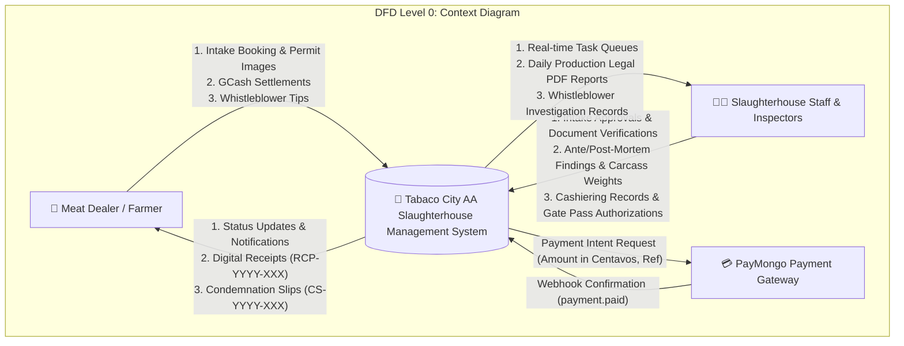
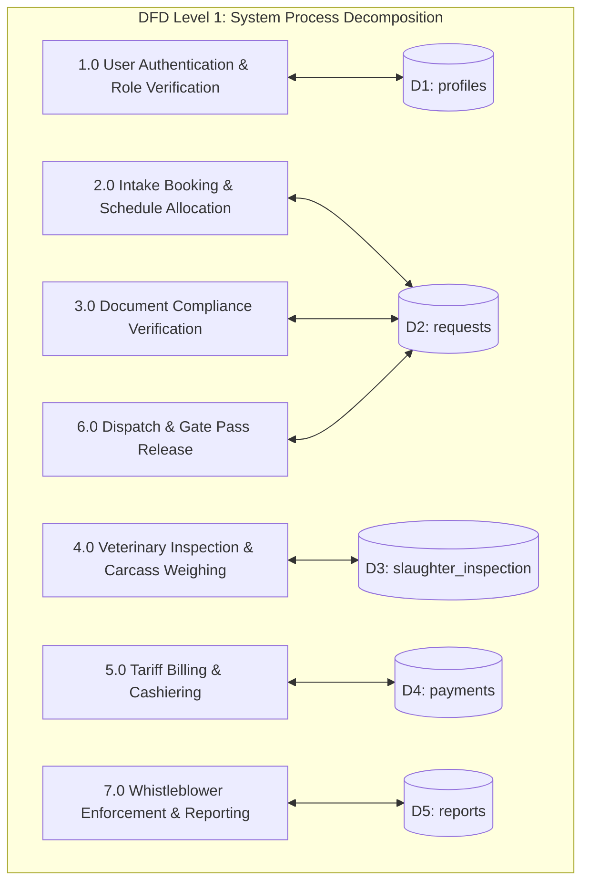
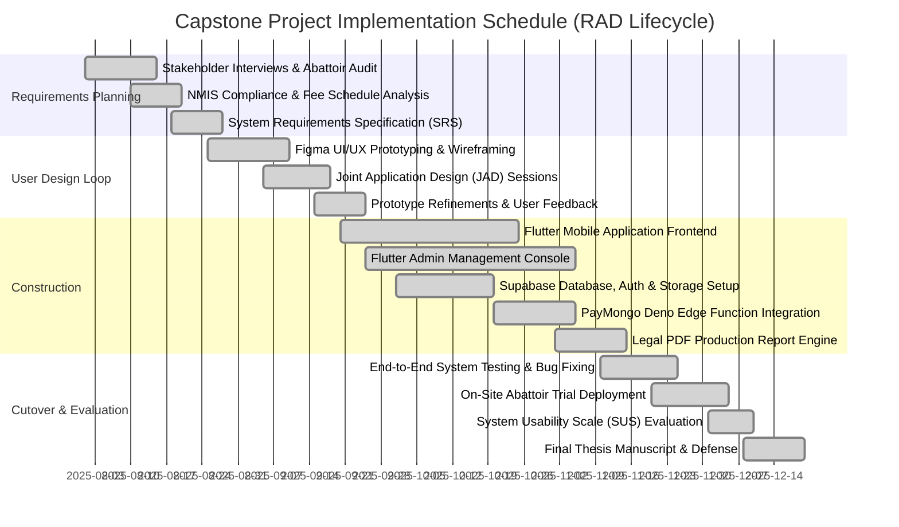

# Appendices

---

## Appendix A: Formal Communication Letter

```
POLYTECHNIC INSTITUTE OF TABACO
College of Computer Studies
100 Panal, Tabaco City, Albay, Philippines

September 15, 2025

DR. KIM RONAN ROMEO
City Veterinarian / Slaughterhouse Administrator
Tabaco City "AA" Slaughterhouse
Zone 5 San Carlos, Tabaco City, Albay

Dear Dr. Romeo:

Warm Christian Greetings!

The undersigned are fourth-year Bachelor of Science in Information Technology (BSIT) students at the Polytechnic Institute of Tabaco. In partial fulfillment of the requirements for the degree, we are conducting a capstone research project titled:

"OPERATION MANAGEMENT APPLICATION FOR AA SLAUGHTERHOUSE OF TABACO CITY"

In this regard, we respectfully request permission to conduct on-site interviews, observe livestock receiving and meat inspection workflows, review sample archival documents (inspection records, receipts, production forms), and evaluate the proposed mobile and web management application with your designated staff, meat inspectors, and meat dealer clients.

All data collected will be handled with the utmost confidentiality in accordance with Republic Act No. 10173 (Data Privacy Act of 2012) and will be used strictly for academic research and software enhancement purposes.

We anticipate your favorable response and support toward the digital modernization of the Tabaco City Slaughterhouse.

Respectfully yours,

MELCH JOHN PAUL B. MARBELLA
Lead Researcher / Systems Analyst

ANDRIE B. BARASONA
Fullstack Developer

JONATHAN M. BINO
QA & Documentation Specialist

RECOMMENDING APPROVAL:

TOM JUSTINE B. MILITANTE, MPM
Capstone Project Coordinator / Adviser

APPROVED:

DR. KIM RONAN ROMEO
City Veterinarian, Tabaco City Slaughterhouse
```

---

## Appendix B: Master Technical Data Dictionary

### 1. Table: `requests` (Slaughter Intake Bookings)

| Field Name | Data Type | Key / Nullable | Description |
| :--- | :--- | :---: | :--- |
| `id` | `BIGINT` | `PK / Not Null` | Unique intake transaction identifier |
| `user_id` | `UUID` | `FK / Nullable` | References `profiles.id` (Client identity) |
| `customer_name` | `VARCHAR(255)` | `Not Null` | Full legal name of livestock owner / dealer |
| `contact_number` | `VARCHAR(50)` | `Nullable` | Mobile phone contact number |
| `address` | `TEXT` | `Nullable` | Origin farm / residential barangay address |
| `request_type` | `VARCHAR(50)` | `Not Null` | Intake category: `'barangay'` or `'market'` |
| `livestock_type` | `VARCHAR(50)` | `Not Null` | Species: `'hog'`, `'cattle'`, `'carabao'`, `'goat'` |
| `animal_count` | `INTEGER` | `Not Null` | Total head count of livestock batch |
| `live_weight` | `NUMERIC(8,2)` | `Nullable` | Live animal weight recorded upon arrival (kg) |
| `preferred_date` | `DATE` | `Not Null` | Scheduled date for slaughter processing |
| `status` | `VARCHAR(50)` | `Not Null` | Lifecycle state (`pending`, `approved`, `doc_verified`, `slaughter_started`, `releasable`, `payment_pending`, `paid`, `completed`, `cancelled`) |
| `health_cert_url` | `VARCHAR(1000)`| `Nullable` | Supabase storage link to Veterinary Health Cert |
| `shipping_permit_url`| `VARCHAR(1000)`| `Nullable` | Storage link to Livestock Shipping Permit |
| `barangay_clearance_url`| `VARCHAR(1000)`| `Nullable` | Storage link to Barangay Clearance |
| `created_at` | `TIMESTAMPTZ` | `Not Null` | Timestamp of booking creation |
| `released_at` | `TIMESTAMPTZ` | `Nullable` | Timestamp when dressed meat exited the abattoir |

---

### 2. Table: `slaughter_inspection` (Veterinary Clinical Records)

| Field Name | Data Type | Key / Nullable | Description |
| :--- | :--- | :---: | :--- |
| `id` | `BIGINT` | `PK / Not Null` | Unique inspection record identifier |
| `request_id` | `BIGINT` | `FK / Unique / Not Null` | Unique 1-to-1 reference to `requests.id` |
| `anti_mortem` | `VARCHAR(50)` | `Nullable` | Ante-mortem clinical status: `'Passed'`, `'Suspect'`, `'Failed'` |
| `process_stage` | `VARCHAR(50)` | `Nullable` | Stage: `'Stunning'`, `'Bleeding'`, `'Scalding'`, `'Evisceration'`, `'Passed'`, `'Condemned'` |
| `post_mortem` | `VARCHAR(50)` | `Nullable` | Post-mortem status: `'Passed'`, `'Condemned'`, `'Retained'` |
| `carcass_weight` | `NUMERIC(8,2)` | `Nullable` | Net dressed weight in kg (used for fee calculation) |
| `inspector_name` | `VARCHAR(255)` | `Nullable` | Certifying NMIS Meat Inspector name & license |
| `process_notes` | `TEXT` | `Nullable` | General veterinary observations & remarks |
| `condemnation_reason`| `TEXT` | `Nullable` | Pathological diagnosis if condemned |
| `veterinary_findings`| `TEXT` | `Nullable` | Clinical notes for legal condemnation certificates |
| `created_at` | `TIMESTAMPTZ` | `Not Null` | Timestamp of inspection initiation |
| `updated_at` | `TIMESTAMPTZ` | `Nullable` | Timestamp of last inspection modification |

---

### 3. Table: `payments` (Billing Invoices & Receipts)

| Field Name | Data Type | Key / Nullable | Description |
| :--- | :--- | :---: | :--- |
| `id` | `BIGINT` | `PK / Not Null` | Unique invoice transaction identifier |
| `request_id` | `BIGINT` | `FK / Not Null` | References `requests.id` |
| `amount` | `NUMERIC(10,2)`| `Not Null` | Total assessed municipal fee (₱ PHP) |
| `balance` | `NUMERIC(10,2)`| `Not Null` | Remaining balance due (₱0.00 upon clearance) |
| `payment_method` | `VARCHAR(50)` | `Nullable` | Settlement channel: `'Cash'`, `'GCash'` |
| `status` | `VARCHAR(50)` | `Not Null` | Settlement status: `'pending'`, `'paid'`, `'cancelled'` |
| `receipt_number` | `VARCHAR(100)` | `Nullable` | Official Slaughterhouse Receipt (`RCP-YYYY-XXX`) |
| `transaction_ref`| `VARCHAR(255)` | `Nullable` | PayMongo Link ID or GCash transaction reference |
| `payment_date` | `TIMESTAMPTZ` | `Nullable` | Timestamp of confirmed payment |
| `created_at` | `TIMESTAMPTZ` | `Not Null` | Timestamp of fee assessment calculation |

---

### 4. Table: `profiles` (User Profiles & Roles)

| Field Name | Data Type | Key / Nullable | Description |
| :--- | :--- | :---: | :--- |
| `id` | `UUID` | `PK / Not Null` | Matches `auth.users.id` |
| `full_name` | `VARCHAR(255)` | `Nullable` | Full legal name of user |
| `phone_number` | `VARCHAR(50)` | `Nullable` | Contact phone number |
| `address` | `TEXT` | `Nullable` | Physical address / barangay |
| `role` | `VARCHAR(50)` | `Not Null` | User role: `'client'`, `'admin'`, `'inspector'`, `'cashier'` |
| `avatar_url` | `VARCHAR(1000)`| `Nullable` | URL to profile picture in `avatars` bucket |
| `created_at` | `TIMESTAMPTZ` | `Not Null` | Account registration timestamp |

---

### 5. Table: `reports` (Illegal Slaughter Whistleblower Reports)

| Field Name | Data Type | Key / Nullable | Description |
| :--- | :--- | :---: | :--- |
| `id` | `BIGINT` | `PK / Not Null` | Unique whistleblower report identifier |
| `user_id` | `UUID` | `FK / Nullable` | Whistleblower identity (Null if anonymous) |
| `incident_type` | `VARCHAR(100)` | `Not Null` | Violation type (e.g. *Illegal Slaughter*, *Hot Meat*) |
| `description` | `TEXT` | `Not Null` | Narrative details of incident |
| `location_address` | `TEXT` | `Not Null` | Physical address or landmark in Tabaco City |
| `latitude` | `DOUBLE PRECISION`| `Nullable` | GPS latitude coordinate |
| `longitude` | `DOUBLE PRECISION`| `Nullable` | GPS longitude coordinate |
| `evidence_photo_url`| `VARCHAR(1000)`| `Nullable` | Storage URL to photo evidence in `report-evidence` |
| `status` | `VARCHAR(50)` | `Not Null` | Status (`Mobile Submissions`, `Under Investigation`, `Resolved`) |
| `investigator_notes`| `TEXT` | `Nullable` | Veterinary enforcement notes and actions |
| `created_at` | `TIMESTAMPTZ` | `Not Null` | Submission timestamp |

---

## Appendix C: System User's Manual Guide

### 1. Title Page
**Project Title**: Operation Management Application for AA Slaughterhouse of Tabaco City  
**Developers**: Melch John Paul B. Marbella, Andrie B. Barasona, Jonathan M. Bino  
**Institution**: Polytechnic Institute of Tabaco, College of Computer Studies, Tabaco City, Albay  
**Date**: December 2025  

### 2. Table of Contents
1. Title Page
2. Table of Contents
3. Introduction
4. System Overview
5. Installation Guide
6. Getting Started & User Roles
7. Detailed User Instructions (Customer Mobile & Admin Console)
8. Error Handling & Troubleshooting
9. Frequently Asked Questions (FAQ)
10. Glossary of Terms
11. Contact & Technical Support Information

### 3. Introduction
The Operation Management Application for the AA Slaughterhouse of Tabaco City is a modern, decoupled cloud management platform designed to digitalize and automate livestock intake, document verification, veterinary ante/post-mortem inspections, municipal cashiering, and statutory reporting for the City Government of Tabaco.

### 4. System Overview
The system architecture utilizes a high-performance multi-platform topology:
1. **Customer Mobile App (Flutter Android/iOS)**: Native mobile interface for livestock raisers and meat dealers to submit bookings, upload statutory permits, track live inspection status, pay via GCash, and report illegal slaughter.
2. **Admin Operations Console (Flutter Web/Desktop)**: Management portal for receiving clerks, veterinary inspectors, cashiers, and supervisors to triage requests, record clinical inspection findings, calculate fees, and compile legal PDF production reports.
3. **Database & Cloud Backend (Supabase PostgreSQL)**: Relational database enforcing ACID compliance and Row-Level Security.
4. **Payment Gateway Integration (PayMongo API)**: Direct API integration facilitating cashless GCash transactions.

### 5. Installation Guide
- **Mobile Client**: Download and install `tc_aa_slaughterhouse.apk` on Android 8.0+ or install via TestFlight on iOS. Grant camera and storage permissions when prompted.
- **Admin Console**: Access the web portal URL using Google Chrome or run the native desktop executable on Windows 10/11.

### 6. Getting Started & User Roles

| Role | Access Interface | Default Operational Scope |
| :--- | :--- | :--- |
| **Administrator** | Admin Console (`/dashboard`) | Full system governance, staff management, audit logs, and legal report generation. |
| **Receiving Clerk** | Admin Console (`/receiving`) | Intake triage (Barangay vs. Market queues), holding pen capacity allocation, and document verification. |
| **Meat Inspector** | Admin Console (`/inspection`) | Ante-mortem examination, process stage tagging, post-mortem pathology logging, carcass weighing, and condemnation slip issuance. |
| **Cashier** | Admin Console (`/cashiering`) | Municipal tariff assessment, cash receipt recording (`RCP-YYYY-XXX`), and gate pass release validation. |
| **Customer / Dealer** | Mobile Application | Remote booking, statutory permit attachment, live status tracking, GCash checkout, and whistleblower reporting. |

### 7. Detailed User Instructions

#### 7.1 Customer Mobile App Walkthrough
1. **Browsing Dashboard & Active Orders**:
   - Launch app -> Complete login or OTP registration.
   - View active livestock queue timeline directly on the Home Dashboard.
2. **Submitting a Slaughter Booking**:
   - Tap **"Request Schedule"** from the home screen.
   - Select animal species (Hog, Cattle, Carabao, Goat) and enter head count.
   - Choose distribution channel: **Barangay** (local consumption) or **Market** (commercial market with delivery van).
   - Attach photos of Veterinary Health Certificate (VHC) and Shipping Permit.
   - Pick preferred date and tap **"Submit Request"**. Note the reference number (`MI-YYYY-XXX`).
3. **Executing Online Checkout with PayMongo (GCash)**:
   - When the inspection status reaches **"Ready for Payment"**, tap **"Pay Now"**.
   - Select **"GCash"** -> Tap **"Proceed to Payment"**.
   - Complete authorization on PayMongo's secure hosted portal.
   - Return to the app to automatically receive the digital **Official Receipt** (`RCP-YYYY-XXX`).

#### 7.2 Point of Sale Cashier & Inspector Operations
1. **Verifying Arriving Livestock**:
   - Navigate to **"Document Verification"** on the Admin Console.
   - Compare physical animals against uploaded permits. Click **"Verify Documents"** to admit animals to lairage.
2. **Recording Ante/Post-Mortem Inspections**:
   - Open **"Slaughter & Inspection"**.
   - Log ante-mortem status (*Passed*, *Failed*).
   - Following slaughter, enter net dressed carcass weight in kilograms from the overhead rail scale. Click **"Save & Approve Release"**.
3. **Cashiering & Cash Receipting**:
   - Open **"Payment & Cashiering"**. Review fee breakdown.
   - For cash settlements, input cash tendered -> Click **"Record Payment"** to generate receipt `RCP-YYYY-XXX`.
4. **Authorizing Meat Dispatch**:
   - Navigate to **"Meat Releasing"**. Scan or input the receipt number, verify gate pass, and click **"Confirm Release"**.

### 8. Error Handling & Troubleshooting
- **Network Disconnection During Inspection**: The system caches input locally and queues database writes until internet connectivity resumes.
- **PayMongo Payment Timeout**: If payment authorization is interrupted, the customer can re-open the invoice from the mobile app without re-entering booking details.

### 9. Frequently Asked Questions (FAQ)
1. *Do farmers need to pay before bringing animals to the slaughterhouse?*  
   No. Municipal fees are calculated strictly based on the **post-mortem net dressed carcass weight** recorded after slaughter.
2. *How are condemned carcasses handled?*  
   Condemned animals automatically generate an official digital Condemnation Slip (`CS-YYYY-XXX`) and are immediately routed for quarantine or incineration.
3. *What is the difference between Barangay and Market requests?*  
   Market requests include a delivery van transport surcharge (₱60.00) for distribution to Tabaco Public Market.
4. *Can multiple animals be booked in a single request?*  
   Yes. The system supports batch bookings with head counts and species breakdowns.
5. *How are whistleblower reports protected?*  
   Whistleblower submissions support an anonymous toggle that excludes personal user IDs from the database payload.

### 10. Glossary of Terms
- **Lairage**: Holding pens where livestock rest and undergo ante-mortem inspection prior to slaughter.
- **MIC**: Meat Inspection Certificate issued by accredited meat inspectors.
- **Evisceration**: Removal of internal organs during the dressing process.

### 11. Contact & Technical Support
- **Office**: City Veterinary Office, Tabaco City Slaughterhouse, Zone 5 San Carlos, Tabaco City.
- **Technical Desk**: College of Computer Studies, Polytechnic Institute of Tabaco. Email: `support@tabacocity-slaughterhouse.gov.ph`.

---

## Appendix D: Information Flow Diagrams (DFD)

### DFD Level 0 (Context Diagram)



---

### DFD Level 1 (Decomposition Diagram)



---

## Appendix E: Project Implementation Gantt Chart



---

## Appendix F: Key Stakeholder Interview Question Guide

### Section A: Slaughterhouse Management & Receiving Clerks
1. What are the primary bottlenecks in the current manual livestock receiving and booking process?
2. How do you verify statutory permits (Veterinary Health Certificates, Livestock Shipping Permits)?
3. What causes disputes or delays during carcass weighing and fee calculation?
4. How are Daily Slaughterhouse Production Reports compiled for submission to the National Meat Inspection Service (NMIS)?

### Section B: Meat Inspectors & Veterinary Personnel
1. What clinical parameters are evaluated during ante-mortem inspection?
2. What are the most common reasons for carcass condemnation (e.g. Swine Erysipelas, Septicemia, Abscesses)?
3. How are condemnation slips currently issued and recorded?
4. What information is essential on the official Meat Inspection Certificate (MIC)?

### Section C: Meat Dealers, Farmers, and Public Consumers
1. What difficulties do you encounter when scheduling livestock for slaughter at the Tabaco City facility?
2. How do you currently receive updates on whether your livestock has passed inspection and is ready for pickup?
3. What is your preferred method for paying slaughterhouse fees (Cash vs. GCash)?
4. Have you witnessed illegal or unregulated slaughter activities in your barangay, and would you use an anonymous digital reporting tool?

---

## Appendix G: System Usability Scale (SUS) Evaluation Instrument

The standardized 10-item System Usability Scale questionnaire utilized for evaluating the application across a 5-point Likert scale ($1 = \text{Strongly Disagree}$, $5 = \text{Strongly Agree}$):

1. I think that I would like to use this system frequently.
2. I found the system unnecessarily complex.
3. I thought the system was easy to use.
4. I think that I would need the support of a technical person to be able to use this system.
5. I found the various functions in this system were well integrated.
6. I thought there was too much inconsistency in this system.
7. I would imagine that most people would learn to use this system very quickly.
8. I found the system very cumbersome to use.
9. I felt very confident using the system.
10. I needed to learn a lot of things before I could get going with this system.

### SUS Score Calculation Formula
- For odd-numbered items ($1, 3, 5, 7, 9$): $\text{Score Contribution} = \text{User Rating} - 1$
- For even-numbered items ($2, 4, 6, 8, 10$): $\text{Score Contribution} = 5 - \text{User Rating}$
- $\text{Total SUS Score} = (\text{Sum of all 10 score contributions}) \times 2.5$ (Scale from $0$ to $100$)
