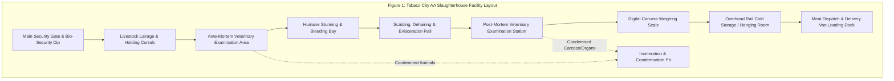

# Chapter 1: Introduction

## Background of the Study

The slaughterhouse industry stands as a pivotal component within the global food supply chain, indispensable for ensuring a consistent, safe, and high-quality supply of meat products to meet the escalating demands of a growing population. Its significance extends far beyond mere food production, encompassing crucial contributions to food security, economic stability, and public health. By mandating that animals are slaughtered under stringent sanitary conditions and regulatory oversight, the industry safeguards consumers from potential health risks while upholding ethical and humane treatment standards for livestock. However, despite its multifaceted importance, a significant portion of slaughterhouses, particularly those under the purview of local government units (LGUs), remain mired in the inefficiencies of outdated manual processes. These traditional methods pervade critical operational aspects, including record-keeping, operational monitoring, and client transaction facilitation, thereby hindering their potential for growth and optimal service delivery.

These deeply entrenched manual systems are a primary catalyst for a cascade of operational inefficiencies. They frequently lead to inaccurate documentation due to human error, result in disorganized and often irrecoverable records, and significantly impede the swift processing of vital data and financial transactions. A salient example of this pervasive issue is the Tabaco City Slaughterhouse, which continues to grapple with considerable challenges in meticulously maintaining records pertaining to slaughtering activities, inspection outcomes, and payment processing. The reliance on archaic paper-based systems for these critical functions inevitably translates into protracted operational delays, the distressing loss of invaluable data, and formidable difficulties in generating timely, accurate, and comprehensive reports essential for informed decision-making. In an era characterized by an insistent global push for modernization and digital transformation across all public service sectors, there emerges an undeniable and urgent imperative to develop an advanced, automated system. Such a system must seamlessly integrate both web and mobile-based platforms to not only streamline slaughterhouse operations but also vastly enhance efficiency, foster greater transparency, and ultimately elevate the standard of public service provision.

In recent years, the relentless march of technological innovation has profoundly reshaped and revolutionized industries across the entire global spectrum. The food production and processing sectors, foundational to human sustenance, have been no exception to this transformative wave. The strategic introduction and widespread adoption of automation technologies, sophisticated digital recordkeeping systems, and accessible online services have demonstrably empowered organizations to achieve unprecedented levels of operational efficiency, robust accountability, and improved compliance. Empirical evidence strongly supports these advancements. According to a seminal study by Andersen et al. (2023), the systematic implementation of automation systems within slaughterhouses has been unequivocally linked to a marked reduction in contamination risks and a substantial enhancement in overall productivity, primarily by instilling standardized procedures and minimizing human intervention in critical stages. Complementing this, the Food and Agriculture Organization (FAO, 2019) has consistently underscored the indispensable role of digital systems in meat inspection, asserting their criticality for ensuring not only food safety but also comprehensive traceability across the entire supply chain, from farm to fork. The World Health Organization (WHO, 2020) further reinforces this perspective, reporting that the strategic deployment of digital monitoring tools proves exceptionally effective in preventing the incidence of foodborne illnesses, which often stem from improper handling practices and suboptimal sanitation conditions prevalent in traditionally managed slaughterhouses. Moreover, research conducted by Javid and Gomez (2021) has illuminated the significant environmental advantages of integrating web-based management systems within meat processing facilities, highlighting their capacity to optimize energy consumption and considerably minimize environmental waste. Beyond these operational and environmental benefits, the Humane Society International (2022) has prominently emphasized that the thoughtful adoption of technology plays a crucial role in promoting more humane animal handling practices and ensures improved adherence to stringent animal welfare standards, reflecting a growing societal demand for ethical treatment of livestock.

Within the specific context of the Philippine setting, a growing body of scholarly work and official reports has consistently echoed the critical importance and urgent necessity of adopting modern technologies to significantly improve and streamline slaughterhouse operations across the archipelago. Gonzales and Dizon (2019), in their incisive analysis, observed that the conspicuous absence of automated data systems severely limits the effective enforcement of crucial meat inspection regulations. This systemic deficiency, they argue, inevitably results in glaring inconsistencies in monitoring practices, ultimately compromising food safety standards. The National Meat Inspection Service (NMIS, 2020), the primary regulatory body, has formally identified that a vast majority of local slaughterhouses throughout the country continue to rely on severely outdated manual systems. These antiquated methods, NMIS contends, represent a significant impediment to achieving full compliance with established national sanitation standards, thereby posing a latent risk to public health.

The Department of Agriculture (DA, 2021) has further underscored that the widespread limitation of technical infrastructure among various local government units acts as a considerable bottleneck, significantly delaying the much-needed modernization of public slaughter facilities, which are vital for local economies and food supply. In support of these observations, Pascual and De Leon (2020) provided evidence that the strategic implementation of computer-based management systems demonstrably improves data reliability, reduces errors, and significantly enhances operational control within such facilities. Likewise, Reyes (2022) concluded in their study that the adoption of digital governance frameworks profoundly strengthens transparency and accountability across a broad spectrum of local public services, extending its benefits to the critical domain of slaughterhouse management.

---

## Rationale of the Study

The study is necessitated by the Tabaco City Slaughterhouse's reliance on outdated manual operations for record-keeping, inspection, and customer transactions, which severely limits efficiency, compromises data accuracy, and poses risks to food safety and regulatory compliance. The researchers propose the development of an Integrated Web and Mobile-Based Slaughterhouse Management and Customer Portal System to digitize the entire workflow, thereby boosting operational efficiency, strengthening traceability and accountability, and fostering transparency between management and clients.

While prior research supports the benefits of automation in the meat industry, this project uniquely addresses the specific, limited-resource context of a government-operated facility in the Philippines, aiming to bridge a critical research gap and establish a scalable model for the digital modernization of public slaughterhouses nationwide. The profound impact of this study extends beyond mere technological upgrade; it represents a strategic investment in public health, economic development, and sustainable food security for communities nationwide.

---

## Company Profile

The **Tabaco City "AA" Slaughterhouse** is a government-regulated facility dedicated to ensuring the safe, hygienic, and efficient processing of livestock for the community. Located in **Zone 5 San Carlos, Tabaco City, Albay**, the slaughterhouse operates under strict compliance with food safety standards, environmental regulations, and animal welfare policies governed by Republic Act No. 9296 (The Meat Inspection Code of the Philippines) as amended by Republic Act No. 10536.

Funded collaboratively by the Department of Agriculture - Philippine Rural Development Project (DA-PRDP), the World Bank, and the Local Government Unit (LGU) of Tabaco City, the slaughterhouse's mission is to provide quality, hygienic meat products that meet the needs of local consumers, market stallholders, and regional distributors. Its vision is to become a model "AA" abattoir in the Bicol Region, recognized for operational efficiency, absolute regulatory compliance, and food safety excellence.

The facility is equipped with specialized functional zones:
1. Livestock holding pens (Lairage) for swine and large cattle.
2. Ante-mortem clinical inspection corrals.
3. Modern slaughtering halls (Stunning, Bleeding, Scalding, Dehairing, Evisceration, Splitting).
4. Post-mortem veterinary examination lines.
5. Overhead rail carcass chilling rooms and cold storage.
6. Waste-water treatment facility and bio-digester systems.

---

## Significance of the Study

The development of the Operation Management Application for the AA Slaughterhouse of Tabaco City delivers tangible benefits across key stakeholder groups:

1. **AA Slaughterhouse Management**: Provides administrative dashboards for real-time monitoring of daily animal intake, slaughter progress, carcass tonnage, fee collections, and automated compilation of statutory production reports for the National Meat Inspection Service (NMIS).
2. **Employees and Meat Inspectors**: Streamlines operational routines by replacing manual ledger books with digital tagging, rapid document validation, and mobile veterinary logging.
3. **Local Government Unit of Tabaco City**: Enhances municipal revenue transparency, prevents fee leakage, and enforces strict food safety oversight to safeguard public health.
4. **Clients and Meat Vendors**: Offers a mobile customer portal to submit slaughter bookings remotely, track batch progress, receive instant notifications, and pay fees digitally via GCash.
5. **General Public**: Provides an anonymous whistleblower channel to report illegal, backyard, or "botcha" slaughtering operations directly to veterinary authorities.
6. **Future Researchers**: Serves as a technical blueprint and empirical reference for computer science and IT students developing enterprise and civic management information systems.

---

## Statement of the Problem

The Tabaco City Slaughterhouse is inefficient due to manual operations for animal handling, inspection, slaughter tracking, and record-keeping. The proposed Operation Management Application for the AA Slaughterhouse of Tabaco City will digitize workflows, enabling real-time monitoring and improving efficiency, accuracy, and transparency for management and customers.

Specifically, the study aims to answer the following research questions:
1. What innovative features can be developed to automate and optimize the scheduling of animal arrivals, queueing, and real-time tracking?
   - a. Customer Portal
   - b. Report or Complaint illegal slaughter
   - c. User Management
   - d. Scheduling
   - e. Inspection Monitoring Record (Ante-mortem and Post-mortem)
   - f. Generated reports
2. What technological solutions can improve traceability, monitoring, reporting, and documentation to ensure compliance with regulatory and inspection requirements?
3. What digital mechanism can be integrated to enhance the billing and payment process of the slaughterhouse?
4. What digital processes can be implemented to enhance workplace management and resource utilization?
5. What is the level of usability, reliability, and accessibility of the proposed system?

---

## Objectives of the Study

### General Objective
To design, develop, and evaluate an **Operation Management Application for the AA Slaughterhouse of Tabaco City** that replaces manual, paper-based workflows with a unified web and mobile digital platform, enhancing operational efficiency, data integrity, public health compliance, and service transparency.

### Specific Objectives
1. To develop modular system features that automate and optimize operational workflows:
   - a. A mobile Customer Portal for slaughter scheduling and permit submissions.
   - b. An illegal slaughter whistleblower reporting tool with photo evidence upload.
   - c. Role-based User Management for administrators, meat inspectors, cashiers, and clients.
   - d. An automated Scheduling and Queueing module for holding pen capacity.
   - e. A digital Inspection Monitoring system for ante-mortem and post-mortem examination.
   - f. An automated Reporting system for generating legal Daily Slaughterhouse Production Reports.
2. To implement end-to-end meat traceability and digital Meat Inspection Certificate (MIC) generation ensuring strict NMIS regulatory compliance.
3. To integrate an electronic billing and digital payment gateway (PayMongo GCash and Cashier Receipting) to eliminate revenue discrepancies.
4. To implement administrative dashboards and real-time push notifications (Firebase Cloud Messaging) for effective workforce coordination.
5. To evaluate the usability, effectiveness, and user acceptance level of the system using the System Usability Scale (SUS).

---

## Scope and Delimitation of the Study

### Scope (Inclusions)
- **Target Facility**: Exclusively designed for and deployed at the Tabaco City "AA" Slaughterhouse, Zone 5 San Carlos, Tabaco City.
- **Client Application (`mobile_app`)**: Native mobile app for Android and iOS used by meat dealers, farmers, and citizens to book appointments, upload permits (VHC, Shipping Permit, Barangay Clearance), track live slaughter status, receive condemnation slips, settle fees via GCash, and report illegal slaughter.
- **Admin Console (`admin_panel`)**: Desktop/Web portal for receiving officers, meat inspectors, cashiers, and administrators to triage requests, verify documents, log ante/post-mortem inspection results, enter carcass weights, calculate municipal fees, issue receipts, confirm meat dispatch, and generate legal PDF production reports.
- **Cloud Infrastructure**: PostgreSQL database, Authentication, and Storage powered by Supabase, serverless Deno Edge Functions, and PayMongo payment processing.

### Delimitations (Exclusions)
- The system does **not** replace the physical, clinical examination of animals or manual slaughtering operations, which remain the statutory duty of licensed meat inspectors and abattoir personnel.
- The system does **not** include enterprise-wide financial accounting, staff payroll computation, or cold-chain logistics outside the abattoir facility grounds.
- The empirical evaluation is delimited to stakeholders, butchers, inspectors, administrators, and meat dealers associated with the Tabaco City Slaughterhouse.

---

## Definition of Terms

- **Automation**: The use of software and cloud technology to execute operational tasks—such as data recording, schedule allocation, fee calculation, and document generation—without requiring extensive manual paperwork (Andersen et al., 2023).
- **Ante-Mortem Inspection**: The physical examination of live livestock prior to slaughter to evaluate disease symptoms, physiological fitness, and hygiene compliance (NMIS, 2020).
- **Post-Mortem Inspection**: The detailed veterinary examination of dressed animal carcasses, internal organs (viscera), and lymph nodes following slaughter to ensure freedom from zoonotic pathology (WHO, 2020).
- **Customer Portal**: A mobile-optimized interface allowing livestock owners and meat dealers to remotely reserve slaughter schedules, upload statutory travel permits, and review billing invoices (Javid & Gomez, 2021).
- **Meat Inspection Certificate (MIC)**: The statutory document issued by accredited meat inspectors certifying that the inspected meat is wholesome and fit for human consumption (NMIS, 2020).
- **Condemnation Slip**: An official notice issued when an animal or carcass fails ante- or post-mortem inspection, ordering the seizure, confiscation, and incineration of unwholesome meat.
- **Traceability**: The ability to reconstruct the complete lifecycle, ownership history, veterinary inspection results, and distribution channel of meat products from intake to release (WHO, 2020).
- **PayMongo Gateway**: A Philippine financial technology infrastructure integrated via API to facilitate cashless digital settlements via GCash.
- **System Usability Scale (SUS)**: A standardized, 10-item psychometric survey tool used to evaluate the usability, learnability, and overall user acceptance of software applications (Ampuan & Delena, 2022).
