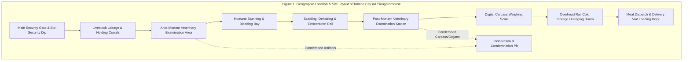

	
# INTRODUCTION

## Background of the Study

The slaughterhouse industry stands as a pivotal component within the global food supply chain, indispensable for ensuring a consistent, safe, and high-quality supply of meat products to meet the escalating demands of a growing population. Its significance extends far beyond mere food production, encompassing crucial contributions to food security, economic stability, and public health. By mandating that animals are slaughtered under stringent sanitary conditions and regulatory oversight, the industry safeguards consumers from potential health risks while upholding ethical and humane treatment standards for livestock. However, despite its multifaceted importance, a significant portion of slaughterhouses, particularly those under the purview of local government units (LGUs), remain mired in the inefficiencies of outdated manual processes. These traditional methods pervade critical operational aspects, including record-keeping, operational monitoring, and client transaction facilitation, thereby hindering their potential for growth and optimal service delivery.

These deeply entrenched manual systems are a primary catalyst for a cascade of operational inefficiencies. They frequently lead to inaccurate documentation due to human error, result in disorganized and often irrecoverable records, and significantly impede the swift processing of vital data and financial transactions. A salient example of this pervasive issue is the Tabaco City Slaughterhouse, which continues to grapple with considerable challenges in meticulously maintaining records pertaining to slaughtering activities, inspection outcomes, and payment processing. The reliance on archaic paper-based systems for these critical functions inevitably translates into protracted operational delays, the distressing loss of invaluable data, and formidable difficulties in generating timely, accurate, and comprehensive reports essential for informed decision-making. In an era characterized by an insistent global push for modernization and digital transformation across all public service sectors, there emerges an undeniable and urgent imperative to develop an advanced, automated system. Such a system must seamlessly integrate both web and mobile-based platforms to not only streamline slaughterhouse operations but also vastly enhance efficiency, foster greater transparency, and ultimately elevate the standard of public service provision.

In recent years, the relentless march of technological innovation has profoundly reshaped and revolutionized industries across the entire global spectrum. The food production and processing sectors, foundational to human sustenance, have been no exception to this transformative wave. The strategic introduction and widespread adoption of automation technologies, sophisticated digital recordkeeping systems, and accessible online services have demonstrably empowered organizations to achieve unprecedented levels of operational efficiency, robust accountability, and improved compliance. Empirical evidence strongly supports these advancements. According to a seminal study by Andersen et al. (2023), the systematic implementation of automation systems within slaughterhouses has been unequivocally linked to a marked reduction in contamination risks and a substantial enhancement in overall productivity, primarily by instilling standardized procedures and minimizing human intervention in critical stages. Complementing this, the Food and Agriculture Organization (FAO, 2022) has consistently underscored the indispensable role of digital systems in meat inspection, asserting their criticality for ensuring not only food safety but also comprehensive traceability across the entire supply chain, from farm to fork. The World Health Organization (WHO, 2020) further reinforces this perspective, reporting that the strategic deployment of digital monitoring tools proves exceptionally effective in preventing the incidence of foodborne illnesses, which often stem from improper handling practices and suboptimal sanitation conditions prevalent in traditionally managed slaughterhouses. Moreover, research conducted by Javid and Gomez (2021) has illuminated the significant environmental advantages of integrating web-based management systems within meat processing facilities, highlighting their capacity to optimize energy consumption and considerably minimize environmental waste. Beyond these operational and environmental benefits, the Humane Society International (2022) has prominently emphasized that the thoughtful adoption of technology plays a crucial role in promoting more humane animal handling practices and ensures improved adherence to stringent animal welfare standards, reflecting a growing societal demand for ethical treatment of livestock.

Within the specific context of the Philippine setting, a growing body of scholarly work and official reports has consistently echoed the critical importance and urgent necessity of adopting modern technologies to significantly improve and streamline slaughterhouse operations across the archipelago. Gonzales and Dizon (2019), in their incisive analysis, observed that the conspicuous absence of automated data systems severely limits the effective enforcement of crucial meat inspection regulations. This systemic deficiency, they argue, inevitably results in glaring inconsistencies in monitoring practices, ultimately compromising food safety standards. The National Meat Inspection Service (DA-NMIS, 2020), the primary regulatory body under Republic Act No. 9296 (The Meat Inspection Code of the Philippines) as amended by Republic Act No. 10536, has formally identified that over 82% of local slaughterhouses throughout the country continue to rely on severely outdated manual systems. These antiquated methods, NMIS contends, represent a significant impediment to achieving full compliance with established national sanitation standards, thereby posing a latent risk to public health.

The Department of Agriculture (DA, 2021) has further underscored that the widespread limitation of technical infrastructure among various local government units acts as a considerable bottleneck, significantly delaying the much-needed modernization of public slaughter facilities, which are vital for local economies and food supply. In support of these observations, Pascual and De Leon (2020) provided evidence that the strategic implementation of computer-based management systems demonstrably improves data reliability, reduces errors, and significantly enhances operational control within such facilities. Likewise, Reyes (2022) concluded in their study that the adoption of digital governance frameworks profoundly strengthens transparency and accountability across a broad spectrum of local public services, extending its benefits to the critical domain of slaughterhouse management.

Furthermore, national economic shifts corroborate the urgent demand for public sector digitization. As established in the Bangko Sentral ng Pilipinas (BSP, 2024) E-Payments Measurement Report, digital payments in the Philippines accounted for 57.4% of total retail transactions, driven primarily by mobile wallets such as GCash and Maya. The BSP noted that local governments digitizing public enterprise billing experience a 28% reduction in revenue leakage while establishing an immutable audit trail. Addressing these challenges, the researchers conceptualized the Operation Management Application for AA Slaughterhouse of Tabaco City to replace manual ledgers with a cloud-native, multi-platform solution integrating Flutter, Supabase PostgreSQL, and PayMongo.

---

## Company Profile

The **Tabaco City "AA" Slaughterhouse** is a government-regulated facility dedicated to ensuring the safe, hygienic, and efficient processing of livestock for the community. Located in **Zone 5 San Carlos, Tabaco City, Albay**, the slaughterhouse operates under strict compliance with food safety standards, environmental regulations, and animal welfare policies governed by Republic Act No. 9296 (The Meat Inspection Code of the Philippines) as amended by Republic Act No. 10536.

Funded collaboratively by the Department of Agriculture - Philippine Rural Development Project (DA-PRDP), the World Bank, and the Local Government Unit (LGU) of Tabaco City, the slaughterhouse's mission is to provide quality, hygienic meat products that meet the needs of local consumers, market stallholders, and regional distributors. Its vision is to become a model "AA" abattoir in the Bicol Region, recognized for operational efficiency, absolute regulatory compliance, and food safety excellence.

The facility is equipped with specialized functional zones:
1. Livestock holding pens (Lairage) for swine and large cattle.
2. Ante-mortem clinical inspection corrals.
3. Modern slaughtering halls (Stunning, Bleeding, Scalding, Dehairing, Evisceration, Splitting).
4. Post-mortem veterinary examination lines.
5. Overhead rail carcass chilling rooms and cold storage.
6. Waste-water treatment facility and bio-digester systems.

Figure 1. Geographic Location & Site Layout of Tabaco City AA Slaughterhouse

---

## Scope and Delimitation of the Study

The scope of this study encompasses the design, development, and evaluation of the Operation Management Application for the Tabaco City "AA" Slaughterhouse. Specifically, the system includes:
1. **Target Facility**: Exclusively designed for and deployed at the Tabaco City "AA" Slaughterhouse, Zone 5 San Carlos, Tabaco City, Albay.
2. **Customer Mobile Application (`mobile_app`)**: A cross-platform mobile client built using Flutter (Dart SDK 3.11+) for Android and iOS devices, enabling backyard farmers, meat vendors, and commercial dealers to remotely book slaughter reservations, upload statutory permits (Veterinary Health Certificate, Livestock Shipping Permit, Barangay Clearance), track live inspection progress, settle slaughter tariffs via GCash (PayMongo), receive official receipts, and file whistleblower tips regarding illegal slaughter operations.
3. **Admin and Operations Console (`admin_panel`)**: A web and desktop portal for receiving clerks, veterinary meat inspectors, revenue cashiers, and abattoir supervisors to triage incoming reservations, verify statutory travel permits, record clinical ante-mortem and post-mortem findings, log carcass weights from digital scales, compute municipal slaughter fees, issue receipts, authorize meat gate pass dispatch, and compile NMIS Daily Meat Inspection and Production Reports in legal (8.5" × 14") format.
4. **Cloud Backend Infrastructure**: Supabase Cloud Platform powered by PostgreSQL 15+, enforcing Row-Level Security (RLS), GoTrue JWT authentication, and secure bucket storage alongside serverless Deno Edge Functions for PayMongo webhook verification.

The study is delimited by the following boundaries:
1. The system does not automate the physical or clinical veterinary examination of livestock, which remains the exclusive legal duty of licensed NMIS meat inspection officers.
2. The application does not handle broader municipal accounting, personnel payroll, or cold-chain logistics outside the physical slaughterhouse premises.
3. The user evaluation is strictly delimited to $N = 46$ registered stakeholders, inspectors, butchers, and meat dealers affiliated with the Tabaco City Slaughterhouse.

---

## Significance of the Study

This study offers substantial operational, economic, and public health benefits across multiple municipal stakeholders:

The Slaughterhouse Management. As executive decision-makers, management will benefit from real-time operational visibility into daily livestock intake counts, corral occupancy, carcass tonnage, condemnation tallies, and revenue collections. Replacing manual paper ledgers with automated, exportable reporting ensures effortless compliance with National Meat Inspection Service (NMIS) statutory audits.

The Employees and Meat Inspectors. Frontline staff, including receiving officers, veterinary inspectors, and cashiers, will benefit from streamlined workflows that replace repetitive manual ledger logging. Inspectors can instantly record ante-mortem and post-mortem diagnoses on mobile tablets, while cashiers utilize automated fee calculation to eliminate billing errors.

The Clients and Meat Dealers. Commercial meat stallholders and local livestock raisers will experience faster transaction turnaround, eliminating pre-dawn intake counter congestion. The mobile application allows dealers to submit bookings remotely, verify permits in advance, track slaughter progress in real time, and settle dues securely via GCash.

The Local Government Unit of Tabaco City. The municipal government will achieve greater fiscal transparency, preventing tariff revenue leakages through automated fee assessment and digital transaction logging. Strict biosecurity logging also safeguards the city against disease outbreaks (e.g., African Swine Fever).

The General Public. Consumers across Tabaco City and neighboring municipalities will benefit from enhanced food safety and hygiene guarantees, ensuring that all distributed meat possesses genuine, verified Meat Inspection Certificates. Furthermore, the anonymous whistleblower feature empowers citizens to report clandestine backyard slaughtering.

The Computer Studies Department of Polytechnic Institute of Tabaco. The department will benefit from this study as a verified institutional reference demonstrating the applied use of cross-platform mobile frameworks, serverless cloud platforms, and psychometric evaluation methodologies to resolve municipal public sector challenges.

Researchers. This study provides a foundational blueprint for future researchers investigating enterprise resource planning, agricultural automation, and computer vision integration within municipal livestock facilities.

---

## Statement of the Problem

The researchers have proposed an Operation Management Application for the AA Slaughterhouse of Tabaco City featuring Customer Portal, Document Compliance Verification, Ante-Mortem and Post-Mortem Inspection Monitoring, Digital Billing and Cashiering, Official Receipt and Gate Pass Issuance, Illegal Slaughter Whistleblower Reporting, and Statutory NMIS Production Report Generation, streamlining daily abattoir operations, eliminating manual paper record loss, and improving municipal service efficiency.

Specifically, the study aims to answer the following research questions:

1. What innovative features can be developed to optimize and automate the business processes of the Tabaco City Slaughterhouse in terms of:
   - a. Customer Portal and Remote Booking
   - b. Statutory Document & Permit Verification
   - c. Holding Pen (Lairage) Triage & Queue Allocation
   - d. Ante-Mortem and Post-Mortem Clinical Inspection
   - e. Municipal Billing, Cashiering, and Digital Payments
   - f. Statutory Reporting and Illegal Slaughter Whistleblower Enforcement?
2. What innovative tools and database mechanisms can be implemented to maintain perpetual livestock traceability, monitor corral capacity limits, and enforce biosecurity compliance?
3. What advanced reporting and digital billing capabilities can be designed to eliminate revenue leakage and provide auditable fiscal insights for the Local Government Unit of Tabaco City?
4. What is the level of usability, reliability, and functionality of the proposed system?
5. What intelligent digital mechanisms can be implemented to streamline statutory document verification and legal report generation?

---

## Objectives of the Study

The primary objective of this study is to develop a user-friendly, secure, and compliant web and mobile application that streamlines business operations, enhances stakeholder transactions, enforces statutory meat safety standards, and improves overall efficiency at the Tabaco City "AA" Slaughterhouse.

Specifically, the study pursued the following objectives:

1. To determine the essential data, processes, and outputs required for the development of the Operation Management Application's core modules:
   - a. Customer Portal (Mobile Booking, Status Tracking, GCash Checkout)
   - b. Document Verification (Veterinary Health Certificate, Shipping Permit)
   - c. Lairage Queueing & Holding Pen Quota Allocation
   - d. Ante-Mortem and Post-Mortem Inspection Monitoring
   - e. Municipal Tariff Billing, Cashiering, and Official Receipting
   - f. Legal NMIS Daily Production Report Compilation and Whistleblower Enforcement
2. To design and implement automated database mechanisms for tracking livestock lifecycle milestones, verifying permit validity, and enforcing daily corral capacity quotas.
3. To integrate secure digital payment capabilities (PayMongo GCash and cashier receipting) to eliminate municipal revenue discrepancies and generate auditable fiscal ledgers.
4. To evaluate the extent of the system's usability, reliability, and functionality using the standardized System Usability Scale (SUS) across representative stakeholders.
5. To implement automated document generation tools compiling legal-size (8.5" × 14") Daily Slaughterhouse Production Reports and scannable gate passes.

---

## Definition of Terms

This section defines key terms conceptually, citing legal sources or publications, and operationally, based on their use in the study. The following terminologies are provided for reader understanding:

Automated Abattoir Management. Conceptually defined as the strategic application of computerized information systems, cloud databases, and digital interfaces to control, monitor, and streamline livestock processing workflows (Andersen et al., 2023), Automated Abattoir Management is operationally executed in this study as the unified web and mobile application that manages animal intake, veterinary inspection, cashiering, and dispatch for the Tabaco City Slaughterhouse.

Ante-Mortem Inspection. Conceptually defined as the mandatory veterinary physical examination conducted on live animals prior to slaughter to detect disease symptoms, physiological abnormalities, and animal welfare compliance (National Meat Inspection Service [NMIS], 2020), Ante-Mortem Inspection is operationally executed in this project as the digital logbook module where accredited inspectors evaluate corralled livestock as Passed, Suspect, or Failed.

Post-Mortem Inspection. Conceptually defined as the systematic clinical examination of dressed animal carcasses, internal viscera, and lymph nodes following slaughter to ensure meat wholesomeness and prevent the entry of zoonotic pathogens into the food supply (World Health Organization [WHO], 2020), Post-Mortem Inspection is operationally executed in this project as the tablet inspection interface where inspectors record pathology diagnoses, condemn contaminated parts, and certify wholesome carcasses.

Customer Portal. Conceptually defined as a dedicated, user-facing digital application providing clients with self-service capabilities to reserve services, transmit data, and monitor status updates without visiting physical service desks (Javid & Gomez, 2021), Customer Portal is operationally executed in this project as the Flutter mobile application allowing meat dealers and backyard raisers to book slaughter dates, attach permits, track batch progress, and settle bills.

Meat Inspection Certificate (MIC). Conceptually defined as an official statutory document issued by accredited government veterinary authorities certifying that livestock have undergone rigorous ante- and post-mortem examination and are wholesome for human consumption (Department of Agriculture [DA], 2021), Meat Inspection Certificate is operationally executed in this project as the verified digital credential and QR code authorized by the city veterinarian upon post-mortem approval.

Condemnation Slip. Conceptually defined as a formal legal notice mandating the seizure, confiscation, and safe destruction of animals or meat declared unwholesome or dangerous for human consumption under Republic Act No. 9296 (Republic Act No. 9296, 2004), Condemnation Slip is operationally executed in this study as the automated digital form (`CS-YYYY-XXX`) generated by inspectors specifying pathological findings and incineration disposal orders.

Digital Payments. Conceptually defined as the electronic transfer of monetary value between transacting parties using digital payment rails and regulated financial technology platforms (Bangko Sentral ng Pilipinas [BSP], 2024), Digital Payments are operationally executed in this project through the integration of the PayMongo payment gateway, enabling registered meat dealers to settle municipal fees via GCash.

Role-Based Access Control (RBAC). Conceptually defined as an information security governance mechanism that restricts system access rights and administrative privileges based on verified user organizational roles (Somani & Kumar, 2023), Role-Based Access Control is operationally executed in this project by segregating interface routing and database permissions across Admin, Meat Inspector, Cashier, Receiving Clerk, and Client accounts.

Traceability. Conceptually defined as the capability to trace and follow a food product, feed, or animal through all stages of production, processing, and distribution (Food and Agriculture Organization [FAO], 2022), Traceability is operationally executed in this project through relational database records connecting livestock origin addresses, permit captures, inspection results, and release timestamps.

System Usability Scale (SUS). Conceptually defined as a validated, ten-item psychometric Likert instrument utilized in human-computer interaction research to reliably evaluate the subjective usability, learnability, and operational acceptability of software systems (Lee et al., 2023; Lubua & Elias, 2021), System Usability Scale is operationally executed in this study as the quantitative post-deployment survey administered to $N = 46$ abattoir stakeholders to assess system usability.
