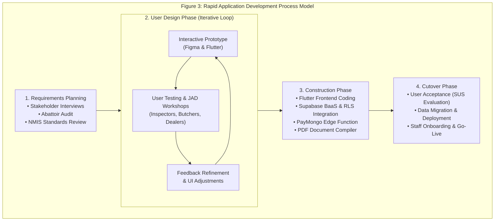
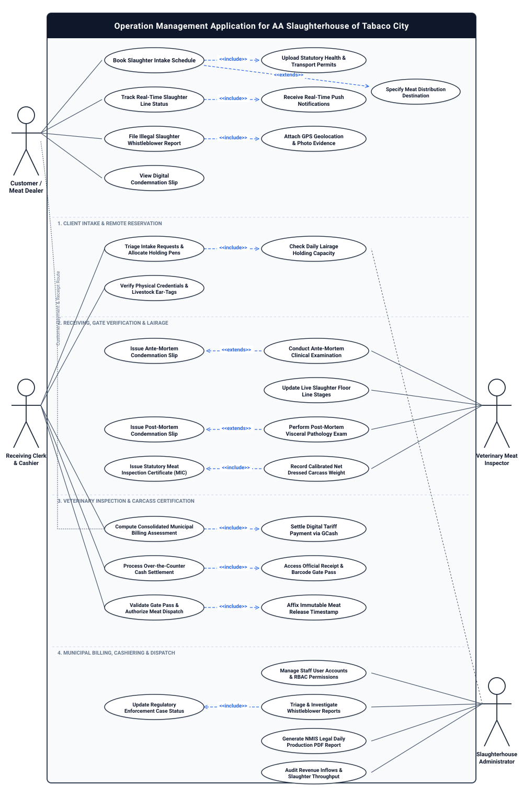
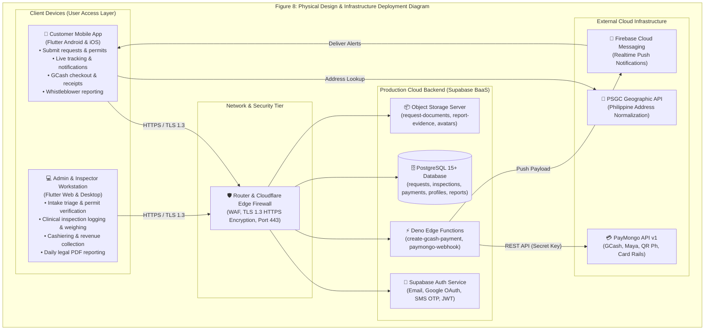
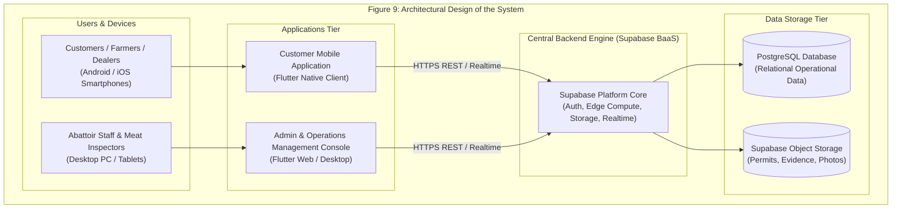
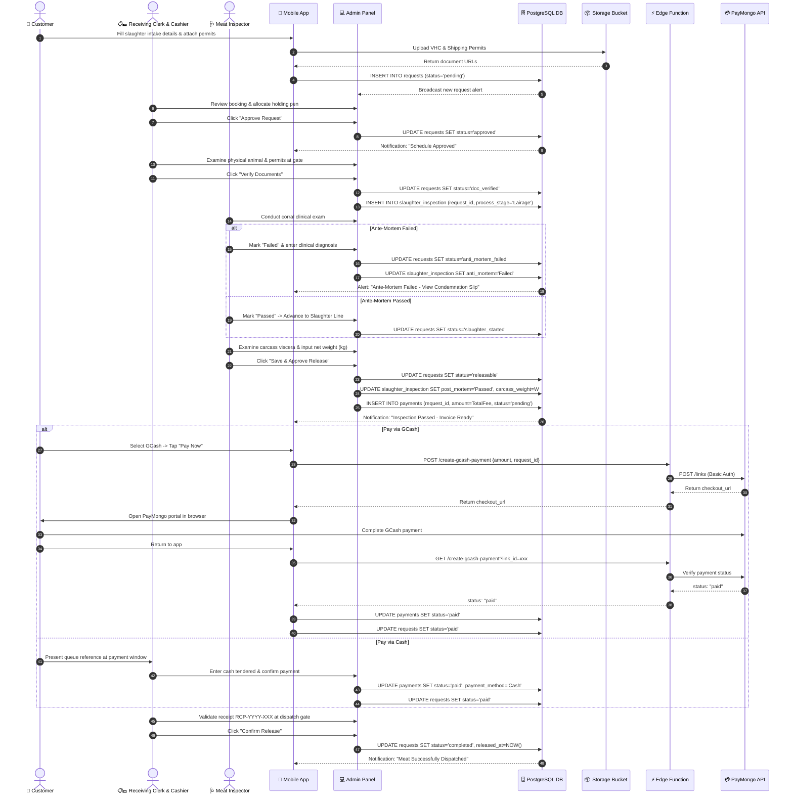
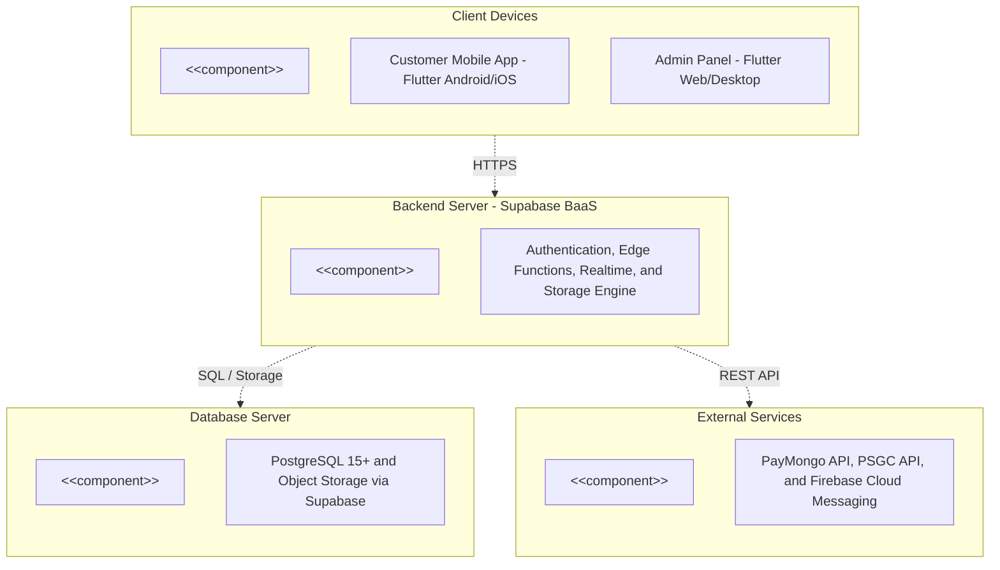
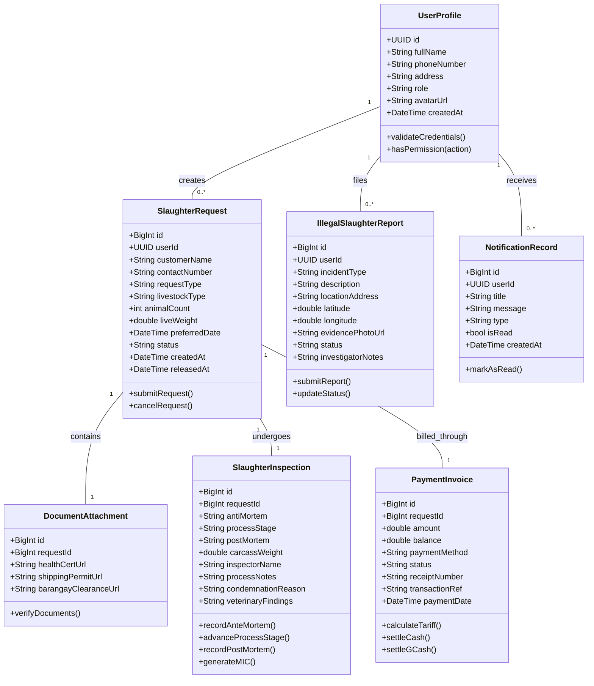

# Chapter 2: Review of Related Literature and Technical Background

## Review of Related Literature/Systems

The development of the **Operation Management Application for AA Slaughterhouse of Tabaco City** is theoretically anchored and empirically validated through an extensive examination of existing literature and operational software systems. The review establishes the empirical foundation for addressing chronic operational bottlenecks, regulatory non-compliance, and financial leakages in municipal abattoir management. To establish rigorous academic grounding, this review is structured into three dedicated subsections: the **Review of Related Literature (RRL)** encompassing five core scholarly publications; the **Review of Related Systems (RRS)** examining five prominent operational systems; and a comprehensive **Synthesis and Comparative Analysis** featuring an analytical matrix comparing the proposed platform against existing benchmarks.

---

### Review of Related Literature (RRL)

#### 1. Abattoir Biosecurity, Sequential Inspection Gates, and Cross-Contamination Mitigation
**Andersen, Roberts, and Lee (2023)** investigated the engineering and microbiological impacts of automation across abattoir processing lines in modern livestock facilities. Their findings demonstrated that transitioning from manual clipboards to synchronized digital tracking checkpoints reduces biological cross-contamination risks by up to 34% while increasing carcass processing throughput. Andersen et al. emphasized that meat safety relies fundamentally on sequential operational gates—specifically, holding lairage triage, clinical ante-mortem evaluation, humane stunning, bleeding, scalding, evisceration, post-mortem visceral inspection, and final carcass weighing. When records are maintained manually on paper ledgers, communication between corral handlers and slaughter line personnel experiences severe latency, creating dangerous opportunities for diseased or suspect livestock to be inadvertently dressed for human consumption. The authors concluded that cloud-synchronized inspection stations enforcing mandatory digital approvals at every gate eliminate human transcription errors and establish an unbroken, auditable biosecurity firewall.

*Relevance to the Proposed System:* The findings of Andersen et al. provide direct empirical validation for the multi-stage digital triage architecture designed for the Tabaco City Slaughterhouse. The proposed system explicitly operationalizes sequential gates wherein an animal cannot advance to stunning or dressing unless its ante-mortem status is digitally certified as passed by an accredited veterinary inspector in the mobile console.

#### 2. Digital Livestock Traceability, Sanitary Certification, and Global Food Safety Governance
The **Food and Agriculture Organization (FAO, 2022)**, in its manual *Good Practices for the Meat Industry*, established global standards governing livestock chain-of-custody tracking, disease surveillance, and sanitary documentation. The FAO underscored that traditional, paper-based veterinary health certificates (VHCs) and handwritten transport permits represent the weakest link in municipal food supply chains. Paper credentials are overwhelmingly vulnerable to physical damage, fraudulent reproduction, and post-dated alterations, completely compromising the traceability of livestock originating from high-risk disease corridors (such as African Swine Fever or Foot-and-Mouth Disease outbreaks). The FAO mandates that modern municipal slaughterhouses adopt end-to-end digital verification workflows where incoming statutory certificates are scanned, cryptographically authenticated, and cross-referenced against national livestock registries prior to animal unloading into holding corrals.

*Relevance to the Proposed System:* The FAO framework serves as the regulatory cornerstone for the digital intake triage module of the Tabaco City Slaughterhouse application. Meat dealers must upload clear digital captures of their Veterinary Health Certificates and Shipping Permits during mobile scheduling, allowing receiving clerks and city veterinarians to verify documentation integrity prior to granting facility admission.

#### 3. Philippine Statutory Standards, Municipal Class AA Compliance, and Production Reporting Deficits
The **Department of Agriculture – National Meat Inspection Service (DA-NMIS, 2020)** published extensive empirical data in its *Meat Safety Manual* and *National Slaughterhouse Performance Report*, detailing compliance challenges across Philippine Local Government Units (LGUs). Under Republic Act No. 9296 (The Meat Inspection Code of the Philippines) as amended by Republic Act No. 10536, municipal abattoirs classified as "Class AA" are authorized to supply meat outside their immediate territorial borders, requiring stringent adherence to national humane handling, clinical ante-mortem/post-mortem triage, and daily reporting standards. However, the DA-NMIS report documented that over 82% of municipal slaughterhouses continue to manage operations via handwritten ledger logbooks. This reliance creates chronic delays in compiling statutory Daily Slaughterhouse Production Reports, causes discrepancies in meat condemnation tracking, and facilitates the distribution of hot meat (*karne ng bulok* or uninspected carcasses) due to unverified paper Meat Inspection Certificates (MIC).

*Relevance to the Proposed System:* This statutory literature highlights the urgent local necessity for the proposed system in Tabaco City. By automating the issuance of digital Meat Inspection Certificates, tracking condemned organs through legal Condemnation Slips (`CS-YYYY-XXX`), and auto-generating standard NMIS-compliant legal Daily Production PDF Reports, the application guarantees full institutional compliance with R.A. 9296.

#### 4. Cashless Public Administration, E-Payment Rails, and Municipal Enterprise Revenue Auditability
The **Bangko Sentral ng Pilipinas (BSP, 2024)**, in its *Report on E-Payments Measurement in the Philippines*, highlighted the structural transformation of public fiscal administration driven by digital retail payment rails. According to the BSP, digital retail transactions accounted for 57.4% of total transaction volume in the country, with mobile wallets such as GCash and Maya leading micro-enterprise and municipal service settlements. The report demonstrated that Local Government Units transitioning public economic enterprises (such as municipal markets, slaughterhouses, and terminals) to integrated digital payment gateways experienced an immediate 28% reduction in uncollected dues, eliminated cash drawer shortages, and eliminated the labor-intensive burden of manual receipt reconciliation. Furthermore, digital payment integration creates an immutable cryptographic audit trail accessible by the Commission on Audit (COA), mitigating human corruptibility and boosting municipal own-source revenue mobilization.

*Relevance to the Proposed System:* The BSP research validates the integration of the PayMongo payment gateway within the Tabaco City Slaughterhouse application. Allowing registered meat dealers to settle slaughter fees, veterinary dues, and corral charges via GCash generates instantaneous digital receipts (`RCP-YYYY-XXX`), automating revenue reconciliation and providing the City Treasurer's Office with transparent, auditable cashflow tracking.

#### 5. Human-Centered Design and Mobile UI/UX Adoption in Agricultural and Inspection Field Workflows
**Huang, Li, and Wang (2022)** analyzed the technological adoption barriers encountered by frontline agricultural field inspectors, livestock traders, and blue-collar abattoir personnel when introducing enterprise software systems. Their research concluded that complex, text-heavy desktop interfaces frequently fail in high-pressure operational environments such as slaughterhouse receiving docks and wet holding corrals. To overcome low technological literacy and physical environmental constraints (such as moisture, glare, and rapid throughput demands), software architectures must implement human-centered design principles: high-contrast visual cues, minimal-tap workflows, localized role-tailored views, and robust client-side validation that prevents fatal data entry errors.

*Relevance to the Proposed System:* The conclusions of Huang et al. directly informed the client-side architecture of the Tabaco City application. By utilizing Flutter to deliver a responsive, tactile mobile application for meat dealers and a high-efficiency dashboard console for receiving officers and inspectors, the platform eliminates operational friction and ensures widespread adoption across diverse stakeholder demographics.

---

### Review of Related Systems (RRS)

#### 1. DA-NMIS Meat Inspection Information System (MIIS)
The **Meat Inspection Information System (MIIS)** is a macro-level administrative web portal implemented by the Department of Agriculture - National Meat Inspection Service (DA-NMIS) across regional offices in the Philippines. The system serves primarily as a regulatory repository designed to capture aggregated regional meat production statistics, monitor accredited meat transport vehicles, and track the licensing status of commercial meat establishments.

*System Limitations and Research Gap:* While effective for macro-level governance and national policy formulation, MIIS operates strictly as a post-facto reporting database. It possesses no operational integration with municipal slaughterhouse floors. Specifically, MIIS lacks customer-facing reservation features, does not accommodate real-time holding pen allocation, cannot monitor daily live triage or post-mortem carcass weighing on the line, provides no integrated cashiering or cashless billing mechanism, and cannot issue immediate digital gate passes for meat transport vans. The Tabaco City Slaughterhouse application bridges this gap by functioning as a frontline operational execution engine rather than a passive statistical repository.

#### 2. Marikina City Slaughterhouse Automated Management System (MCSAMS)
The **Marikina City Slaughterhouse Automated Management System (MCSAMS)** is an on-premise local area network (LAN) software application developed to manage administrative recording and weighing logbooks for the Marikina City abattoir. The system captures basic livestock intake details, records gross carcass weights from linked digital scales, and calculates city fees for printing on thermal paper slips.

*System Limitations and Research Gap:* MCSAMS relies entirely on an aging on-premise desktop client-server architecture with an isolated local database. As a consequence, it cannot be accessed remotely by meat dealers, local farmers, or field veterinarians. The system does not feature a mobile booking portal, lacks pre-arrival statutory certificate verification, cannot process cashless payments via mobile e-wallets, and does not provide an automated public whistleblower channel for reporting illegal backyard slaughtering. Furthermore, the lack of cloud replication exposes Marikina's operational logs to catastrophic physical hardware failures.

#### 3. Australian National Livestock Identification System (NLIS)
The **National Livestock Identification System (NLIS)** is Australia's state-of-the-art livestock traceability platform, widely regarded as a global benchmark for biosecurity management. The system employs electronic Radio Frequency Identification (RFID) ear tags or rumen boluses attached to cattle, sheep, and goats. As livestock pass through abattoir receiving gates, automated RFID interrogators read tag transponders and transmit animal identification codes directly to a centralized national database to track movement history and disease exposure.

*System Limitations and Research Gap:* Despite its sophisticated biosecurity capabilities, the NLIS architecture is financially and technologically prohibitive for municipal local government units in developing economies such as the Philippines. The capital expenditure required for RFID ear tags, specialized radio transceivers, and proprietary maintenance far exceeds municipal budgetary realities. Furthermore, NLIS is strictly an animal biosecurity tracking system; it contains no municipal cashiering modules, lacks automated local slaughter tariff calculators, and does not support municipal meat inspection certificate issuance or public citizen engagement.

#### 4. European Union TRACES (Trade Control and Expert System - Abattoir Sanitary Module)
**TRACES (Trade Control and Expert System)** is a multilingual web-based sanitary and phytosanitary tracking network developed by the European Commission. The platform connects veterinary authorities, border control posts, and abattoirs across European Union member states to authenticate digital veterinary health certificates and monitor transboundary shipments of livestock and animal carcasses.

*System Limitations and Research Gap:* TRACES was architected exclusively for supranational customs clearance and international regulatory compliance. It is characterized by immense bureaucratic complexity and rigid data entry workflows tailored for certified border veterinarians. It completely lacks localized municipal functionality, including holding pen capacity management, localized cashiering with Philippine Peso currency and municipal ordinance tariffs, direct integration with domestic mobile wallets (GCash/PayMongo), and customer-facing schedule tracking.

#### 5. CSB-System Meat & Abattoir Enterprise Resource Planning (ERP)
**CSB-System** is a commercial, enterprise-grade ERP solution engineered specifically for industrial meat processing conglomerates across North America and Western Europe. The system integrates directly with industrial monorail conveying systems, automated optical sorting stations, automated carcass splitting machinery, and enterprise financial ledgers.

*System Limitations and Research Gap:* CSB-System is tailored for multi-million-dollar industrial processing complexes processing thousands of head per hour. Its implementation requires proprietary industrial hardware and expensive commercial software licensing agreements that are completely incompatible with the operational scale and fiscal constraints of Philippine municipal abattoirs. Crucially, CSB-System lacks native compliance with Philippine statutory reporting formats (NMIS Form 5/6), does not support local municipal council fee ordinances, and cannot interface with Philippine digital banking rails.

---

### Synthesis and Comparative Analysis of Related Systems

The literature and systems reviewed underscore a profound structural gap in municipal abattoir management. While global systems such as Australia's NLIS, the EU's TRACES, and commercial platforms like CSB-System demonstrate the immense value of digital automation, their extreme capital expenditure, proprietary hardware dependencies, and complex administrative designs render them impractical for Philippine Local Government Units. Conversely, domestic solutions such as the DA-NMIS MIIS operate strictly at the macro-statistical level, while localized municipal efforts like Marikina's MCSAMS remain tethered to outdated on-premise hardware devoid of mobile engagement, cloud synchronization, and cashless payment integration.

The **Operation Management Application for AA Slaughterhouse of Tabaco City** directly resolves this systemic dilemma. By combining a modern, cloud-native backend (Supabase PostgreSQL 16) with a responsive, cross-platform frontend (Flutter Dart), the proposed platform delivers an enterprise-grade, paperless abattoir workflow tailored precisely to Philippine municipal conditions. It uniquely integrates remote dealer scheduling with automated daily holding pen quotas, digital statutory document verification, real-time veterinary clinical examination logging, automated tariff calculations based on Tabaco City ordinances, instantaneous cashless settlement via PayMongo GCash, encrypted gate pass dispatch verification, automated legal NMIS Daily Production PDF generation, and a community whistleblower module for illegal slaughter enforcement.

Table 2.1 presents a systematic comparative evaluation demonstrating how the proposed platform addresses the operational and technological deficiencies inherent in existing systems.

#### Table 2.1: Comparative Matrix of Related Systems and the Proposed Tabaco City Slaughterhouse Application

| System / Evaluation Criteria | DA-NMIS MIIS (PH) | Marikina MCSAMS (PH) | Australia NLIS | EU TRACES | CSB-System ERP | Proposed Tabaco City Application |
| :--- | :---: | :---: | :---: | :---: | :---: | :---: |
| **Primary System Architecture** | Centralized Web Portal | On-Premise LAN Desktop | RFID / Centralized Cloud | Supranational Web Cloud | Commercial Enterprise ERP | **Cloud Multiplatform (Flutter + Supabase)** |
| **Target User Base** | National / Regional NMIS | Slaughterhouse Floor Staff | Farmers & Abattoirs | International Border Vets | Large Industrial Meatpackers | **Dealers, Vets, Clerks, Cashiers, Admins** |
| **Remote Dealer Mobile Booking** | ❌ No | ❌ No | ❌ No | ❌ No | ❌ No | **✅ Yes (Flutter iOS/Android Portal)** |
| **Daily Lairage Quota Enforcement** | ❌ No | ❌ No | ❌ No | ❌ No | ⚠️ Partial (ERP) | **✅ Yes (Real-time Head Count Limits)** |
| **Pre-Intake Document Verification** | ⚠️ Text Logs Only | ❌ Manual Paper Only | ⚠️ Electronic RFID Tag | ✅ Digital Vet Certificate | ⚠️ Batch Order Slips | **✅ Yes (In-App VHC & Permit Upload)** |
| **Ante & Post-Mortem Digital Logging** | ❌ Monthly Totals Only | ⚠️ Weight Slips Only | ❌ Biosecurity Only | ⚠️ Sanitary Passports | ⚠️ Carcass Class Only | **✅ Yes (Corral & Dressing Rail Triage)** |
| **Statutory Condemnation Slips** | ❌ Manual Paper Form | ❌ Manual Paper Form | ❌ No | ⚠️ Customs Rejection | ⚠️ Discard Ledger | **✅ Yes (Legal CS-YYYY-XXX Auto-Gen)** |
| **Dynamic Municipal Tariff Engine** | ❌ No | ⚠️ Fixed Scale Rate | ❌ No | ❌ No | ⚠️ Commercial Invoicing | **✅ Yes (Tabaco City Ordinance Rates)** |
| **Cashless E-Wallet Payment (GCash)**| ❌ No | ❌ Manual Cash Only | ❌ No | ❌ No | ❌ No | **✅ Yes (PayMongo Deno Edge Webhook)** |
| **Digital QR Gate Pass for Dispatch** | ❌ Manual Paper Slip | ❌ Manual Paper Slip | ❌ No | ⚠️ Border Clearance | ⚠️ Barcode Monorail | **✅ Yes (Scannable QR Verification)** |
| **Automated NMIS Legal PDF Reports** | ⚠️ Static Web Tables | ❌ Manual Export | ❌ No | ⚠️ European Standard | ❌ Custom Enterprise | **✅ Yes (8.5"×14" Legal Production PDF)** |
| **Community Whistleblower Module** | ❌ No | ❌ No | ❌ No | ❌ No | ❌ No | **✅ Yes (GPS Geotagging & Photo Upload)** |
| **Total Implementation Cost** | High (National Gov) | Moderate (LAN Server) | Extreme (RFID Setup) | Extreme (EU Wide) | Prohibitive ($100k+) | **Highly Cost-Effective (BaaS Cloud)** |

*Note: ✅ = Fully Supported / Built-in; ⚠️ = Partially Supported / Limited; ❌ = Not Supported / Absent.*

---

## Conceptual Design

The conceptual framework provides the logical model for the project, originating from an urgent problem statement: the operational inefficiencies and compliance risks inherent in manual abattoir management.

```mermaid
graph TD
	    subgraph Figure 2: Conceptual Design Diagram (Input-Process-Output Framework)
	        subgraph INPUT
	            I1["REQUIREMENTS & DATA<br/>• Customer & Livestock Details<br/>• Login Credentials & RBAC Roles<br/>• Livestock Specifications (Hog/Cattle)<br/>• Slaughter Schedule Request (Barangay/Market)<br/>• Statutory Documents (VHC, Permits)<br/>• Payment Preferences (GCash / Cash)<br/>• Whistleblower Reports (GPS & Photos)"]
	            I2["KNOWLEDGE BASE<br/>• NMIS R.A. 9296 Standards<br/>• Tabaco City Tariff Schedule<br/>• Veterinary Pathology Rules"]
	        end
	
	        subgraph PROCESS
	            P1["SOFTWARE DEVELOPMENT (RAD)<br/>• Requirements Analysis<br/>• Interactive Prototyping"]
	            P2["SYSTEM WORKFLOW ENGINE<br/>• Authentication & Role Validation<br/>• Request Triage & Allocation<br/>• Document Compliance Verification<br/>• Ante & Post-Mortem Inspection<br/>• Slaughter Line Process Tracking<br/>• Carcass Weighing & Fee Billing<br/>• PayMongo Digital Gateway Flow<br/>• Legal MIC & PDF Report Generation<br/>• Realtime Push Notification Sync"]
	        end
	
	        subgraph OUTPUT
	            O1["CUSTOMER MODULE<br/>• Schedule Booking & Tracking<br/>• Digital Receipt (RCP-YYYY-XXX)<br/>• Condemnation Notice (CS-YYYY-XXX)<br/>• Whistleblower Tip Confirmation"]
	            O2["ADMIN & INSPECTION MODULE<br/>• Intake Triage & Holding Queues<br/>• Ante/Post-Mortem Clinical Logs<br/>• Net Carcass Weight Records<br/>• Cashiering & Fee Reconciliation<br/>• Daily Production Legal PDF Reports<br/>• Gate Pass Meat Dispatch Logs"]
	        end
	
	        INPUT --> PROCESS
	        PROCESS --> OUTPUT
	        OUTPUT -. "Continuous Operational Feedback" .-> INPUT
    end
```

---

## Technical Background & Software Development Methodology

The research team utilized the **Rapid Application Development (RAD)** methodology to design, build, test, and iterate the application. RAD was chosen because of its ability to continuously incorporate user feedback and rapidly adapt to evolving abattoir regulatory requirements.



### 1. Requirements Planning Phase
The Requirements Planning phase involves identifying, analyzing, and documenting the functional and non-functional needs of the system to align with organizational goals (Sommerville, 2020). Researchers collaborated closely with stakeholders—such as slaughterhouse managers, licensed meat inspectors, butchers, and meat dealers—to define core information requirements and map manual workflow bottlenecks.

### 2. User Design Phase
The User Design phase serves as an interactive workshop where requirements are translated into working models. Prototypes representing functional components were built, demonstrated to meat inspectors and dealers, tested, and iteratively refined. This rapid feedback mechanism ensured that navigation flows, inspection logging dialogs, and receipt layouts aligned with frontline abattoir realities.

### 3. Construction Phase
The Construction phase serves as the primary development phase where approved prototypes are converted into production-ready software. Flutter 3.11+ and Dart were leveraged for client applications, while Supabase provided backend PostgreSQL persistence and Deno Edge Functions executed secure PayMongo payment integrations.

### 4. Cutover Phase
The Cutover phase represents the final implementation and deployment transition. Activities included system validation, staff training, data migration, and formal usability evaluation via the System Usability Scale (SUS).

---

## System Design

The system design explains the core components, structure, and data flow of the proposed Operation Management Application for the AA Slaughterhouse of Tabaco City. It provides a comprehensive roadmap for how the system functions to meet municipal abattoir needs.

### Software Design Pattern (MVC Architecture)

The system utilizes the **Model-View-Controller (MVC)** architectural design pattern to decouple user interface presentation, operational business logic, and database management.

```mermaid
graph TD
    subgraph Figure 4: Decoupled Multi-Tier Software Architecture (MVC Pattern)
        Actor["Users<br/>(Customers, Receiving Staff, Meat Inspectors, Cashiers, Admins)"]

        subgraph "Presentation Tier (View Layer)"
            V1["Customer Mobile App (Flutter Android/iOS)<br/>• Booking intake, Live tracking, GCash checkout, Whistleblower reporting"]
            V2["Admin Console (Flutter Web/Desktop)<br/>• Triage queue, Permit verification, Inspection station, Cashiering, PDF reports"]
        end

        subgraph "Application Tier (Controller Layer)"
            C1["Auth & RBAC Controller (GoTrue & Profiles Sync)"]
            C2["Slaughter Scheduling & Lairage Controller"]
            C3["Veterinary Inspection & Condemnation Controller"]
            C4["Cashiering & Tariff Calculation Engine"]
            C5["PayMongo Deno Edge Runtime Service"]
            C6["ReportPdfGenerator Legal Document Engine"]
        end

        subgraph "Persistence Tier (Model Layer)"
            M1["Supabase PostgreSQL Database<br/>(requests, slaughter_inspection, payments, profiles, notifications, reports)"]
            M2["Supabase Object Storage Server<br/>(request-documents, report-evidence, avatars)"]
        end

        Actor -- "User Action / HTTP Interaction" --> Presentation Tier
        Presentation Tier -- "Request Payload / Form Submission" --> Application Tier
        Application Tier -- "ACID SQL Queries / Storage Mutations" --> Persistence Tier
        Persistence Tier -- "Result Set / Public URLs" --> Application Tier
        Application Tier -- "State Models & Business Data" --> Presentation Tier
        Presentation Tier -- "Render UI State & Reactive Stream Updates" --> Actor
    end
```

---

### Existing Manual Flowchart of Tabaco City Slaughterhouse


### Analysis of Existing Flowchart

The existing manual process for abattoir operations at the Tabaco City Slaughterhouse is characterized by fragmented, paper-based, and labor-intensive procedures, beginning when a livestock owner, backyard raiser, or commercial meat dealer physically arrives at the facility with live animals. Upon arrival, the receiving clerk must manually inspect physical paper credentials—specifically the Veterinary Health Certificate (VHC) and Livestock Shipping Permit—and record animal specifications into a handwritten paper intake ledger. This manual entry step is inherently susceptible to transcription errors, illegible handwriting, and misplaced physical documents.

Once recorded, animals are manually marked or ear-tagged and directed to holding corrals (lairage). The workflow diverges significantly across disconnected physical stations. Licensed veterinary meat inspectors must perform clinical ante-mortem examinations by walking through holding pens with physical clipboards and handwritten logbooks. If an animal exhibits signs of systemic infection or communicable pathology, a paper condemnation notice is manually drafted; however, because records are not synchronized in real time, communication between the corral inspectors, receiving clerks, and abattoir line workers relies on oral announcements, creating risks of uninspected or suspect animals inadvertently entering the slaughter floor.

Following ante-mortem approval, animals proceed to the slaughter line (stunning, bleeding, scalding, and evisceration). Upon completion of dressing, post-mortem inspectors examine internal organs (liver, lungs, kidneys, viscera) and carcass lymph nodes. Findings are recorded manually in separate veterinary logbooks. Dressed carcasses are then hoisted onto physical scales, and the net weight is manually transcribed onto paper slips. These slips must then be hand-carried to the municipal cashier's booth. 

At the cashier station, the cashier manually computes municipal slaughter tariffs—calculating facility fees, permit fees, holding corral dues, and variable post-mortem rates based on handwritten carcass weights. Handwritten official receipts and paper Meat Inspection Certificates (MIC) are issued upon cash payment. Finally, security personnel at the dispatch loading dock must inspect paper receipts before authorizing meat release to delivery vans. Consequently, this entire operation is heavily dependent on manual physical verification and disjointed efforts across isolated stations, fostering severe operational bottlenecks during peak pre-dawn hours, increasing the likelihood of human error, and completely preventing municipal administrators from accessing real-time operational or financial insights.

---

### Proposed System Flowchart

The proposed system architecture is governed by an algorithmic state machine that systematically enforces regulatory compliance, role-based access control (RBAC), municipal tariff computation, and transactional database integrity across all five abattoir stakeholder tiers. Figure 6 details the algorithmic decision logic, conditional branches, API payloads, transactional checks (ACID commit and rollback), error handling status codes, and artifact generation workflows governing the system.

```mermaid
graph TD
    subgraph Figure 6: Algorithmic Logic Flowchart of Proposed Operation Management Application
        %% Acronyms & Variable Initialization
        Init["<b>System Initialization & State Declaration</b><br/>Acronyms: CST = Customer/Dealer | REC = Receiving Clerk | INSP = Inspector<br/>CSH = Cashier | ADM = Administrator/MCO<br/>Variables: USR=0, PR=0, OR=0, QR=0, CS=0"] --> Start([Start: Launch Application])

        Start --> AuthGate{"Is User Authenticated?<br/>(GoTrue Session Active?)"}
        
        %% Authentication Failure Branch
        AuthGate -- "No" --> LoginForm["Display Login Screen<br/>(Input Email/Password or Phone OTP)"]
        LoginForm --> ValidateCreds{"Are Credentials<br/>Valid?"}
        ValidateCreds -- "No" --> Err401["Output: 401 Unauthorized<br/>Display Error Notification"] --> NodeB2
        ValidateCreds -- "Yes" --> SetSession["Set USR = Session.User.ID<br/>Load Encrypted JWT Token"] --> AuthGate

        %% Authenticated: Role Dispatch Diamond
        AuthGate -- "Yes" --> RoleRouter{"Evaluate Active<br/>User Role (USR)"}

        %% ------------------ BRANCH 1: CUSTOMER (CST) ------------------
        RoleRouter -- "Role == CST" --> CstChoice{"Select Service<br/>Transaction Type"}
        
        %% Whistleblower Sub-branch
        CstChoice -- "Whistleblower Tip" --> WbInput["Capture Geolocation (lat, lng),<br/>Timestamp, Activity Description & Photo"]
        WbInput --> PackWb["Construct Payload_Whistleblower"] --> NodeB1

        %% Booking Sub-branch
        CstChoice -- "Slaughter Booking" --> BookForm["Select Slaughter Date, Species,<br/>& Head Count Quantity (Q)"]
        BookForm --> QuotaCheck{"Check Daily Quota:<br/>Is Capacity >= Q AND<br/>Request Time < 15:00?"}
        QuotaCheck -- "No (Quota Full / Cutoff)" --> Err422_Quota["Output: 422 Unprocessable Entity<br/>'Quota Exceeded / Booking Closed'"] --> NodeB2
        QuotaCheck -- "Yes (Capacity Available)" --> UploadDocs["Upload Digital Statutory Credentials<br/>(Veterinary Health Cert & Shipping Permit)"]
        UploadDocs --> PackIntake["Construct Payload_Intake<br/>{user_id, date, species, Q, doc_urls}"] --> NodeB1

        %% ------------------ BRANCH 2: RECEIVING CLERK (REC) ------------------
        RoleRouter -- "Role == REC" --> RecQueue["Fetch Pending Intake Queue<br/>(status == 'pending_intake')"]
        RecQueue --> TriageAudit{"Physical Intake Triage:<br/>Do Ear-Tags & Brands<br/>Match Uploaded Permits?"}
        TriageAudit -- "No (Discrepant/Illegal)" --> RecReject["Set status = 'cancelled'<br/>Log Regulatory Rejection Reason"]
        RecReject --> PackRecRej["Construct Payload_TriageReject"] --> NodeB1
        TriageAudit -- "Yes (Credentials Verified)" --> RecAccept["Assign Lairage Holding Corral Pen ID<br/>Set status = 'doc_verified'"]
        RecAccept --> PackRecAcc["Construct Payload_TriagePass"] --> NodeB1

        %% ------------------ BRANCH 3: MEAT INSPECTOR (INSP) ------------------
        RoleRouter -- "Role == INSP" --> InspSelect{"Select Inspection<br/>Stage Station"}
        
        %% Ante-Mortem Sub-branch
        InspSelect -- "Ante-Mortem" --> AnteExam{"Clinical Ante-Mortem Exam:<br/>Is Animal Clinically Sound<br/>& Free of Pathology?"}
        AnteExam -- "No (Suspect/Diseased)" --> AnteFail["Set status = 'anti_mortem_failed'<br/>Increment CS = CS + 1<br/>Generate Condemnation Slip (CS-YYYY-XXX)<br/>Enforce Statutory Quarantine / Incineration"]
        AnteFail --> PackAnteFail["Construct Payload_CondemnAnte"] --> NodeB1
        AnteExam -- "Yes (Wholesome)" --> AntePass["Set status = 'ante_passed'<br/>Authorize Transfer to Stunning Floor"]
        AntePass --> PackAntePass["Construct Payload_AntePass"] --> NodeB1

        %% Post-Mortem Sub-branch
        InspSelect -- "Post-Mortem" --> PostExam{"Visceral Post-Mortem Exam:<br/>Are Carcass & Internal Organs<br/>Free of Pathological Lesions?"}
        PostExam -- "No (Condemned Organs)" --> PostFail["Set status = 'post_mortem_failed'<br/>Increment CS = CS + 1<br/>Log Pathological Diagnostic Findings<br/>Generate Condemnation Slip & Confiscate"]
        PostFail --> PackPostFail["Construct Payload_CondemnPost"] --> NodeB1
        PostExam -- "Yes (Wholesome Carcass)" --> WeighScale["Record Dressed Net Carcass Weight W (kg)<br/>from Calibrated Overhead Scale<br/>Generate Digital MIC Record<br/>Set status = 'ready_for_payment'"]
        WeighScale --> PackInspPass["Construct Payload_Inspection"] --> NodeB1

        %% ------------------ BRANCH 4: CASHIER (CSH) ------------------
        RoleRouter -- "Role == CSH" --> CashQueue["Fetch Unpaid Invoice Queue<br/>(status == 'ready_for_payment')"]
        CashQueue --> CalcTariff["<b>Execute Tariff Computation Algorithm:</b><br/>Tariff_Total = Base_Facility + Vet_Fee +<br/>Corral_Fee + (W * PerKg_Rate) + Van_Fee"]
        CalcTariff --> PayMethod{"Select Payment<br/>Settlement Method"}
        
        %% GCash E-Wallet Sub-branch
        PayMethod -- "GCash (Digital)" --> PayMongoAPI["Invoke PayMongo Edge Service:<br/>Generate Payment Link & Checkout QR"]
        PayMongoAPI --> PayMongoHook{"Webhook Callback:<br/>Is Payment Status<br/>== 'paid'?"}
        PayMongoHook -- "No (Pending/Failed)" --> Err422_Pay["Output: 422 Payment Incomplete<br/>Display Pending Alert"] --> NodeB2
        PayMongoHook -- "Yes (Settled)" --> SetPR_E["Set PR = Payment_Intent_ID"] --> GenReceipt

        %% Cash Sub-branch
        PayMethod -- "Cash (Over-the-Counter)" --> CashTender["Input Cash Tendered (T)"]
        CashTender --> CashCheck{"Is Cash Tendered<br/>T >= Tariff_Total?"}
        CashCheck -- "No" --> Err422_Cash["Output: 422 Insufficient Cash<br/>Display Shortage Notice"] --> NodeB2
        CashCheck -- "Yes" --> CalcChange["Compute Change = T - Tariff_Total<br/>Set PR = Cash_Session_ID"] --> GenReceipt

        GenReceipt["Increment OR = OR + 1<br/>Generate Official Receipt (RCP-YYYY-XXX)<br/>Generate Encrypted Gate Pass Token (QR)<br/>Set status = 'paid'"]
        GenReceipt --> PackCash["Construct Payload_Cashier"] --> NodeB1

        %% ------------------ BRANCH 5: ADMINISTRATOR (ADM) ------------------
        RoleRouter -- "Role == ADM" --> AdmSelect{"Select Administrative<br/>Governance Task"}
        
        %% Dispatch Gate Sub-branch
        AdmSelect -- "Meat Dispatch Clearance" --> ScanQR["Scan Gate Pass QR Token at Dispatch Dock"]
        ScanQR --> VerifyQR{"Is QR Signature Valid<br/>AND status == 'paid'?"}
        VerifyQR -- "No" --> Err403_Disp["Output: 403 Forbidden Access<br/>'Unauthorized Dispatch / Unpaid'"] --> NodeB2
        VerifyQR -- "Yes" --> ConfirmDisp["Set status = 'completed'<br/>Stamp released_at = NOW()<br/>Authorize Meat Van Loading"]
        ConfirmDisp --> PackDisp["Construct Payload_Dispatch"] --> NodeB1

        %% Legal Report Compilation Sub-branch
        AdmSelect -- "Statutory PDF Reports" --> QueryReport["Query PostgreSQL Daily Aggregates<br/>(Intake, Condemned, Passed, Net Weights, Fees)"]
        QueryReport --> CompilePDF["Execute ReportPdfGenerator Service:<br/>Compile Legal-Size NMIS Daily Slaughterhouse<br/>Production Report PDF (8.5in x 14in)"]
        CompilePDF --> PackRep["Construct Payload_Report"] --> NodeB1

        %% ------------------ CENTRAL CONFLUENCE NODE B1 ------------------
        NodeB1(["<b>Confluence Node B1</b><br/>Execute ACID SQL Mutation via Supabase Client"])
        NodeB1 --> AcidCheck{"Did PostgreSQL ACID<br/>Transaction Succeed?"}

        %% ACID Failure / Rollback Path
        AcidCheck -- "No (Exception / Conflict)" --> Rollback["Execute SQL ROLLBACK & Abort Changes<br/>Evaluate Error Taxonomy:<br/>403 RLS Violation | 422 Constraint | 500 DB Error<br/>Display Error Notification Toast"] --> NodeB2

        %% ACID Success / Commit Path
        AcidCheck -- "Yes (Committed)" --> CommitSQL["<b>Execute SQL COMMIT to PostgreSQL 16</b><br/>Update Tables: requests, slaughter_inspection,<br/>payments, profiles, audit_logs"]
        CommitSQL --> RealtimeSync["Broadcast Change via Supabase Realtime Engine<br/>(WebSocket Event: INSERT/UPDATE to Subscribed Clients)"]
        RealtimeSync --> IssueArtifacts["<b>Issue HTTP 200 OK Response</b><br/>Emit Cryptographic / Statutory Artifacts:<br/>• Official Receipt (RCP-YYYY-XXX)<br/>• Gate Pass QR Token (QR)<br/>• Condemnation Notice (CS-YYYY-XXX)<br/>• Digital Meat Inspection Cert (MIC)<br/>• Legal NMIS Daily Production PDF"]
        IssueArtifacts --> NodeB2

        %% ------------------ TERMINAL CONFLUENCE NODE B2 ------------------
        NodeB2(["<b>Confluence Node B2</b><br/>Process Termination / State Reconciliation"])
        NodeB2 --> End([End: Await Next User Action / Idle])
    end
```



### Analysis of Proposed System Flowchart

The Proposed System Flowchart in Figure 6 defines the algorithmic logic, state transitions, security boundary checks, and transactional database mechanics governing the Operation Management Application for the AA Slaughterhouse of Tabaco City. Unlike simplistic process diagrams, this algorithmic flowchart models the operational lifecycle as a stateful, event-driven distributed system operating across five actor tiers: Customer/Meat Dealer (`CST`), Receiving Clerk (`REC`), Veterinary Meat Inspector (`INSP`), Municipal Cashier (`CSH`), and Slaughterhouse Administrator/Meat Control Officer (`ADM`). The system architecture ensures fault tolerance, strict regulatory compliance with R.A. 9296, and immutable fiscal accounting through the following algorithmic phases:

#### 1. System Initialization and Cryptographic Access Control Gate
Upon client launch on Flutter mobile or desktop web, the system initializes its session environment and declares global transactional variables: active user session (`USR = 0`), payment transaction index (`PR = 0`), official receipt sequence (`OR = 0`), gate pass cryptographic token (`QR = 0`), and statutory condemnation slip counter (`CS = 0`). 

Control immediately encounters the **Authentication Gate (`AuthGate`)**, which queries the Supabase GoTrue authentication engine to verify active session presence. If unauthenticated, the user is routed to the credential challenge interface requiring email/password or phone number OTP verification. If authentication fails, the engine outputs an `HTTP 401 Unauthorized` status code, terminates execution at Confluence Node B2, and alerts the user. Upon valid credential validation, the encrypted JSON Web Token (JWT) is assigned to `USR`, and execution transitions to the **Role Evaluation Router (`RoleRouter`)**, which performs Role-Based Access Control (RBAC) inspection against the `profiles` table to dispatch the user into their authorized functional branch.

#### 2. Distributed Role-Based Algorithmic Pipelines

##### Branch 1: Customer Pipeline (`Role == CST`)
The customer portal branches based on transaction intent:
1. **Whistleblower Enforcement Sub-branch:** If a citizen initiates an illegal slaughter complaint, the application interrogates hardware sensors to capture high-precision GPS geolocation coordinates (`lat, lng`), auto-generates a UTC timestamp, prompts for photographic evidence upload to Supabase Storage, and packages `Payload_Whistleblower` directly to Confluence Node B1 for immediate administrative investigation.
2. **Slaughter Reservation Sub-branch:** If booking slaughter services, the dealer inputs the scheduled date, species (Hog, Cattle, Carabao, or Goat), and head count quantity ($Q$). The system executes an algorithmic quota evaluation check:
   $$\text{Available Capacity} \ge Q \quad \land \quad \text{Current Time} < \text{15:00 Cutoff}$$
   If capacity is exhausted or the 15:00 PM cutoff has elapsed, the transaction is rejected with an `HTTP 422 Unprocessable Entity` ("Lairage Quota Exceeded"), routing to Node B2. If capacity permits, the dealer uploads statutory Veterinary Health Certificates and Livestock Shipping Permits. The client packages `Payload_Intake` containing `{user_id, date, species, Q, doc_urls}` and routes to Confluence Node B1.

##### Branch 2: Receiving Clerk Pipeline (`Role == REC`)
When livestock physically arrive at the abattoir gate, the receiving clerk fetches the queue of bookings with `status = 'pending_intake'`. The clerk executes a physical verification triage, cross-checking physical ear-tags and brand markings against uploaded digital permits. If discrepancies or signs of uncertified transport are detected, the clerk marks the request `cancelled`, logs the legal rejection rationale, and packages `Payload_TriageReject` to Node B1. If verified, the clerk assigns a dedicated holding corral pen ID, updates the status to `doc_verified`, and transmits `Payload_TriagePass` to Node B1.

##### Branch 3: Veterinary Meat Inspector Pipeline (`Role == INSP`)
Accredited veterinary inspectors operate across two clinical checkpoints:
1. **Ante-Mortem Corral Examination:** Inspectors examine live animals in holding pens for systemic pathologies, fever, or communicable diseases. If diagnosed as unfit, the inspector sets `status = 'anti_mortem_failed'`, increments the condemnation counter ($CS = CS + 1$), generates an official Condemnation Slip (`CS-YYYY-XXX`), and enforces statutory quarantine or incineration under NMIS regulations via `Payload_CondemnAnte`. If sound, the animal is marked `ante_passed` via `Payload_AntePass` and authorized to enter the slaughter line.
2. **Post-Mortem Visceral & Carcass Examination:** Following stunning, bleeding, scalding, and evisceration, inspectors examine internal organs and carcass lymph nodes. If localized or generalized pathology is detected, the carcass/organs are condemned via `Payload_CondemnPost`. If wholesome, inspectors read the net dressed carcass weight ($W$ in kg) from overhead rail scales, record the weight, generate a digital Meat Inspection Certificate (MIC) record, transition the status to `ready_for_payment`, and dispatch `Payload_Inspection` to Node B1.

##### Branch 4: Municipal Cashier Pipeline (`Role == CSH`)
Upon receiving notification that dressed weights are recorded, the cashier console executes the **Municipal Tariff Computation Algorithm** in accordance with Tabaco City revenue ordinances:
$$\text{Tariff\_Total} = \text{Base\_Facility} + \text{Vet\_Fee} + \text{Corral\_Fee} + (W \times \text{PerKg\_Rate}) + \text{Van\_Dispatch}$$
The cashier then prompts the meat dealer for settlement mode:
- **GCash Digital E-Wallet:** Invokes the PayMongo Deno Edge Runtime API to construct an encrypted payment checkout link. The system monitors the PayMongo webhook callback; if payment verification times out or fails, an `HTTP 422 Payment Incomplete` error aborts the flow to Node B2. If confirmed, `PR` is set to the PayMongo transaction ID.
- **Over-the-Counter Cash:** The cashier inputs cash tendered ($T$). If $T < \text{Tariff\_Total}$, an insufficient payment error aborts the transaction. If $T \ge \text{Tariff\_Total}$, the system calculates change ($\text{Change} = T - \text{Tariff\_Total}$) and binds `PR` to the cashiering session.

Upon settlement confirmation, the sequence counter increments ($OR = OR + 1$), an immutable Official Receipt (`RCP-YYYY-XXX`) is compiled, a cryptographically signed Gate Pass QR token (`QR`) is generated, the status is set to `paid`, and `Payload_Cashier` is dispatched to Node B1.

##### Branch 5: Slaughterhouse Administrator Pipeline (`Role == ADM`)
Administrators execute operational governance tasks:
1. **Meat Dispatch Clearance:** At the facility dispatch loading dock, security officers scan the vehicle driver's Gate Pass QR token. The system verifies cryptographic token authenticity and checks if `status == 'paid'`. If unverified or unpaid, an `HTTP 403 Forbidden Access` error aborts vehicle release. If verified, the system updates `status = 'completed'`, stamps the official release timestamp (`released_at = NOW()`), and dispatches `Payload_Dispatch` to Node B1.
2. **Statutory Legal PDF Reporting:** Administrators execute daily audit reporting by querying PostgreSQL aggregates (total head count, species breakdown, condemnations, total dressed weights, and gross revenue collections). The system invokes the `ReportPdfGenerator` service to compile official 8.5" $\times$ 14" legal-size NMIS Daily Slaughterhouse Production Reports formatted to Department of Agriculture statutory standards.

#### 3. Central Transaction Confluence Node (Node B1) and ACID Integrity
All operational payloads converge at **Confluence Node B1**, where the system invokes the Supabase client to execute transactional SQL mutations against PostgreSQL 16. To prevent data corruption, orphaned records, or financial double-spending, all mutations adhere strictly to **ACID principles (Atomicity, Consistency, Isolation, Durability)**:
- **Failure / Rollback Path:** If an unexpected database exception, foreign key conflict, or Row-Level Security (RLS) constraint violation occurs, the database engine executes an immediate `SQL ROLLBACK`, completely aborting all in-flight changes. The application classifies the failure using standard HTTP error taxonomy (403 RLS Violation, 422 Constraint Failure, 500 Internal Database Error), displays an explanatory error notification toast on the client interface, and terminates cleanly at Confluence Node B2.
- **Success / Commit Path:** When all constraint validations succeed, the engine executes an `SQL COMMIT`, persisting state changes across the `requests`, `slaughter_inspection`, `payments`, `profiles`, and `audit_logs` tables. Concurrently, PostgreSQL triggers the **Supabase Realtime Engine**, broadcasting change payloads over WebSocket channels to all active mobile and desktop client instances. 

Finally, the backend issues an `HTTP 200 OK` response and emits the appropriate cryptographic or legal artifacts: official receipts (`RCP-YYYY-XXX`), digital gate passes (`QR`), condemnation slips (`CS-YYYY-XXX`), digital Meat Inspection Certificates (MIC), or legal NMIS Daily Production PDF documents. Both successful and handled error pathways terminate gracefully at **Confluence Node B2**, resetting transient variables and returning the application to an idle state awaiting subsequent user transactions.

---

## Use Case Diagram

As illustrated in Figure 7, the proposed Operation Management Application for AA Slaughterhouse of Tabaco City is functionally partitioned into three interconnected operational layers: client-facing intake operations, floor-level veterinary inspection workflows, and administrative revenue governance. In the Tabaco City AA Slaughterhouse operational setup, frontline intake management and municipal revenue collection are consolidated under a single dedicated administrative personnel member: the **Receiving Clerk & Cashier**.

The client-facing workflow centers on the core function "Book Slaughter Intake Schedule," which governs remote customer reservation procedures. This process begins by capturing animal species, head counts, and preferred slaughter dates. To ensure strict statutory compliance, this workflow includes the mandatory sub-routine "Upload Statutory Health & Transport Permits" (Veterinary Health Certificate and Shipping Permits) and extends to "Specify Meat Distribution Destination" (Barangay meat shops vs. Tabaco City Public Market). Supporting client functions—such as "Track Real-Time Slaughter Line Status" (which includes receiving push notifications), "Settle Digital Tariff Payment via GCash," "Access Digital Official Receipt & Gate Pass," and "File Illegal Slaughter Whistleblower Report" (which includes GPS coordinate logging and photo evidence attachment)—streamline facility access and enhance civic transparency.

Floor-level abattoir operations prioritize humane livestock handling, clinical biosecurity, and carcass traceability. Frontline intake receiving and corral coordination are executed by the Receiving Clerk & Cashier through "Triage Intake Requests & Allocate Holding Pens" (which includes checking daily pen capacity quota before animals arrive) and "Verify Physical Credentials & Livestock Ear-Tags" upon physical arrival at the abattoir gate. Once livestock are admitted to the holding pens, the primary clinical workflow, "Conduct Ante-Mortem Clinical Exam," is performed by the Veterinary Meat Inspector to evaluate animal health; if pathology is detected, the workflow extends to "Issue Ante-Mortem Condemnation Slip." Following humane stunning, bleeding, scalding, and evisceration on the slaughter floor, the meat inspector executes "Perform Post-Mortem Visceral Pathology Exam" (which extends to "Issue Post-Mortem Condemnation Slip" for diseased organs) and "Record Calibrated Net Dressed Carcass Weight" (which includes generating the statutory "Meat Inspection Certificate").

The administrative and revenue layer delivers municipal oversight, revenue auditability, and statutory compliance. Frontline cashiering is also managed by the Receiving Clerk & Cashier, who executes "Assess Consolidated Municipal Billing Assessment," which automatically evaluates carcass weight tariffs and municipal fees before initiating "Process Over-the-Counter Cash Settlement" or verifying PayMongo GCash payments. To complete the abattoir lifecycle, this same clerk executes "Validate Gate Pass & Authorize Meat Dispatch" at the loading dock, which includes affixing an immutable release timestamp. At the executive level, the City Veterinarian and Slaughterhouse Administrator execute "Generate NMIS Legal Daily Production PDF Report" (which includes aggregating daily approved and condemned carcass tonnage), "Audit Revenue Inflows & Slaughter Throughput," "Manage User Accounts & RBAC Role Privileges," and "Triage & Investigate Whistleblower Tips."

<div align="center">
  
  <br/>
  <b>Figure 7. Use Case Diagram (System Boundary & Operational Subsystems)</b>
</div>



```mermaid
graph TD
    subgraph System["Operation Management Application for AA Slaughterhouse of Tabaco City"]
        direction TB

        subgraph Sub_Client["1. Client Intake & Remote Reservation"]
            direction TB
            UC_Book(["Book Slaughter Intake Schedule"])
            UC_Upload(["Upload Statutory Health & Transport Permits"])
            UC_Dest(["Specify Meat Distribution Destination"])
            UC_Track(["Track Real-Time Slaughter Line Status"])
            UC_Notify(["Receive Real-Time Push Notifications"])
            UC_ReportTip(["File Illegal Slaughter Whistleblower Report"])
            UC_GeoPhoto(["Attach GPS Geolocation & Photo Evidence"])
            UC_CondemnSlip(["View Digital Condemnation Slip"])

            UC_Book -. "<<include>>" .-> UC_Upload
            UC_Book -. "<<extends>>" .-> UC_Dest
            UC_Track -. "<<include>>" .-> UC_Notify
            UC_ReportTip -. "<<include>>" .-> UC_GeoPhoto
        end

        subgraph Sub_Receiving["2. Receiving, Gate Verification & Lairage"]
            direction TB
            UC_Triage(["Triage Intake Requests & Allocate Holding Pens"])
            UC_Quota(["Check Daily Lairage Holding Capacity"])
            UC_VerifyDocs(["Verify Physical Credentials & Livestock Ear-Tags"])

            UC_Triage -. "<<include>>" .-> UC_Quota
        end

        subgraph Sub_Vet["3. Veterinary Inspection & Carcass Certification"]
            direction TB
            UC_Ante(["Conduct Ante-Mortem Clinical Examination"])
            UC_AnteFail(["Issue Ante-Mortem Condemnation Slip"])
            UC_Stages(["Update Live Slaughter Floor Line Stages"])
            UC_Post(["Perform Post-Mortem Visceral Pathology Exam"])
            UC_PostFail(["Issue Post-Mortem Condemnation Slip"])
            UC_Weigh(["Record Calibrated Net Dressed Carcass Weight"])
            UC_MIC(["Issue Statutory Meat Inspection Certificate"])

            UC_Ante -. "<<extends>>" .-> UC_AnteFail
            UC_Post -. "<<extends>>" .-> UC_PostFail
            UC_Weigh -. "<<include>>" .-> UC_MIC
        end

        subgraph Sub_Billing["4. Municipal Billing, Cashiering & Dispatch"]
            direction TB
            UC_Bill(["Compute Consolidated Municipal Billing Assessment"])
            UC_PayGCash(["Settle Digital Tariff Payment via GCash"])
            UC_Cash(["Process Over-the-Counter Cash Settlement"])
            UC_Receipt(["Access Official Receipt & Barcode Gate Pass"])
            UC_Dispatch(["Validate Gate Pass & Authorize Meat Dispatch"])
            UC_ReleaseStamp(["Affix Immutable Meat Release Timestamp"])

            UC_Bill -. "<<include>>" .-> UC_PayGCash
            UC_Cash -. "<<include>>" .-> UC_Receipt
            UC_Dispatch -. "<<include>>" .-> UC_ReleaseStamp
        end

        subgraph Sub_Admin["5. Administrative Oversight & Statutory Compliance"]
            direction TB
            UC_RBAC(["Manage Staff User Accounts & RBAC Permissions"])
            UC_Investigate(["Triage & Investigate Whistleblower Reports"])
            UC_CaseStatus(["Update Regulatory Enforcement Case Status"])
            UC_PDF(["Generate NMIS Legal Daily Production PDF Report"])
            UC_Audit(["Audit Revenue Inflows & Slaughter Throughput"])

            UC_Investigate -. "<<include>>" .-> UC_CaseStatus
        end
    end

    %% Left Actors
    Actor_Cust["👤 Customer / Meat Dealer"]
    Actor_Staff["📋💵 Receiving Clerk & Cashier"]

    %% Right Actors
    Actor_Insp["🩺 Veterinary Meat Inspector"]
    Actor_Admin["👨‍💼 Slaughterhouse Administrator"]

    %% Customer Associations (Left Top)
    Actor_Cust --> UC_Book
    Actor_Cust --> UC_Track
    Actor_Cust --> UC_ReportTip
    Actor_Cust --> UC_CondemnSlip
    Actor_Cust --> UC_PayGCash
    Actor_Cust --> UC_Receipt

    %% Receiving Clerk & Cashier Associations (Left Bottom)
    Actor_Staff --> UC_Triage
    Actor_Staff --> UC_VerifyDocs
    Actor_Staff --> UC_Bill
    Actor_Staff --> UC_Cash
    Actor_Staff --> UC_Dispatch

    %% Veterinary Meat Inspector Associations (Right Top)
    Actor_Insp --> UC_Ante
    Actor_Insp --> UC_Stages
    Actor_Insp --> UC_Post
    Actor_Insp --> UC_Weigh

    %% Slaughterhouse Administrator Associations (Right Bottom)
    Actor_Admin --> UC_Triage
    Actor_Admin --> UC_RBAC
    Actor_Admin --> UC_Investigate
    Actor_Admin --> UC_PDF
    Actor_Admin --> UC_Audit
```

### Identification and Profile of System Actors

The system establishes strict Role-Based Access Control (RBAC) across four primary human actor roles, supplemented by three automated external cloud services:

1. **Customer / Meat Dealer (Primary External Actor)**: Commercial meat vendors, institutional butchers, and local backyard farmers who utilize the Flutter mobile application. This actor submits slaughter intake reservations, provides livestock specifications, uploads required municipal and veterinary transport documentation, monitors the real-time processing status of submitted animals, executes cashless payments through PayMongo GCash, and accesses verified digital receipts and legal certificates. Additionally, this actor can utilize an anonymous whistleblower channel to report illegal, uninspected slaughtering activities within Tabaco City.
2. **Receiving Clerk & Cashier (Primary Frontline Operations & Revenue Actor)**: In the Tabaco City AA Slaughterhouse, frontline animal receiving and municipal revenue cashiering are performed by a single, designated operations officer. Operating the desktop/tablet administrative console, this single personnel member manages the intake reservation queue, monitors holding pen occupancy limits, conducts physical verification of live animals and statutory permits (VHC and Shipping Permit) at the facility gate, computes consolidated municipal tariffs based on net dressed carcass weights, collects over-the-counter cash payments, issues official receipts (`RCP-YYYY-XXX`), and validates digital gate passes at the dispatch loading dock to authorize final meat release.
3. **Veterinary Meat Inspector (Primary Clinical Actor)**: Accredited National Meat Inspection Service (NMIS) veterinary officers and city meat control personnel. This actor conducts clinical ante-mortem health examinations in holding corrals, advances the sequential stages of the slaughter line (Stunning, Bleeding, Scalding, Evisceration), performs post-mortem pathological examinations on dressed carcasses and internal viscera, logs certified dressed carcass weights via calibrated scales, approves digital Meat Inspection Certificates (MIC), and issues formal statutory Condemnation Notices (`CS-YYYY-XXX`) for pathological or unwholesome carcasses.
4. **Slaughterhouse Administrator (Primary Supervisory Actor)**: The City Veterinarian and Abattoir Operations Manager. This actor possesses super-administrative authority to manage employee user accounts, assign RBAC access permissions, adjust municipal fee schedules and daily intake capacity limits, oversee whistleblower case investigations, audit daily revenue collections, and compile statutory legal-size Daily Slaughterhouse Production PDF Reports for submission to the National Meat Inspection Service (NMIS) and City Government.
5. **Secondary External Actors (Cloud & API Services)**:
   - **PayMongo Payment Gateway**: Executes secure digital payment links, validates GCash transactions via webhooks, and returns cryptographic authorization receipts.
   - **Firebase Cloud Messaging (FCM)**: Dispatches automated real-time push notifications to mobile client devices regarding schedule approvals, inspection results, and release clearances.
   - **Supabase BaaS Core**: Delivers secure user authentication, transactional PostgreSQL 15+ database management, Row-Level Security (RLS) policy enforcement, and encrypted document storage.

### Master Use Case Dictionary

The Master Use Case Dictionary provides an exhaustive catalog of the 22 functional use cases comprising the Operation Management Application for AA Slaughterhouse of Tabaco City.

#### System Use Case Catalog: Master Functional Specifications

| Use Case ID | Use Case Name | Primary Actor | Subsystem Module | Pre-Condition | Post-Condition |
| :--- | :--- | :--- | :--- | :--- | :--- |
| **UC-01** | Book Slaughter Intake Schedule | Customer / Meat Dealer | Customer Mobile Subsystem | Client logged in with verified account | Schedule request recorded with `status = 'pending'` |
| **UC-02** | Upload Statutory Permits | Customer / Meat Dealer | Customer Mobile Subsystem | UC-01 initiated; digital captures ready | Document URLs saved in `requests` table |
| **UC-03** | Track Live Slaughter Status | Customer / Meat Dealer | Customer Mobile Subsystem | Active booking submitted | Visual status timeline refreshed in real-time |
| **UC-04** | Settle Digital Payment via GCash | Customer / Meat Dealer | Customer Mobile Subsystem | Request status is `releasable` / invoice ready | PayMongo checkout link completed; `status = 'paid'` |
| **UC-05** | Access Official Receipt & Gate Pass | Customer / Meat Dealer | Customer Mobile Subsystem | Tariff settlement verified | Digital Receipt (`RCP-YYYY-XXX`) & Gate Pass rendered |
| **UC-06** | View Digital Condemnation Slip | Customer / Meat Dealer | Customer Mobile Subsystem | Condemnation recorded by inspector | Official slip (`CS-YYYY-XXX`) displayed with cause |
| **UC-07** | File Whistleblower Report | Customer / Meat Dealer / Public | Customer Mobile Subsystem | Valid GPS location or incident evidence | Report saved in `reports` with `status = 'pending'` |
| **UC-08** | Triage Intake Requests & Pens | Receiving Clerk & Cashier / Admin | Receiving & Lairage Subsystem | Intake request in `pending` queue | Request marked `approved`; lairage corral ID assigned |
| **UC-09** | Verify Physical Credentials | Receiving Clerk & Cashier | Receiving & Lairage Subsystem | Live animal arrives at facility gate | Status advanced to `doc_verified` |
| **UC-10** | Log Ante-Mortem Clinical Exam | Veterinary Meat Inspector | Veterinary Inspection Subsystem | Livestock marked `doc_verified` in corral | Status set to `ante_passed` or `anti_mortem_failed` |
| **UC-11** | Update Slaughter Floor Stages | Veterinary Meat Inspector | Veterinary Inspection Subsystem | Animal passed ante-mortem; line active | Processing stage advanced (Stun $\rightarrow$ Bleed $\rightarrow$ Dress) |
| **UC-12** | Log Post-Mortem Visceral Exam | Veterinary Meat Inspector | Veterinary Inspection Subsystem | Dressing and evisceration completed | Status set to `releasable` or `post_mortem_failed` |
| **UC-13** | Record Net Carcass Weight | Veterinary Meat Inspector | Veterinary Inspection Subsystem | Post-mortem inspection passed | Dressed carcass weight (kg) written to database |
| **UC-14** | Issue Meat Inspection Certificate | Veterinary Meat Inspector | Veterinary Inspection Subsystem | Weight logged and wholesomeness certified | Digital MIC record generated with inspector stamp |
| **UC-15** | Issue Meat Condemnation Slip | Veterinary Meat Inspector | Veterinary Inspection Subsystem | Clinical pathology detected | Official Condemnation Slip generated; incinerated |
| **UC-16** | Assess Consolidated Tariff | Receiving Clerk & Cashier | Revenue & Cashiering Subsystem | Net carcass weight recorded by inspector | Itemized municipal bill computed by tariff engine |
| **UC-17** | Process Cash Settlement | Receiving Clerk & Cashier | Revenue & Cashiering Subsystem | Client chooses cash payment channel | Tendered cash logged; transaction stamped `paid` |
| **UC-18** | Validate Dispatch Gate Pass | Receiving Clerk & Cashier | Revenue & Cashiering Subsystem | Request marked `paid`; delivery vehicle ready | Record updated to `completed` with `released_at` |
| **UC-19** | Manage User Accounts & RBAC | Slaughterhouse Administrator | Administrative Subsystem | Master administrator logged in | User credentials and role profiles updated |
| **UC-20** | Investigate Whistleblower Tips | Slaughterhouse Administrator | Administrative Subsystem | Whistleblower incident filed in system | Incident triaged, verified, and resolved |
| **UC-21** | Generate Daily Production PDF | Slaughterhouse Administrator | Compliance Subsystem | Daily operational shift completed | NMIS legal-size Daily Production PDF generated |
| **UC-22** | Audit Revenue & Throughput | Slaughterhouse Administrator | Compliance Subsystem | Historical transactions present in database | Analytical charts, fee totals, and head counts rendered |

---

### Detailed Use Case Specifications for Mission-Critical Modules

#### Use Case Specification: UC-01 & UC-02 – Submit Slaughter Booking and Statutory Document Attachments
- **Use Case ID**: UC-01 / UC-02
- **Use Case Name**: Reserve Slaughter Intake Schedule and Upload Statutory Permits
- **Primary Actor**: Customer / Meat Dealer
- **Secondary Actor**: Supabase Object Storage Server
- **Trigger**: The customer opens the mobile application to reserve abattoir processing for an upcoming batch of livestock.
- **Pre-Conditions**: The customer has installed the mobile app and is authenticated via Supabase GoTrue.
- **Main Success Scenario**:
  1. The customer navigates to the "New Booking" screen.
  2. The customer selects the livestock species (`Hog`, `Cattle`, `Carabao`, or `Goat`) and enters the head count quantity.
  3. The customer designates the distribution destination category: *Barangay* (local meat shops) or *Market* (Tabaco City Public Market).
  4. The customer selects a preferred slaughter date and time slot from the dynamic calendar.
  5. The system performs an automated quota check to verify that daily holding pen capacity is not exceeded.
  6. The customer uses the device camera or file browser to capture and upload images of the mandatory *Veterinary Health Certificate (VHC)*, *Livestock Shipping Permit*, and *Barangay Origin Clearance*.
  7. The application uploads image binaries to the secure `request-documents` Supabase Storage bucket and receives authenticated storage URIs.
  8. The customer reviews the booking summary and taps "Submit Booking Request".
  9. The system validates all required form fields, inserts a new record into `requests` with status `pending`, and displays a confirmation modal with a unique tracking code (`REQ-YYYY-XXX`).
- **Post-Conditions**: The booking request is queued for administrative triage, and a real-time event is broadcast to the receiving station console.
- **Exception Flows**:
  - *Daily Pen Quota Exceeded*: The system alerts the user that the selected date has reached statutory holding capacity and suggests alternative available schedule dates.
  - *Missing Regulatory Document*: The form highlights missing file attachments and prevents submission until all required statutory certificates are attached.

---

#### Use Case Specification: UC-10 & UC-12 – Ante-Mortem and Post-Mortem Veterinary Clinical Inspection
- **Use Case ID**: UC-10 / UC-12
- **Use Case Name**: Execute Clinical Ante-Mortem and Post-Mortem Veterinary Examinations
- **Primary Actor**: Veterinary Meat Inspector
- **Secondary Actor**: Supabase Database Server
- **Trigger**: Livestock in holding pens are ready for pre-slaughter clinical examination, or dressed carcasses reach the post-slaughter inspection station.
- **Pre-Conditions**: Physical livestock credentials have been verified by the receiving clerk (`status = 'doc_verified'`).
- **Main Success Scenario (Ante-Mortem)**:
  1. The inspector selects the active corral intake batch from the inspector tablet console.
  2. The inspector conducts clinical observation of animal gait, respiration, body temperature, and behavioral symptoms.
  3. If clinically sound, the inspector marks the record as "Passed" and enters an optional clinical note.
  4. The system updates `requests.status` to `ante_passed` and logs the certifying inspector's ID and timestamp.
  5. The animal is cleared to enter the stunning and bleeding slaughter line.
- **Main Success Scenario (Post-Mortem & Weighing)**:
  1. Following scalding, dehairing, and evisceration, the inspector examines the carcass split, internal organs (liver, lungs, spleen, kidneys), and regional lymph nodes.
  2. If wholesome, the inspector marks the post-mortem status as "Passed".
  3. The inspector reads the calibrated digital overhead carcass scale and inputs the certified dressed weight in kilograms into the system.
  4. The system validates the weight value, updates `slaughter_inspection` with `post_mortem = 'Passed'` and `carcass_weight = W`, mutates `requests.status` to `releasable`, and automatically generates the digital Meat Inspection Certificate (MIC) record.
- **Alternative Flow (Pathology Detected / Condemnation)**:
  - If diseased, septicemic, or suspect lesions are identified during either ante-mortem or post-mortem inspection, the inspector selects "Failed" / "Condemned".
  - The inspector selects the pathological diagnosis (e.g., Swine Fever, Pneumonia, Tuberculosis, Brucellosis) and severity (Partial vs. Total Seizure).
  - The system updates transaction status to `anti_mortem_failed` or `post_mortem_failed`, triggers the generation of an official digital Meat Condemnation Slip (`CS-YYYY-XXX`), logs the confiscation order, and alerts abattoir personnel to transfer the condemned material to the municipal incineration and disposal pit.

---

#### Use Case Specification: UC-16 & UC-17 – Municipal Tariff Assessment, PayMongo GCash, and Cashiering
- **Use Case ID**: UC-16 / UC-17
- **Use Case Name**: Assess Municipal Slaughterhouse Tariff and Process Cash / GCash Payment
- **Primary Actor**: Receiving Clerk & Cashier & Customer / Meat Dealer
- **Secondary Actor**: PayMongo Payment Gateway API
- **Trigger**: Dressed carcass inspection is completed and the transaction state advances to `releasable`.
- **Pre-Conditions**: Net dressed carcass weight has been recorded by the examining veterinary inspector.
- **Main Success Scenario (Cashless GCash Payment)**:
  1. The system's automated tariff computation engine calculates the itemized billing assessment based on official Tabaco City municipal ordinances:
     $$\text{Total Fee} = \text{Permit} + \text{VHC Fee} + \text{Corral Fee} + \text{Facility Fee} + (W_{\text{net}} \times \text{Rate}_{\text{per kg}}) + \text{Van Fee}$$
  2. The customer views the itemized invoice on the mobile app and selects "Pay with GCash".
  3. The mobile application invokes the Supabase Edge Function `create-gcash-payment`, passing the `request_id` and total amount.
  4. The Edge Function securely communicates with PayMongo API v1 to create an authenticated checkout link and returns the checkout URL.
  5. The customer completes payment authorization in the hosted GCash interface.
  6. PayMongo emits a cryptographic webhook notification (`payment.paid`) to the backend, or the client verifies settlement upon return.
  7. The system updates `payments.status` to `paid`, sets `requests.status` to `paid`, and issues digital Official Receipt `RCP-YYYY-XXX`.
- **Alternative Flow (Over-the-Counter Cash Payment)**:
  - The customer presents the transaction tracking code at the cashier counter.
  - The Receiving Clerk & Cashier opens the billing assessment on the desktop console, inputs cash tendered, and the system computes change due.
  - The Receiving Clerk & Cashier clicks "Confirm Cash Payment"; the system updates payment state to `paid`, logs payment method as `Cash`, and triggers printout of the official municipal receipt.

---

## Physical Design

The physical design describes how the Operation Management Application for AA Slaughterhouse of Tabaco City operates within its actual hardware, network, and cloud environment. According to Pressman (2020), physical design translates the logical structure of a system into concrete technical components, defining how hardware, software, and network elements interact to support the system’s intended functions. Sommerville (2020) further explains that this stage of system development specifies the deployment environment, including client devices, servers, and data storage facilities, ensuring that the system operates reliably under real-world conditions. In this study, the physical design is illustrated in Figure 8 and reflects the actual deployment structure of the proposed system.

As shown in the figure, users access the system through two client applications built with Flutter: the mobile application, which allows customers such as backyard farmers and meat dealers to submit slaughter schedule requests, upload required documents, monitor transaction status, and settle payments; and the admin panel, which slaughterhouse staff, inspectors, and management personnel use on a desktop or laptop to manage the complete slaughtering pipeline. Both applications transmit requests over the internet through a router integrated with a firewall, which serves as the first layer of security by filtering incoming and outgoing traffic and protecting the system from unauthorized access.

The filtered requests are then received by the Supabase cloud backend, which functions as both the web and application server of the system. The Authentication Server validates user credentials through email and password, Google Sign-In, and one-time password (OTP) verification, ensuring that only authorized customers and staff can access system functions. Once authenticated, requests are processed by the Edge Functions, which execute the system’s core business logic, including request management, ante-mortem and post-mortem inspection recording, decision and status management, and financial processing. The Edge Functions communicate directly with the PayMongo API to generate and confirm GCash payment transactions, and with the Philippine Standard Geographic Code (PSGC) API to support address verification during customer registration. All processed data are stored in the Database Server, which serves as the central repository using a PostgreSQL database, while a separate Storage Server holds uploaded documents, evidence photos, and profile images. This structured physical configuration ensures secure communication, centralized data management, and efficient performance.



<div align="center"><b>Figure 8. Physical Design</b></div>

---

## Technologies to be Used

The following technologies were utilized in the development of the Operation Management Application for AA Slaughterhouse of Tabaco City:

1. **Flutter**: Flutter is an open-source user interface (UI) software development kit created by Google, used to build natively compiled applications for mobile, web, and desktop from a single codebase (Google, n.d.). It works by compiling Dart code into native machine code, allowing developers to design highly customizable and responsive interfaces through a widget-based architecture. Windmill and Chao (2022) note that Flutter significantly reduces development time and maintenance effort because a single codebase can be deployed across multiple platforms without sacrificing performance or visual consistency. In this study, Flutter was used to build both the customer-facing mobile application and the staff-facing admin panel, ensuring a consistent design language and shared business logic across the two client applications.

2. **Dart**: Dart is a client-optimized, object-oriented programming language developed by Google, designed for building fast applications on multiple platforms (Google, n.d.). It works by compiling ahead-of-time (AOT) into native code for production builds or just-in-time (JIT) during development to enable features such as hot reload. In this study, Dart served as the primary programming language for implementing the application logic, state management, and user interface behavior of both the mobile application and the admin panel.

3. **Supabase**: Supabase is an open-source backend-as-a-service (BaaS) platform that provides a hosted PostgreSQL database, authentication, file storage, and serverless edge functions through a unified set of application programming interfaces (Supabase, n.d.). It works by giving developers direct access to a managed PostgreSQL database along with auto-generated APIs, removing the need to build and maintain a traditional backend server from scratch. In this study, Supabase served as the core backend of the system, providing the Authentication service for email, Google Sign-In, and one-time password (OTP) verification; the PostgreSQL database for storing slaughter requests, inspection records, payments, and user profiles; the Storage service for uploaded certificates, permits, and evidence photos; and Edge Functions for executing server-side business logic such as GCash payment processing.

4. **PayMongo API**: PayMongo API is a Philippine payment infrastructure that allows businesses to accept online payments, including GCash, credit cards, and other local payment methods, through a set of application programming interfaces (PayMongo, n.d.). It works by generating a secure payment link or checkout session for a given transaction, then notifying the requesting application once the payment status changes. In this study, the PayMongo API was integrated through a Supabase Edge Function to allow customers to pay slaughter fees via GCash directly within the mobile application, with the system automatically recording and confirming successful transactions.

5. **Philippine Standard Geographic Code (PSGC) API**: Philippine Standard Geographic Code (PSGC) API is a data service based on the official classification system maintained by the Philippine Statistics Authority, which provides standardized codes and names for the country’s regions, provinces, cities, municipalities, and barangays (Philippine Statistics Authority, n.d.). It works by allowing applications to query and retrieve accurate, up-to-date Philippine address data through a simple application programming interface call. In this study, the PSGC API was used to populate address fields during customer registration, ensuring that location data entered into the system followed a standardized and verifiable format.

6. **Firebase Cloud Messaging (FCM)**: Firebase Cloud Messaging (FCM) is a cross-platform messaging solution developed by Google that allows applications to reliably send notifications and messages at no cost (Google, n.d.). It works by maintaining a persistent connection between the application and Google’s messaging servers, allowing the backend to push real-time alerts to a user’s device even when the application is not actively in use. In this study, FCM was integrated with Supabase Edge Functions to deliver real-time notifications to customers and staff regarding request status updates, inspection results, and meat releasing schedules.

This information was gathered because it identified the core technologies required to build a functional, secure, and scalable Operation Management Application for AA Slaughterhouse of Tabaco City. It was related to the study because it explained how the selected frameworks, backend platform, and third-party services worked together to support the system’s mobile application, admin panel, payment processing, address verification, and notification features.

---

## System Architecture

System architecture refers to the overall structure of the system, showing how its major components are organized and how they interact to support system operations. It provides a clear view of how users, application services, and data storage work together to ensure that the system functions properly and efficiently. This architectural structure serves as a guide in understanding how the system is designed and deployed to meet its intended objectives (Kang, 2023).

**Architectural Design.** The proposed Operation Management Application for AA Slaughterhouse of Tabaco City follows a cloud-native, three-tier architecture. In this design, users access the system through two separate Flutter-based client applications: a customer mobile application installed on Android and iOS smartphones, and an admin and operations management console accessed on desktop computers and tablets. Requests such as slaughter intake booking, statutory document uploading, veterinary inspection logging, tariff payment processing, and report generation are transmitted over encrypted HTTPS connections to the Supabase Backend-as-a-Service (BaaS) platform, which serves as the central backend engine of the system.

The Supabase backend handles core system functions including user authentication through email, Google Sign-In, and one-time password (OTP) verification; slaughter request management and holding pen allocation; ante-mortem and post-mortem veterinary inspection recording; municipal tariff computation and cashiering; and real-time push notification delivery through Firebase Cloud Messaging (FCM). The payment module is integrated through Supabase Edge Functions, which securely communicate with the PayMongo API to process GCash digital payments and confirm transactions via webhook callbacks. To ensure data security, Supabase enforces Row-Level Security (RLS) policies on the PostgreSQL database, controlling access so that each user role—customer, receiving clerk, meat inspector, cashier, and administrator—can only view and modify records authorized for their specific function.

All system data, including user profiles, slaughter intake requests, veterinary inspection records, payment transactions, official receipts, condemnation slips, gate pass tokens, whistleblower reports, and daily production logs, are stored in a centralized PostgreSQL relational database. Uploaded documents such as Veterinary Health Certificates, Shipping Permits, whistleblower evidence photos, and user avatars are stored in a separate Supabase Object Storage server. Administrators access the system through the admin console to manage user accounts and role-based permissions, triage whistleblower reports, audit revenue collections, and generate statutory NMIS-compliant Daily Slaughterhouse Production PDF reports. This architectural design supports centralized operational control, secure data handling, regulatory compliance with Republic Act No. 9296, and efficient system performance, while allowing multiple stakeholders to access the system simultaneously across mobile and desktop platforms. Figure 9 displayed the Architectural Design of the System.



---

## System Diagram (End-to-End Sequence Diagram)



---

## Deployment Diagram

A deployment diagram is a type of Unified Modeling Language (UML) structural diagram that illustrates the physical arrangement of hardware nodes, software artifacts, and communication pathways in a system's runtime environment. It shows how software components are distributed across physical or virtual machines and how these nodes interact over network protocols to deliver system functionality. This diagram is essential for understanding the actual infrastructure on which the system operates once it is released for production use (Sommerville, 2020).

**Deployment Design.** The proposed Operation Management Application for AA Slaughterhouse of Tabaco City is deployed across four interconnected runtime nodes. The first node is the Client Tier, which represents the physical user hardware—Android and iOS smartphones running the customer mobile application (tc_aa_slaughterhouse.apk), and desktop PCs or tablets running the admin and operations management console through a Flutter web build. These client devices transmit all requests over encrypted HTTPS connections to the cloud-hosted backend infrastructure.

The second node is the Edge Gateway, powered by the Supabase Deno Edge Runtime, which serves as the serverless execution environment for business logic such as the GCash payment processing function (create-gcash-payment/index.ts). This edge node securely communicates with the External Payment Node, which represents the PayMongo API Gateway (api.paymongo.com/v1), to generate payment links and verify transaction settlements via REST HTTPS calls. The third and fourth nodes reside within the Supabase Backend-as-a-Service (BaaS) cloud: a PostgreSQL 15+ database server handling all relational data operations with Row-Level Security (RLS) enforcement on internal port 5432, and an S3-compatible Object Storage server managing binary file buckets for request documents, report evidence, and user avatars. Client devices connect to the database through PostgREST and WebSocket protocols, and upload files directly to the storage server via binary multipart requests. This deployment configuration ensures that all system components operate within a secure, scalable, and centrally managed cloud environment. Figure 11 displayed the Deployment Diagram.



<div align="center"><b>Figure 11. Deployment Diagram</b></div>

---

## Package Diagram

Package diagrams are Unified Modeling Language (UML) structured diagrams that present the proposed system’s structure at package level (Pressman, 2020). This UML Package Diagram represents the modular architecture of the system, organizing its codebase and services into distinct, loosely coupled packages that follow a left-to-right dependency chain. At the entry point, the User Interface package bundles the customer-facing Customer Mobile App and internal Admin Panel sub-packages, which interface with User Management to enforce role-based access control across Administrators, Cashiers, Meat Inspectors, Receiving Clerks, and Customers. Operational workflows flow through the Operations and Inspection package (orchestrating intake requests, document verification, slaughter inspection, carcass condemnation, and gate pass clearances) and synchronize directly with Finance and Billing (handling fee payments, cash collections, automated municipal tariff calculations, and GCash integrations) alongside Compliance and Reporting (managing daily operational reports, PDF inspection certificates, and whistleblower incident reports), before all state changes are permanently committed to the Database package via PostgreSQL and Supabase. Figure 12 displayed the Package Diagram.

```mermaid
graph LR
    subgraph UserInterface["User Interface"]
        ui1["Customer Mobile App<br/>Flutter"]
        ui2["Admin Panel<br/>Flutter Web"]
    end

    subgraph UserManagement["User Management"]
        um1["Customer"]
        um2["Receiving Clerk"]
        um3["Meat Inspector"]
        um4["Cashier"]
        um5["Administrator"]
    end

    subgraph OperationsAndInspection["Operations and Inspection"]
        op1["Requests"]
        op2["Document Verification"]
        op3["Slaughter Inspection"]
        op4["Condemnation"]
        op5["Gate Pass"]
    end

    subgraph FinanceAndBilling["Finance and Billing"]
        fn1["Payments"]
        fn2["Cash"]
        fn3["Tariff Engine"]
        fn4["GCash Integration"]
    end

    subgraph ComplianceAndReporting["Compliance and Reporting"]
        cr1["Daily Reports"]
        cr2["PDF Generator"]
        cr3["Whistleblower"]
    end

    subgraph Database["Database"]
        db1["PostgreSQL 15+<br/>Supabase"]
    end

    UserInterface --> UserManagement
    UserManagement --> OperationsAndInspection
    OperationsAndInspection --> FinanceAndBilling
    OperationsAndInspection --> ComplianceAndReporting
    FinanceAndBilling --> Database
    ComplianceAndReporting --> Database
```



<div align="center"><b>Figure 12. Package Diagram</b></div>

---

## Class Diagram



---

## Development Tools

The development of the Operation Management Application for AA Slaughterhouse of Tabaco City utilized modern open-source development frameworks, user experience design suites, database runtimes, and compiler toolchains. Table 1 outlines the complete development stack and technical justifications.

### Table 1. Development Tools Used

| Category | Tools Used | Technical Justification |
| :--- | :--- | :--- |
| **UI/UX Design & Prototyping** | Figma | Used to create interactive mobile wireframes, abattoir dashboard layouts, and design token libraries. |
| **Integrated Development Environment** | Antigravity IDE / VS Code | Multiplatform Flutter/Dart pair programming, cross-package refactoring, and static code linting. |
| **Frontend Framework** | Flutter SDK (v3.11+) | Compiles native, high-performance UI binaries for Android, iOS, Web, and Windows Desktop from a single codebase. |
| **Core Programming Language** | Dart (v3.11+) | Object-oriented language powering client application state, asynchronous stream subscriptions, and PDF generation. |
| **Backend & Cloud Services** | Supabase BaaS | Managed cloud platform providing PostgreSQL database, GoTrue authentication, object storage, and realtime websockets. |
| **Serverless Compute** | Deno TypeScript | Executes server-side business logic and communicates securely with the PayMongo API without exposing secret keys. |
| **Payment Gateway** | PayMongo API v1 | Philippine fintech infrastructure for automated GCash checkout links and payment verification. |
| **Document Generation** | Dart `pdf` & `printing` | Compiles legal-size (8.5" x 14") Daily Slaughterhouse Production Reports and thermal receipt layouts. |
| **Version Control & Collaboration**| Git & GitHub | Distributed version control, continuous integration, and commit auditing. |

---

## Database and Data Management

The Tabaco City Slaughterhouse system utilizes a hybrid relational and cloud-storage architecture centered on **PostgreSQL 15+** managed via Supabase. PostgreSQL enforces strict ACID (Atomicity, Consistency, Isolation, Durability) compliance across all core tables—including `requests`, `slaughter_inspection`, `payments`, `profiles`, `notifications`, and `reports`.

### Data Handling & Security Architecture:
1. **Row-Level Security (RLS)**: Protects tables at the database engine level. Clients can only access their own booking records, while meat inspectors and cashiers possess elevated operational mutation rights.
2. **ACID Transaction Isolation**: Ensures that updating carcass weights in `slaughter_inspection` and mutating `requests.status = 'releasable'` occurs atomically, preventing partial updates.
3. **Cryptographic Storage**: Sensitive session tokens and auth credentials are encrypted using JWT and bcrypt/Argon2 algorithms.
4. **Binary Object Storage**: Statutory veterinary documents and whistleblower photographic evidence are isolated into secure Supabase storage buckets (`request-documents`, `report-evidence`, `avatars`).

---

## Recommended Software Requirements

The system requires compatible operating systems, web browsing runtimes, network capabilities, and security credential protocols across both client-facing mobile terminals and administrative desktop workstations. Table 2 details the minimum and recommended software specifications.

### Table 2. Software Requirements

| Category | Client-Side Specifications (Mobile App) | Admin-Side Specifications (Admin Console) |
| :--- | :--- | :--- |
| **Operating System** | Android 8.0 (Oreo) or higher / iOS 13.0 or higher | Windows 10/11 (64-bit), macOS 12+, or Ubuntu Linux 20.04+ |
| **Web Browser** | Android System Webview / Safari Webkit | Google Chrome (v110+), Mozilla Firefox, Microsoft Edge |
| **Network Connectivity** | 4G LTE / 5G Mobile Data or Wi-Fi (≥ 5 Mbps) | Stable Abattoir Local LAN / High-Speed Broadband (≥ 25 Mbps) |
| **Credentials & Auth** | Registered Citizen / Dealer Account, Google OAuth | Staff Account with assigned RBAC role (Admin, Inspector, Cashier) |

---

## Recommended Hardware Requirements

To guarantee smooth operational performance during peak pre-dawn slaughter hours, the system infrastructure requires specific hardware configurations across cloud servers, abattoir workstations, peripheral devices, and mobile smartphones. Table 3 presents the recommended hardware specifications.

### Table 3. Recommended Hardware Requirements

| Device Category | Hardware Component | Minimum / Recommended Specification |
| :--- | :--- | :--- |
| **Cloud Server** | Processor & Memory | Supabase Cloud Instance (4 Core vCPU, 8 GB RAM, High-IOPS NVMe Storage) |
| **Admin Workstation** | Processor | Intel Core i5 / AMD Ryzen 5 (Quad-Core ≥ 2.5 GHz) |
| | Memory & Storage | 8 GB to 16 GB DDR4 RAM, 256 GB NVMe SSD |
| | Display | 21.5" to 27" Full HD (1920 × 1080) LED Display |
| **Abattoir Peripherals** | Document Printer | High-Speed Laser Printer supporting Legal Size (8.5" × 14") |
| | Thermal Receipt Printer | 80mm ESC/POS Direct Thermal Printer (USB / LAN) |
| | Barcode Scanner | 1D / 2D Handheld USB / Bluetooth Optical Scanner |
| | Cash Drawer | Heavy-Duty Electronic Cash Drawer (RJ11 connected to receipt printer) |
| | Digital Carcass Scale | Heavy-Duty Overhead Rail Digital Scale with Serial / Bluetooth Interface |
| **Mobile Terminals** | Device Type | Android Smartphone or Tablet (Quad-Core, 4 GB RAM, 8 MP Camera with Autofocus) |
