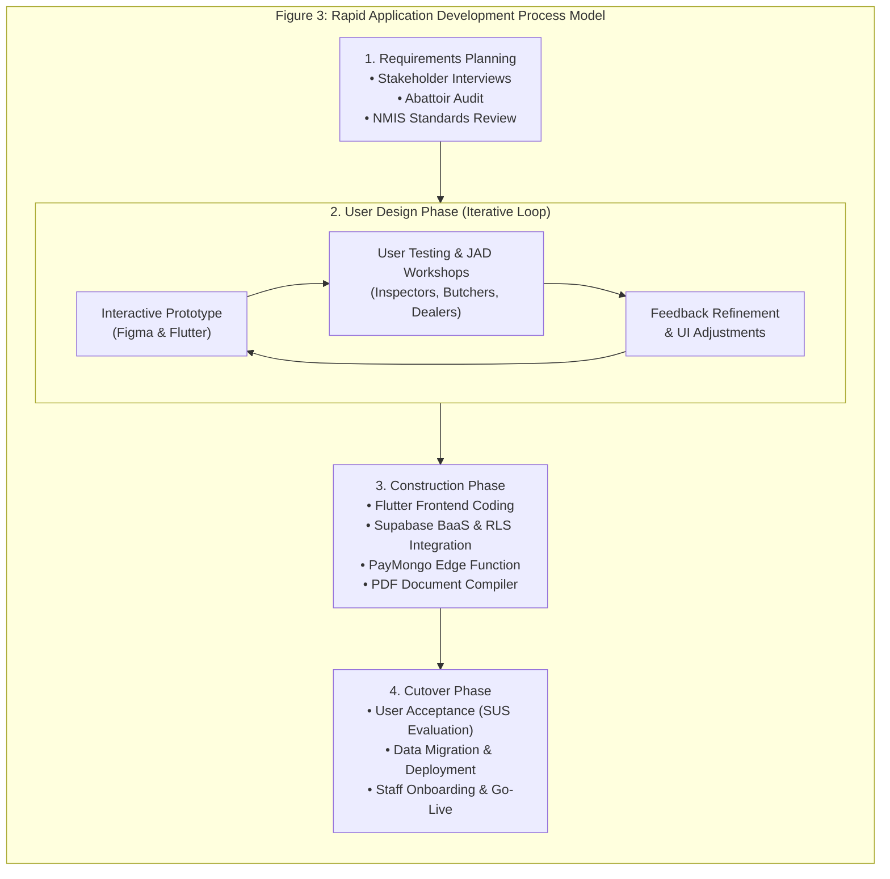
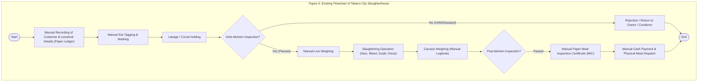
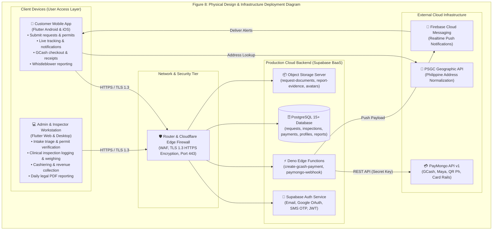
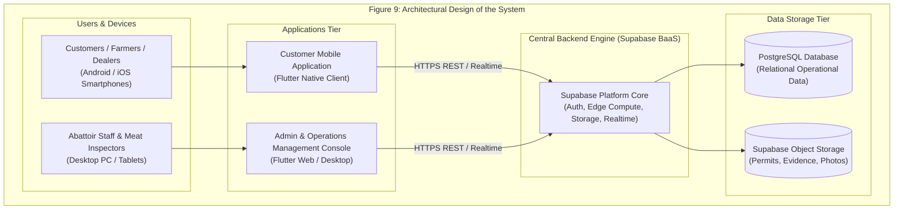
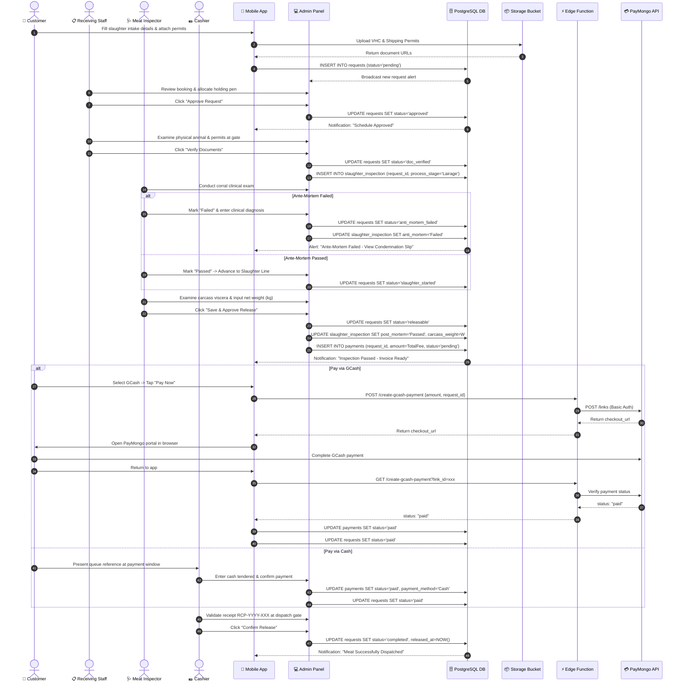
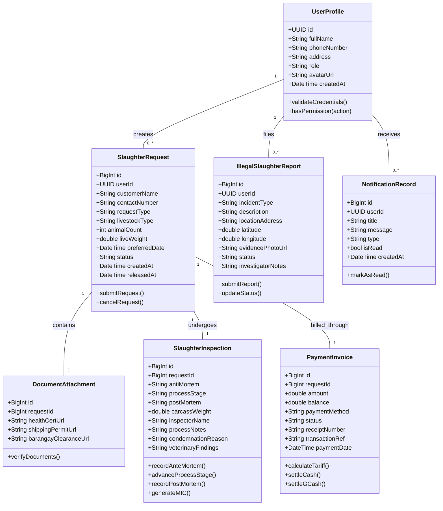

# Chapter 2: Review of Related Literature and Technical Background

## Review of Related Literature/Systems

The proposed **Operation Management Application for AA Slaughterhouse of Tabaco City** is anchored by a robust framework of related literature and existing systems that validate its necessity, technical feasibility, and strategic importance in the context of the Philippines' digitalizing public sector. The literature review focuses on four key areas: the evolution and functionality of abattoir management systems, the strategic necessity of automation for local government units (LGUs), the role of user experience (UX) and mobile portals in stakeholder adoption, and the software engineering methodologies governing public cloud systems.

### Global Evolution of Abattoir Management & Traceability
The transition from traditional, manual abattoir record-keeping to automated, cloud-synchronized platforms is an established subject in contemporary agricultural literature. Andersen et al. (2023) demonstrated that automating abattoir records significantly reduces biological cross-contamination risks and boosts processing throughput by standardizing operational checkpoints. Complementing this, Food and Agriculture Organization (FAO, 2019) guidelines mandate rigorous digital traceability protocols from farm gate to retail dispatch. Research by Huang et al. (2021) and Kim and Park (2022) proved that cloud-synchronized databases increase operational data accessibility while minimizing manual calculation errors. Furthermore, international case studies by Singh et al. (2020) and Chen et al. (2023) highlight that hybrid multiplatform applications (desktop web and mobile) optimize livestock scheduling and foster high client satisfaction.

### Philippine Regulatory Environment & Public Slaughterhouse Challenges
In the Philippines, the National Meat Inspection Service (NMIS, 2020), the primary regulatory body under the Department of Agriculture, reported that a vast majority of local slaughterhouses throughout the country continue to rely on severely outdated manual systems. These antiquated methods represent a significant impediment to achieving full compliance with established national sanitation standards under Republic Act No. 9296 (The Meat Inspection Code of the Philippines). Gonzales and Dizon (2019) observed that the conspicuous absence of automated data systems severely limits the effective enforcement of crucial meat inspection regulations, creating information silos and hindering agile, data-driven decision-making.

On the local systems development front, Pascual and De Leon (2020) provided evidence that computer-based management systems demonstrably improve data reliability and reduce administrative errors in municipal facilities. Santos and Cruz (2021) developed a computerized inventory prototype that eliminated data redundancy in animal tracking. Villanueva and Cortez (2021) designed an online meat inspection prototype that automated the generation of critical inspection reports, significantly accelerating the reporting process. Furthermore, Reyes (2022) concluded that digital governance frameworks profoundly strengthen transparency and public accountability across local public services.

### Digital Payments & Cashless Public Administration
Integrating digital payment gateways is paramount for modernizing municipal public services. The Bangko Sentral ng Pilipinas (BSP) E-Payments Measurements Report (2024) indicates that digital retail payments have reached 57.4% of total transaction volume in the Philippines, illustrating a rapid cultural and economic pivot toward mobile wallets like GCash and Maya. Integrating secure payment gateways such as PayMongo allows municipal abattoirs to accept cashless settlements, directly eliminating manual receipt screenshot reviews, preventing cash drawer shortages, and establishing an auditable revenue trail.

---

## Conceptual Design

The conceptual framework provides the logical model for the project, originating from an urgent problem statement: the operational inefficiencies and compliance risks inherent in manual abattoir management.

```mermaid
graph LR
    subgraph Figure 2: Conceptual Design Diagram (Input-Process-Output Framework)
        subgraph INPUT
            I1["REQUIREMENTS & DATA<br/>• Customer & Livestock Details<br/>• Login Credentials & RBAC Roles<br/>• Livestock Specifications (Hog/Cattle)<br/>• Slaughter Schedule Request (Barangay/Market)<br/>• Statutory Documents (VHC, Permits)<br/>• Payment Preferences (GCash / Cash)<br/>• Whistleblower Reports (GPS & Photos)"]
            I2["KNOWLEDGE BASE<br/>• NMIS R.A. 9296 Standards<br/>• Tabaco City Tariff Schedule<br/>• Veterinary Pathology Rules"]
        end

        subgraph PROCESS
            P1["SOFTWARE DEVELOPMENT (RAD)<br/>• Requirements Analysis<br/>• Interactive Prototyping"]
            P2["SYSTEM WORKFLOW ENGINE<br/>• Authentication & Role Validation<br/>• Request Triage & Allocation<br/>• Document Compliance Verification<br/>• Ante & Post-Mortem Inspection<br/>• Slaughter Line Process Tracking<br/>• Carcass Weighing & Fee Billing<br/>• PayMongo Digital Gateway Flow<br/>• Legal MIC & PDF Report Generation<br/>• Realtime Push Notification Sync"]
        end

        subgraph OUTPUT
            O1["CUSTOMER MODULE<br/>• Schedule Booking & Tracking<br/>• Digital Receipt (RCP-YYYY-XXX)<br/>• Condemnation Notice (CS-YYYY-XXX)<br/>• Whistleblower Tip Confirmation"]
            O2["ADMIN & INSPECTION MODULE<br/>• Intake Triage & Holding Queues<br/>• Ante/Post-Mortem Clinical Logs<br/>• Net Carcass Weight Records<br/>• Cashiering & Fee Reconciliation<br/>• Daily Production Legal PDF Reports<br/>• Gate Pass Meat Dispatch Logs"]
        end

        INPUT --> PROCESS
        PROCESS --> OUTPUT
        OUTPUT -. "Continuous Operational Feedback" .-> INPUT
    end
```

---

## Technical Background & Software Development Methodology

The research team utilized the **Rapid Application Development (RAD)** methodology to design, build, test, and iterate the application. RAD was chosen because of its ability to continuously incorporate user feedback and rapidly adapt to evolving abattoir regulatory requirements.



### 1. Requirements Planning Phase
The Requirements Planning phase involves identifying, analyzing, and documenting the functional and non-functional needs of the system to align with organizational goals (Sommerville, 2020). Researchers collaborated closely with stakeholders—such as slaughterhouse managers, licensed meat inspectors, butchers, and meat dealers—to define core information requirements and map manual workflow bottlenecks.

### 2. User Design Phase
The User Design phase serves as an interactive workshop where requirements are translated into working models. Prototypes representing functional components were built, demonstrated to meat inspectors and dealers, tested, and iteratively refined. This rapid feedback mechanism ensured that navigation flows, inspection logging dialogs, and receipt layouts aligned with frontline abattoir realities.

### 3. Construction Phase
The Construction phase serves as the primary development phase where approved prototypes are converted into production-ready software. Flutter 3.11+ and Dart were leveraged for client applications, while Supabase provided backend PostgreSQL persistence and Deno Edge Functions executed secure PayMongo payment integrations.

### 4. Cutover Phase
The Cutover phase represents the final implementation and deployment transition. Activities included system validation, staff training, data migration, and formal usability evaluation via the System Usability Scale (SUS).

---

## System Design

The system design explains the core components, structure, and data flow of the proposed Operation Management Application for the AA Slaughterhouse of Tabaco City. It provides a comprehensive roadmap for how the system functions to meet municipal abattoir needs.

### Software Design Pattern (MVC Architecture)

The system utilizes the **Model-View-Controller (MVC)** architectural design pattern to decouple user interface presentation, operational business logic, and database management.

```mermaid
graph TD
    subgraph Figure 4: Decoupled Multi-Tier Software Architecture (MVC Pattern)
        Actor["Users<br/>(Customers, Receiving Staff, Meat Inspectors, Cashiers, Admins)"]

        subgraph "Presentation Tier (View Layer)"
            V1["Customer Mobile App (Flutter Android/iOS)<br/>• Booking intake, Live tracking, GCash checkout, Whistleblower reporting"]
            V2["Admin Console (Flutter Web/Desktop)<br/>• Triage queue, Permit verification, Inspection station, Cashiering, PDF reports"]
        end

        subgraph "Application Tier (Controller Layer)"
            C1["Auth & RBAC Controller (GoTrue & Profiles Sync)"]
            C2["Slaughter Scheduling & Lairage Controller"]
            C3["Veterinary Inspection & Condemnation Controller"]
            C4["Cashiering & Tariff Calculation Engine"]
            C5["PayMongo Deno Edge Runtime Service"]
            C6["ReportPdfGenerator Legal Document Engine"]
        end

        subgraph "Persistence Tier (Model Layer)"
            M1["Supabase PostgreSQL Database<br/>(requests, slaughter_inspection, payments, profiles, notifications, reports)"]
            M2["Supabase Object Storage Server<br/>(request-documents, report-evidence, avatars)"]
        end

        Actor -- "User Action / HTTP Interaction" --> Presentation Tier
        Presentation Tier -- "Request Payload / Form Submission" --> Application Tier
        Application Tier -- "ACID SQL Queries / Storage Mutations" --> Persistence Tier
        Persistence Tier -- "Result Set / Public URLs" --> Application Tier
        Application Tier -- "State Models & Business Data" --> Presentation Tier
        Presentation Tier -- "Render UI State & Reactive Stream Updates" --> Actor
    end
```

---

## Process Flowcharts

### Existing Manual Flowchart of Tabaco City Slaughterhouse



---

### Proposed System Flowchart

```mermaid
graph TD
    subgraph Figure 6: Proposed System Flowchart of Operation Management Application
        Start([Start: App Launch]) --> AuthCheck{"User Authenticated?"}
        AuthCheck -- "No" --> Login["Login / OTP Verification"]
        Login --> AuthCheck
        
        AuthCheck -- "Yes" --> ActionType{"Action Type?"}
        ActionType -- "Whistleblower Tip" --> FileReport["Submit Illegal Slaughter Report (GPS + Photo Upload)"]
        FileReport --> AdminInvestigate["Admin Investigation & Enforcement Logging"]
        AdminInvestigate --> End([End])
        
        ActionType -- "Slaughter Service" --> BookIntake["Submit Request Schedule (Barangay/Market + Upload Permits)"]
        BookIntake --> AdminReview{"Admin Intake Approved?"}
        
        AdminReview -- "No" --> NotifyReject["Dispatch Rejection Notification"]
        NotifyReject --> End
        
        AdminReview -- "Yes" --> DocVerify{"Document Verification Passed?"}
        DocVerify -- "No" --> CancelDoc["Set Status = Cancelled & Notify Customer"]
        CancelDoc --> End
        
        DocVerify -- "Yes" --> AnteExam{"Ante-Mortem Inspection Passed?"}
        AnteExam -- "No (Condemned)" --> CondemnAnte["Set Status = anti_mortem_failed<br/>Generate Condemnation Notice (CS-YYYY-XXX)<br/>Quarantine / Incinerate"]
        CondemnAnte --> End
        
        AnteExam -- "Yes" --> SlaughterLine["Slaughter Operations Line<br/>(Stunning, Bleeding, Scalding, Evisceration)"]
        SlaughterLine --> PostExam{"Post-Mortem Inspection Passed?"}
        
        PostExam -- "No (Condemned)" --> CondemnPost["Set Status = post_mortem_failed<br/>Log Pathological Findings<br/>Generate Condemnation Slip & Confiscate"]
        CondemnPost --> End
        
        PostExam -- "Yes" --> WeighCarcass["Record Net Carcass Weight (kg)<br/>Generate Digital MIC Record"]
        WeighCarcass --> CalcTariff["Compute Municipal Fees & Invoices<br/>(Vet, Permit, Facility, Corral, Weight Rate, Van)"]
        
        CalcTariff --> PayMethod{"Payment Method?"}
        PayMethod -- "GCash" --> PayMongoLink["Create PayMongo Link -> GCash Checkout -> Verify"]
        PayMethod -- "Cash" --> CashierWindow["Cashier Receives Cash -> Stamps Paid"]
        
        PayMongoLink --> ClearPay["Set Status = paid<br/>Generate Official Receipt (RCP-YYYY-XXX)"]
        CashierWindow --> ClearPay
        
        ClearPay --> GatePass["Gate Pass Verification at Dispatch Loading Dock"]
        GatePass --> MeatRelease["Confirm Pickup: Set Status = completed<br/>Stamp released_at Timestamp"]
        MeatRelease --> GenDailyReport["Compile Legal Daily Slaughterhouse Production PDF"]
        GenDailyReport --> End
    end
```



---

## Use Case Diagram

The Use Case Diagram illustrates interactions between five primary actor tiers: **Customer / Meat Dealer**, **Receiving Clerk**, **Veterinary Meat Inspector**, **Cashier / Revenue Collector**, and **Slaughterhouse Administrator**.

```mermaid
graph LR
    subgraph Figure 7: System Use Case Diagram
        subgraph Actors
            CUST["👤 Customer / Meat Dealer"]
            REC["📋 Receiving Clerk"]
            INSP["🩺 Meat Inspector"]
            CASH["💵 Cashier"]
            ADM["👨‍💼 Administrator"]
        end

        subgraph Use Cases
            UC1["Book Slaughter Request & Upload Permits"]
            UC2["Track Real-time Slaughter Status"]
            UC3["Settle Digital Payment via GCash"]
            UC4["View Official Receipt & Gate Pass"]
            UC5["View Digital Condemnation Slip"]
            UC6["Submit Illegal Slaughter Whistleblower Tip"]
            UC7["Submit Service Quality Review"]
            
            UC8["Triage & Approve Intake Schedules"]
            UC9["Verify Physical Documents & Permits"]
            UC10["Log Ante-Mortem Clinical Examination"]
            UC11["Update Slaughter Process Stages"]
            UC12["Log Post-Mortem Findings & Carcass Weight"]
            UC13["Issue Statutory Condemnation Slip"]
            UC14["Assess Municipal Tariff & Process Cash Receipt"]
            UC15["Validate Gate Pass & Authorize Meat Release"]
            UC16["Investigate Whistleblower Complaints"]
            UC17["Generate Legal Daily Production PDF Reports"]
            UC18["Manage Staff Accounts & RBAC Permissions"]
        end

        CUST --> UC1
        CUST --> UC2
        CUST --> UC3
        CUST --> UC4
        CUST --> UC5
        CUST --> UC6
        CUST --> UC7

        REC --> UC8
        REC --> UC9

        INSP --> UC10
        INSP --> UC11
        INSP --> UC12
        INSP --> UC13

        CASH --> UC14
        CASH --> UC15

        ADM --> UC8
        ADM --> UC9
        ADM --> UC14
        ADM --> UC16
        ADM --> UC17
        ADM --> UC18
    end
```



---

## Physical Design & Deployment Architecture



---

## Architectural Design

The Architectural Design models the high-level decoupled three-tier topology of the system.



---

## System Diagram (End-to-End Sequence Diagram)



---

## Deployment Diagram

```mermaid
graph TB
    subgraph Figure 11: Deployment Diagram (UML Runtime Environment)
        subgraph "Client Tier Node (User Hardware)"
            nodeClient["«device» Mobile Smartphone / Desktop PC<br/>• OS: Android 8.0+ / iOS 13+ / Windows 10+<br/>• Runtime: Flutter Native Engine / Webview<br/>• Artifact: tc_aa_slaughterhouse.apk / admin_web"]
        end

        subgraph "Edge Gateway Node"
            nodeEdge["«execution environment» Supabase Deno Edge Runtime<br/>• Protocol: HTTPS / TLS 1.3 (Port 443)<br/>• Artifact: create-gcash-payment/index.ts<br/>• Secrets: PAYMONGO_SECRET_KEY"]
        end

        subgraph "Database & Storage Node (Supabase BaaS)"
            nodeDB["«database server» PostgreSQL 15+ Engine<br/>• Port: 5432 (Internal Socket)<br/>• Features: Row-Level Security, ACID Relational Store"]
            nodeStorage["«storage server» Object Storage S3 Engine<br/>• Buckets: request-documents, report-evidence, avatars"]
        end

        subgraph "External Payment Node"
            nodePayMongo["«external system» PayMongo API Gateway<br/>• Protocol: REST HTTPS (Port 443)<br/>• Host: api.paymongo.com/v1"]
        end

        nodeClient -- "HTTPS / JSON (Port 443)" --> nodeEdge
        nodeClient -- "PostgREST / Websocket (Port 443)" --> nodeDB
        nodeClient -- "Binary Multipart Upload" --> nodeStorage
        nodeEdge -- "HTTPS REST (Port 443)" --> nodePayMongo
        nodeEdge -- "Service Role SQL Mutation" --> nodeDB
    end
```

---

## Package Diagram

```mermaid
graph TD
    subgraph Figure 12: Package Diagram (Modular Codebase Architecture)
        subgraph "Presentation Layer"
            pkgMobileUI["mobile_app::ui<br/>(screens, widgets, auth_gate)"]
            pkgAdminUI["admin_panel::ui<br/>(screens, widgets, sidebar)"]
        end

        subgraph "Domain & Business Logic Layer"
            pkgAuth["core::authentication<br/>(session, token, role_guard)"]
            pkgIntake["operations::intake_scheduling<br/>(requests, lairage_allocation)"]
            pkgInspection["veterinary::inspection<br/>(ante_mortem, post_mortem, condemnation)"]
            pkgBilling["finance::cashiering<br/>(tariff_engine, paymongo_gateway)"]
            pkgReporting["compliance::reporting<br/>(pdf_generator, daily_reports)"]
        end

        subgraph "Data & Persistence Layer"
            pkgSupabase["infrastructure::supabase_client<br/>(postgres_orm, storage_client, realtime_bus)"]
        end

        pkgMobileUI --> pkgAuth
        pkgMobileUI --> pkgIntake
        pkgMobileUI --> pkgBilling
        
        pkgAdminUI --> pkgAuth
        pkgAdminUI --> pkgIntake
        pkgAdminUI --> pkgInspection
        pkgAdminUI --> pkgBilling
        pkgAdminUI --> pkgReporting

        pkgAuth --> pkgSupabase
        pkgIntake --> pkgSupabase
        pkgInspection --> pkgSupabase
        pkgBilling --> pkgSupabase
        pkgReporting --> pkgSupabase
    end
```

---

## Class Diagram



---

## Development Tools & Technical Specifications

### Table 1. Development Tools Used

| Category | Tools Used | Technical Justification |
| :--- | :--- | :--- |
| **UI/UX Design & Prototyping** | Figma | Used to create interactive mobile wireframes, abattoir dashboard layouts, and design token libraries. |
| **Integrated Development Environment** | Antigravity IDE / VS Code | Multiplatform Flutter/Dart pair programming, cross-package refactoring, and static code linting. |
| **Frontend Framework** | Flutter SDK (v3.11+) | Compiles native, high-performance UI binaries for Android, iOS, Web, and Windows Desktop from a single codebase. |
| **Core Programming Language** | Dart (v3.11+) | Object-oriented language powering client application state, asynchronous stream subscriptions, and PDF generation. |
| **Backend & Cloud Services** | Supabase BaaS | Managed cloud platform providing PostgreSQL database, GoTrue authentication, object storage, and realtime websockets. |
| **Serverless Compute** | Deno TypeScript | Executes server-side business logic and communicates securely with the PayMongo API without exposing secret keys. |
| **Payment Gateway** | PayMongo API v1 | Philippine fintech infrastructure for automated GCash checkout links and payment verification. |
| **Document Generation** | Dart `pdf` & `printing` | Compiles legal-size (8.5" x 14") Daily Slaughterhouse Production Reports and thermal receipt layouts. |
| **Version Control & Collaboration**| Git & GitHub | Distributed version control, continuous integration, and commit auditing. |

---

### Database and Data Management

The Tabaco City Slaughterhouse system utilizes a hybrid relational and cloud-storage architecture centered on **PostgreSQL 15+** managed via Supabase. PostgreSQL enforces strict ACID (Atomicity, Consistency, Isolation, Durability) compliance across all core tables—including `requests`, `slaughter_inspection`, `payments`, `profiles`, `notifications`, and `reports`.

#### Data Handling & Security Architecture:
1. **Row-Level Security (RLS)**: Protects tables at the database engine level. Clients can only access their own booking records, while meat inspectors and cashiers possess elevated operational mutation rights.
2. **ACID Transaction Isolation**: Ensures that updating carcass weights in `slaughter_inspection` and mutating `requests.status = 'releasable'` occurs atomically, preventing partial updates.
3. **Cryptographic Storage**: Sensitive session tokens and auth credentials are encrypted using JWT and bcrypt/Argon2 algorithms.
4. **Binary Object Storage**: Statutory veterinary documents and whistleblower photographic evidence are isolated into secure Supabase storage buckets (`request-documents`, `report-evidence`, `avatars`).

---

### Table 2. Software Requirements

| Category | Client-Side Specifications (Mobile App) | Admin-Side Specifications (Admin Console) |
| :--- | :--- | :--- |
| **Operating System** | Android 8.0 (Oreo) or higher / iOS 13.0 or higher | Windows 10/11 (64-bit), macOS 12+, or Ubuntu Linux 20.04+ |
| **Web Browser** | Android System Webview / Safari Webkit | Google Chrome (v110+), Mozilla Firefox, Microsoft Edge |
| **Network Connectivity** | 4G LTE / 5G Mobile Data or Wi-Fi (≥ 5 Mbps) | Stable Abattoir Local LAN / High-Speed Broadband (≥ 25 Mbps) |
| **Credentials & Auth** | Registered Citizen / Dealer Account, Google OAuth | Staff Account with assigned RBAC role (Admin, Inspector, Cashier) |

---

### Table 3. Recommended Hardware Requirements

| Device Category | Hardware Component | Minimum / Recommended Specification |
| :--- | :--- | :--- |
| **Cloud Server** | Processor & Memory | Supabase Cloud Instance (4 Core vCPU, 8 GB RAM, High-IOPS NVMe Storage) |
| **Admin Workstation** | Processor | Intel Core i5 / AMD Ryzen 5 (Quad-Core ≥ 2.5 GHz) |
| | Memory & Storage | 8 GB to 16 GB DDR4 RAM, 256 GB NVMe SSD |
| | Display | 21.5" to 27" Full HD (1920 × 1080) LED Display |
| **Abattoir Peripherals** | Document Printer | High-Speed Laser Printer supporting Legal Size (8.5" × 14") |
| | Thermal Receipt Printer | 80mm ESC/POS Direct Thermal Printer (USB / LAN) |
| | Barcode Scanner | 1D / 2D Handheld USB / Bluetooth Optical Scanner |
| | Cash Drawer | Heavy-Duty Electronic Cash Drawer (RJ11 connected to receipt printer) |
| | Digital Carcass Scale | Heavy-Duty Overhead Rail Digital Scale with Serial / Bluetooth Interface |
| **Mobile Terminals** | Device Type | Android Smartphone or Tablet (Quad-Core, 4 GB RAM, 8 MP Camera with Autofocus) |
