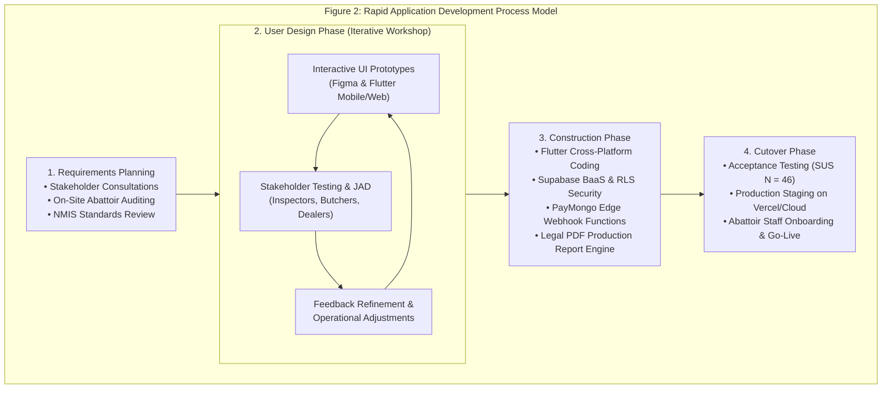

# METHODS

This chapter outlines the methodology employed by the researchers to plan, design, develop, deploy, and evaluate the proposed system. It details the software development life cycle model, data gathering techniques, primary data sources, and analytical tools utilized throughout the study.

---

## Software Development Methodology

A Software Development Methodology (SDM) is consistently defined in contemporary academic and industry literature as a structured framework used to plan, structure, control, and manage the process of creating, designing, deploying, and maintaining software (Itransition, 2024; Quiroz-Vázquez, 2025; Simplilearn, 2025).

The researchers adopted the **Rapid Application Development (RAD)** methodology to architect, implement, test, and iterate the Operation Management Application for the AA Slaughterhouse of Tabaco City. Rapid Application Development is an agile-rooted, adaptive software engineering framework that prioritizes rapid prototyping, iterative user design workshops, and concurrent development over rigid, sequential planning phases (Martin, 1991; Sommerville, 2020). RAD was selected because of the complex, multi-stakeholder operational environment of the municipal abattoir, which necessitated continuous feedback loops with veterinary meat inspectors, receiving personnel, revenue cashiers, and commercial meat dealers to ensure that the digital platform adhered strictly to statutory regulations and real-world abattoir conditions.

Figure 2. Rapid Application Development Process Model

Requirements Planning Stage. In this initial stage, the researchers engaged in structured fact-finding investigations, administrative consultations, and on-site operational observations at the Tabaco City Slaughterhouse. The objective was to define system boundaries, map physical animal receiving workflows, identify chronic record-keeping bottlenecks, and determine legal reporting mandates under Republic Act No. 9296. By engaging directly with the City Veterinarian, meat inspectors, and receiving clerks, the researchers established a verified Software Requirements Specification (SRS) covering customer bookings, pen allocations, ante/post-mortem triage, and cashiering.

User Design Stage. During this iterative phase, stakeholder requirements were translated into interactive visual prototypes. Using Figma and Flutter UI components, the researchers constructed rapid prototypes of the customer mobile scheduling interface, document verification gateway, clinical inspection logbook, and cashiering desk. These prototypes were evaluated through Joint Application Design (JAD) sessions with abattoir staff and meat dealers. Frontline feedback on button ergonomics for wet-floor environments, font contrast, and minimal-tap screen progression was continuously integrated, preventing costly architectural rework in later stages.

Construction Stage. This stage served as the primary development phase where finalized prototypes were converted into production-ready software. Development was organized around a decoupled, multi-platform architecture utilizing the Flutter SDK (Dart 3.11+) for the customer mobile client and the administrative management console. Backend persistence, authentication, and object storage were implemented using Supabase Cloud (PostgreSQL 15+), guarded by database-level Row-Level Security (RLS) policies. Secure cashless payment rails were engineered using serverless Deno TypeScript Edge Functions communicating with the PayMongo API, while automated PDF generation modules were built to output legal-size (8.5" × 14") NMIS Daily Production Reports.

Cutover Stage. The final phase of the methodology encompassed system deployment, staff training, data validation, and empirical user acceptance evaluation. The web console was staged in the cloud, and the mobile application package (`tc_aa_slaughterhouse.apk`) was distributed to commercial meat dealers and livestock raisers. Comprehensive user onboarding workshops were conducted for abattoir personnel, followed by administering the standardized System Usability Scale (SUS) to evaluate operational learnability, usability, and task efficiency across all five stakeholder groups.

---

## Data Gathering Techniques

Techniques for the data gathering are the methods used by the researchers to collect information essential in answering the objective of the study. In these techniques, the researchers used survey questionnaires and interviews to collect information from the stakeholders and users of the system and conducted an interview. The researchers also conducted research using reliable online sources to collect additional information.

Interview. An interview is a data collection method where researchers ask questions directly to a participant to obtain in-depth and detailed information. Unlike a questionnaire, it is typically a live conversation that allows for follow-up questions and the exploration of complex topics, providing rich qualitative data (Creswell et al., 2022). The researchers conducted in-depth, semi-structured interviews with the City Veterinarian, slaughterhouse supervisor, veterinary meat inspectors, receiving clerks, and revenue cashiers at the Tabaco City Slaughterhouse. These interviews uncovered critical pain points regarding manual paper ledgers, unrecorded condemnation records, and pre-dawn counter congestion during peak market hours.

Questionnaire. A questionnaire is a research instrument that consists of a set of questions designed to collect standardized information from a group of people. It is a self-administered tool where respondents would read and answer the questions on their own whether it be paper or digitally. It is particularly effective for gathering quantitative data from a large sample size efficiently (Krosnick, 2023). Standardized questionnaires were distributed to commercial meat stallholders, backyard swine raisers, and institutional butchers to gather baseline data on smartphone ownership, digital payment familiarity, preferred booking lead times, and willingness to adopt automated abattoir portals.

Survey. A survey is a comprehensive research method that is used to systematically collect, analyze, and interpret data from a sample of a population. While it often uses a questionnaire as its primary tool, the survey itself encompasses the entire process, including the sampling strategy, and statistical analysis (Fowler, 2020). The researchers administered on-site surveys using printed forms and Google Forms via QR code links. Post-deployment, the standardized 10-item System Usability Scale (SUS) survey was deployed to quantitatively assess user acceptance, operational learnability, and perceived efficiency across 46 representative respondents.

Document Analysis. Document analysis involves reviewing existing physical records, inspection logs, and transaction reports to extract factual administrative data (Bowen, 2009). The researchers examined physical animal intake ledgers, official Meat Inspection Certificates (MIC), condemnation and confiscation logs, municipal fee assessment slips, and monthly production summaries to ensure the software’s data models strictly complied with National Meat Inspection Service (NMIS) and Tabaco City LGU reporting standards.

---

## Sources of Data

The data utilized in this study were divided into primary and secondary sources, gathered from the following key participants and references:

Tabaco City "AA" Slaughterhouse. Primary operational data were gathered directly from administrative and field personnel at the facility in Zone 5 San Carlos, Tabaco City. Slaughterhouse managers and receiving clerks provided detailed operational records regarding animal receiving capacities, holding pen quotas, ear-tagging procedures, and gate clearance routines. Accredited veterinary meat inspectors supplied clinical data regarding ante-mortem evaluation parameters, post-mortem visceral disease indicators, condemnation criteria, and carcass weighing protocols. Revenue cashiers provided the municipal slaughter fee tariff schedule and official receipting rules.

Commercial Meat Dealers & Backyard Livestock Raisers. Primary client-side data were collected from commercial stallholders operating in the Tabaco City Public Market and local livestock raisers across Albay barangays. These participants provided direct insights regarding livestock transport practices, digital booking preferences, experiences with payment channels (Cash vs. GCash), and requirements for meat release gate passes.

The Internet & Statutory Publications. The internet and government repositories served as essential secondary data sources. The researchers reviewed Republic Act No. 9296 (The Meat Inspection Code of the Philippines), Republic Act No. 10536, DA-NMIS administrative orders, Food and Agriculture Organization (FAO) biosecurity guidelines, World Health Organization (WHO) meat hygiene publications, and Bangko Sentral ng Pilipinas (BSP) digital payment reports to establish statutory compliance benchmarks for the proposed platform.

---

## Tools for Data Analysis

The data collected was analyzed, interpreted, and organized using the following tools:

Purposive Sampling - Purposive sampling is a non-probability sampling technique where researchers deliberately select participants based on specific characteristics or qualities that are relevant to the objectives of the study. This method is dependent on the researcher’s judgement to choose the individuals who are most likely to provide rich and detailed information about the phenomenon under investigation as opposed to selecting randomly (Campbell et al., 2020; Etikan et al., 2016). The researchers stratified a purposive sample of $N = 46$ participants across five operational stakeholder tiers: Slaughterhouse Management ($n = 2$), Veterinary Meat Inspectors ($n = 4$), Operations Staff & Cashiers ($n = 4$), Abattoir Butchers & Floor Handlers ($n = 6$), and Commercial Meat Dealers & Livestock Raisers ($n = 30$).

Google Forms - Google Forms is a versatile, web-based tool for creating and distributing surveys, quizzes, and data collection forms, widely used in academic research for its ease of use and real-time data collation (Widianingrum et al., 2023). It was utilized to collect baseline digital literacy responses and deploy the standardized System Usability Scale (SUS) questionnaire to tech-enabled respondents via direct URL links and on-site QR codes.

Google Sheets - Google Sheets is a cloud-based spreadsheet application that functions as part of Google’s free web-based software office suite. It enables users to create, edit, and collaborate on spreadsheets in real-time from any device utilizing an internet connection (Neil, 2020). Google Sheets was employed as the primary cloud database for collating raw survey data, executing preliminary data cleaning, calculating frequency distributions, and preparing descriptive statistical tables.

IBM SPSS Statistics (v28) & Microsoft Excel - Utilized as the primary statistical computational suite to execute descriptive analyses (means, standard deviations), compute individual and composite System Usability Scale (SUS) metrics, and perform psychometric subscale reliability tests across usability and learnability factors (Field, 2020; Pallant, 2023).

System Usability Scale (SUS) Mathematical Formulation - To quantitatively evaluate the operational acceptability, learnability, and perceived efficiency of the developed system, the standardized 10-item System Usability Scale framework was implemented (Lee et al., 2023; Lubua & Elias, 2021). The instrument employs ten 5-point Likert-scale statements ($1 = \text{Strongly Disagree}$ to $5 = \text{Strongly Agree}$), alternating between positive and negative assertions to mitigate acquiescence bias. In accordance with standard SUS scoring protocol:
1. For odd-numbered positive items ($i \in \{1, 3, 5, 7, 9\}$), score contribution is calculated by subtracting 1 from the raw response value ($Q_i$):
	   $$ON = \sum_{i \in \{1, 3, 5, 7, 9\}} (Q_i - 1)$$
2. For even-numbered negative items ($i \in \{2, 4, 6, 8, 10\}$), score contribution is calculated by subtracting the raw response value ($Q_i$) from 5:
   $$EN = \sum_{i \in \{2, 4, 6, 8, 10\}} (5 - Q_i)$$
3. The composite SUS score is derived by multiplying the sum of all adjusted item contributions by 2.5, yielding a standardized metric on a scale from 0 to 100:
   $$SUS = (ON + EN) \times 2.5$$
4. Decomposing into two psychometric subscales (Lewis & Sauro, 2009): Usability Subscale (Items Q1, Q2, Q3, Q5, Q6, Q7, Q8, Q9) and Learnability Subscale (Items Q4, Q10).
