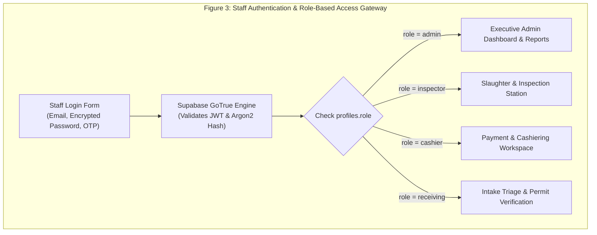
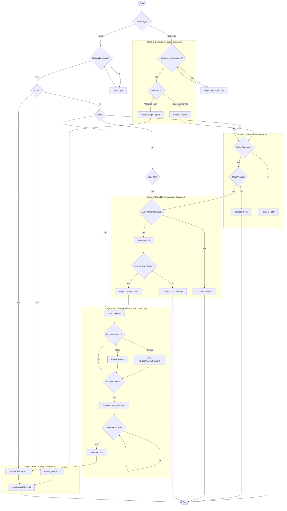
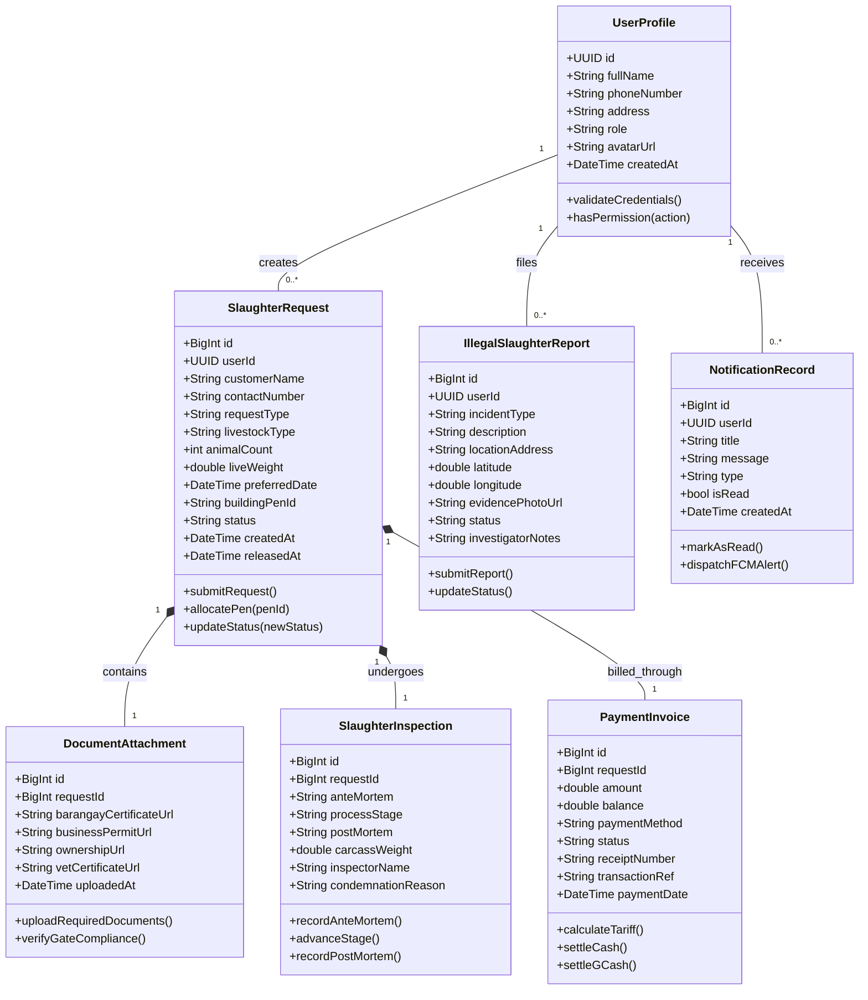
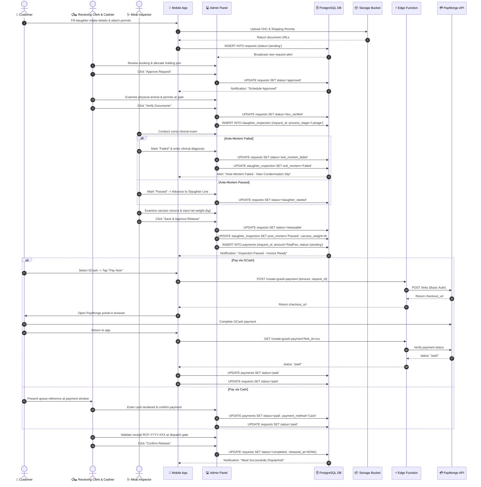
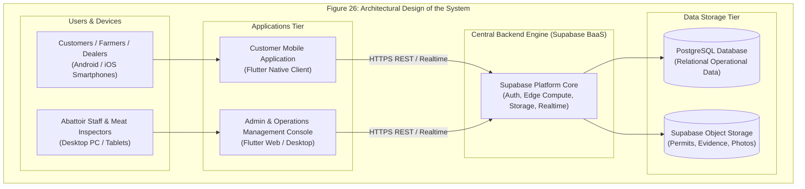
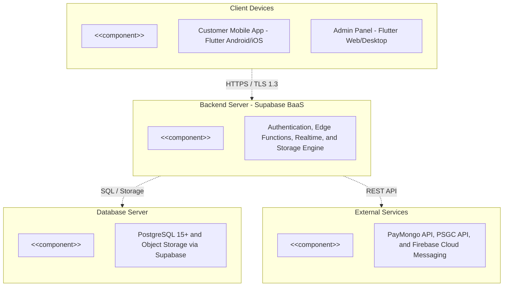

# RESULTS

This chapter presents the completed architectural implementation, functional modules, physical topology, database schemas, and psychometric evaluation of the live Operation Management Application for AA Slaughterhouse of Tabaco City deployed on Supabase and Vercel.

---

## Information Requirements

This section presents and explains the empirical results gathered from the stakeholder interviews, on-site operational observations, and workflow analyses conducted at the Tabaco City "AA" Slaughterhouse in Zone 5 San Carlos, Tabaco City, Albay. The discussion focuses on identifying the critical data elements and information requirements necessary for designing and developing the decoupled enterprise system across its three primary architectural sub-domains.

### A. Sub-Domain A: Intake Booking, Lairage Queueing, and Permit Information Requirements

The operational data presented in Table 1 outlines the essential information requirements needed by the system to support remote livestock reservations, holding corral capacity management, statutory permit attachment, and physical gate verification. These requirements ensure that receiving officers can triage incoming bookings rapidly, enforce humane holding pen quotas, and prevent diseased or uncertified animals from entering the abattoir grounds.
	
	The Customer & Origin Data Requirements category captures the personnel and ownership parameters necessary to establish animal origin traceability. This includes the customer's legal name, contact number, origin farm barangay address, and commercial dealer accreditation credentials. The Livestock & Document Parameters category captures species classification, live head counts, estimated weights, and high-resolution photo captures of statutory documents, including the Veterinary Health Certificate (VHC) and Livestock Shipping Permit. The Queue & Lairage Allocation Data category manages lairage capacity limits, allocating incoming animals to either the Barangay Queue (local consumption) or Market Queue (commercial distribution) while recording verification timestamps upon arrival.

#### Table 1. Sub-Domain A: Intake Booking, Lairage Queueing, and Permit Information Requirements

| Customer & Origin Data Requirements | Livestock & Document Parameters | Queue & Lairage Allocation Data |
| :--- | :--- | :--- |
| Customer / Dealer Full Legal Name | Livestock Species (`Hog`, `Cattle`, `Carabao`, `Goat`) | Preferred Slaughter Date & Time Slot |
| Contact Telephone Number & Verified Account Badge | Live Head Count (Units) | Intake Request Category (`Barangay` vs `Market`) |
| Farm Origin Address & Barangay Location | Estimated / Actual Live Animal Weight (kg) | Assigned Holding Corral / Lairage Pen ID |
| Registered Meat Dealer Accreditation ID | Veterinary Health Certificate (VHC) Image URL | Intake Triage Status (`pending`, `approved`, `cancelled`) |
| PSGC Philippine Geographic Code | Livestock Shipping Permit (SP) Image URL | Gate Document Verification Timestamp |
| Client Account Role (`client` in profiles) | Barangay Origin Clearance Image URL | Document Verification Officer ID & Signature |

---

### B. Sub-Domain B: Veterinary Inspection, Carcass Weighing, and Condemnation Information Requirements

	Table 2 outlines the operational data structures governing clinical ante-mortem evaluation, slaughter processing line stages, post-mortem pathology examination, carcass weighing, and statutory condemnation notice generation. These parameters ensure that clinical diagnoses are immutably captured, preventing the commercial distribution of unwholesome or uninspected meat products.
	
	The Ante-Mortem Clinical Data Requirements category captures live animal health conditions, body temperature, behavioral gait, and disease symptoms in the holding corrals. If an animal is diagnosed as unfit, an official condemnation reason is logged. The Process Stage & Pathology Parameters category tracks real-time progress across slaughter line stations (stunning, bleeding, scalding, evisceration) and records visceral organ examinations. The Carcass & Legal Certification Data category records certified net dressed weights from calibrated overhead scales, generates official digital Meat Inspection Certificates (MIC), and archives legal Condemnation Slips (`CS-YYYY-XXX`) for incinerated carcasses under Republic Act No. 9296.

	#### Table 2. Sub-Domain B: Veterinary Inspection, Carcass Weighing, and Condemnation Information Requirements

| Ante-Mortem Clinical Data Requirements | Process Stage & Pathology Parameters | Carcass & Legal Certification Data |
| :--- | :--- | :--- |
| Ante-Mortem Status (`Passed`, `Suspect`, `Failed`) | Slaughter Stage (`Stun`, `Bleed`, `Scald`, `Eviscerate`) | Net Dressed Carcass Weight (kg) |
| Clinical Symptom Observations (Fever, Lesions) | Post-Mortem Status (`Passed`, `Condemned`, `Retained`) | Meat Inspection Certificate (MIC) Reference ID |
| Quarantine / Isolation Bay Assignment | Pathological Diagnosis (e.g. *Septicemia*, *Swine Fever*) | Certifying NMIS Meat Inspector Full Name |
| Ante-Mortem Examination Timestamp | Condemnation Severity (`Partial` vs `Total`) | Inspector Professional Accreditation Number |
| Examining Veterinarian ID & License Number | Affected Organs Log (Liver, Lungs, Kidneys, Viscera) | Digital Condemnation Slip Number (`CS-YYYY-XXX`) |
| Animal Health Rejection Reason Code | Seizure & Incineration Disposal Confirmation | Inspection Completion Timestamp |

---

### C. Sub-Domain C: Municipal Cashiering, PayMongo GCash, and Statutory Reports Information Requirements

	To support municipal fiscal accountability, automated tariff computation, and statutory compliance, it is essential to define the data structures governing the cashiering console and the PayMongo payment gateway integration. Table 3 outlines the information requirements gathered from cashier interviews and dealer surveys to ensure accurate tariff billing, cashless e-wallet reconciliation, and daily reporting.
	
	The Municipal Tariff & Billing Requirements category encompasses the dynamic fee parameters established by Tabaco City revenue ordinances, evaluating base facility fees, veterinary inspection dues, holding corral rates, and variable post-mortem fees based on certified carcass weight. The PayMongo Gateway & Receipt Parameters category manages digital payment sessions, webhook signatures, payment references, and official receipt numbers (`RCP-YYYY-XXX`). The Dispatch, Whistleblower & Reporting Data category captures scannable gate pass release timestamps, delivery vehicle plate numbers, GPS coordinates and photo evidence for illegal slaughter whistleblower tips, and aggregate data payloads for NMIS legal-size Daily Production Reports.

#### Table 3. Sub-Domain C: Municipal Cashiering, PayMongo GCash, and Statutory Reports Information Requirements

| Municipal Tariff & Billing Requirements | PayMongo Gateway & Receipt Parameters | Dispatch, Whistleblower & Reporting Data |
| :--- | :--- | :--- |
| Veterinary Health Certificate Fee (₱50.00) | Payment Settlement Channel (`Cash` vs `GCash`) | Gate Pass Release Clearance Status (`completed`) |
| Permit to Slaughter Fee (₱60.00) | PayMongo Link ID & Checkout Session URL | Physical Meat Dispatch Timestamp (`released_at`) |
| Slaughterhouse Facility Fee (₱60.00) | PayMongo Webhook Signature & Status (`paid`) | Recipient / Delivery Van Vehicle Plate Number |
| Holding Corral Fee (₱40.00) | Transaction Authorization Reference Code | Whistleblower Report Incident Type & Description |
| Ante-Mortem Inspection Fee (₱40.00) | Official Slaughterhouse Receipt (`RCP-YYYY-XXX`) | Whistleblower GPS Geolocation & Photo URL |
| Post-Mortem Rate (₱5.00 × Carcass Weight kg) | Cash Tendered Amount & Change Due (Cashier) | Whistleblower Case Status (`Under Investigation`) |
| Delivery Van Fee (₱60.00, Market requests only) | Shift Closing Balance & Cash Drawer Reconciliation | Daily Legal Production PDF Report Data Payload |

---

## Features of the Proposed System

The proposed Operation Management Application for AA Slaughterhouse of Tabaco City encompasses a comprehensive suite of 16 integrated digital interfaces designed to streamline abattoir retail operations, veterinary inspection triage, multi-tender payment processing, warehouse dispatch, and administrative auditing.

Figure 3 illustrates the **Staff Authentication & Role-Based Access Gateway**, which serves as the secure perimeter for all internal operations. Built using Supabase GoTrue Auth, the gateway authenticates personnel and assigns session tokens bound to five distinct operational roles: `admin`, `inspector`, `receiving`, `cashier`, and `client`. The interface implements form validation with instant error feedback, preventing invalid submissions and mitigating brute-force risks through rate-limited session handling.



Figure 3. Staff Authentication & Role-Based Access Gateway

Figure 4 presents the **Customer Portal Mobile Home & Status Timeline**, functioning as the mobile entry point for commercial meat dealers and backyard raisers. Built with Flutter, the interface displays active livestock processing milestones in real time (`Intake Approved` $\rightarrow$ `Doc Verified` $\rightarrow$ `Slaughtering` $\rightarrow$ `Ready for Payment` $\rightarrow$ `Meat Released`), alongside quick shortcuts for scheduling new slaughter bookings, reviewing invoices, and accessing digital receipts.

Figure 4. Customer Portal Mobile Home & Status Timeline

Figure 5 shows the **Intake Schedule Booking & Animal Specification Interface**, which allows customers to select livestock species (Hog, Cattle, Carabao, Goat), enter head counts, designate distribution channels (Barangay meat stalls vs. Tabaco City Public Market), and select preferred slaughter dates. The underlying engine executes automated quota checks against daily corral capacity limits, preventing overbooking.

Figure 5. Intake Schedule Booking & Animal Specification Interface

Figure 6 illustrates the **Statutory Document & Permit Upload Interface**, which integrates camera and document picker APIs. Meat dealers capture and attach high-resolution images of Veterinary Health Certificates (VHC), Livestock Shipping Permits, and Barangay Clearances, which are uploaded directly to the secure `request-documents` Supabase Storage bucket.

Figure 6. Statutory Document & Permit Upload Interface

Figure 7 shows the **Admin Intake Triage & Holding Pen Allocation Console**, deployed at the abattoir receiving counter. The console partitions incoming bookings into tabbed queues (*Barangay Requests* vs. *Market Requests*). Receiving staff inspect pen occupancy and click "Approve" to lock the schedule or "Reject" with automated SMS/push notification feedback to the client.

Figure 7. Admin Intake Triage & Holding Pen Allocation Console

Figure 8 displays the **Document Verification & Physical Compliance Gateway**. When livestock arrive physically at the abattoir gate, receiving officers cross-check physical ear tags and brands against uploaded permits. Clicking "Verify Documents" transitions the transaction to `doc_verified` and initializes the clinical inspection record.

Figure 8. Document Verification & Physical Compliance Gateway

Figure 9 presents the **Ante-Mortem Inspection & Corral Clinical Logbook**, enabling veterinary inspectors to conduct pen examinations. Inspectors record live animal clinical status (*Passed*, *Suspect*, *Failed*). Flagging an animal as *Failed* immediately initiates the statutory condemnation workflow.

Figure 9. Ante-Mortem Inspection & Corral Clinical Logbook

Figure 10 illustrates the **Slaughter Line Process Stage Tracking Board**, a tablet-optimized interactive board deployed along the slaughter floor. Abattoir workers advance animal batches through operational stages: *Stunning*, *Bleeding*, *Scalding & Dehairing*, and *Evisceration & Splitting*.

Figure 10. Slaughter Line Process Stage Tracking Board

Figure 11 displays the **Post-Mortem Veterinary Examination Station**. Post-mortem inspectors examine internal viscera (lungs, liver, heart, kidneys) and carcass lymph nodes for pathological lesions. Wholesome carcasses are marked *Passed*, while contaminated portions are flagged for condemnation.

Figure 11. Post-Mortem Veterinary Examination Station

Figure 12 shows the **Digital Carcass Weighing Scale & MIC Approval Interface**. Inspectors input net dressed carcass weight in kilograms directly from calibrated overhead scales. Saving the weight mutates `requests.status` to `releasable`, generates the digital Meat Inspection Certificate (MIC), and triggers the automated municipal fee invoice.

Figure 12. Digital Carcass Weighing Scale & MIC Approval Interface

Figure 13 presents the **Official Digital Meat Condemnation Slip Preview**. When an animal or carcass is condemned, the system generates an official legal notice (`CS-YYYY-XXX`) specifying the condemnation cause, animal owner, and incineration disposal order under Republic Act No. 9296.

Figure 13. Official Digital Meat Condemnation Slip Preview

Figure 14 shows the **Municipal Tariff Billing & Cashiering Workspace**. Cashiers review the itemized statutory fee breakdown. For physical cash payments, the cashier inputs cash tendered, and the system computes change due and stamps the transaction as `paid`.

Figure 14. Municipal Tariff Billing & Cashiering Workspace

Figure 15 displays the **PayMongo Hosted GCash Digital Payment Gateway**. For cashless payments, the client invokes a serverless Deno Edge Function, redirecting the user to PayMongo's secure GCash portal. Webhooks confirm transaction settlement and update database records instantaneously.

Figure 15. PayMongo Hosted GCash Digital Payment Gateway

Figure 16 illustrates the **Official Slaughterhouse Receipt & Barcode Gate Pass**. Upon payment settlement, the system compiles an official municipal receipt (`RCP-YYYY-XXX`) containing an encrypted 2D QR gate pass token, itemized fee breakdown, and customer metadata.

Figure 16. Official Slaughterhouse Receipt & Barcode Gate Pass

Figure 17 presents the **Meat Releasing & Dispatch Confirmation Console**. Gate officers scan the driver's QR gate pass at the loading dock. Upon verifying that the invoice is paid and the meat is certified, the officer clicks "Confirm Release", recording `requests.released_at = NOW()` and setting status to `completed`.

Figure 17. Meat Releasing & Dispatch Confirmation Console

Figure 18 shows the **Illegal Slaughter Whistleblower Reporting & Investigation Console**, providing a citizen reporting channel with anonymous toggling, GPS geolocation capture, and photo evidence upload, paired with an administrative case investigation dashboard.

Figure 18. Illegal Slaughter Whistleblower Reporting & Investigation Console

---

## System Design

The system design explains the core components, structure, and data flow of the proposed Operation Management Application for AA Slaughterhouse of Tabaco City. It provides a comprehensive roadmap for how the system functions to meet municipal abattoir needs.

### Conceptual Design

The conceptual framework logically maps the proposed project’s lifecycle, from resource allocation to the final outcome. The Input column catalogs necessary resources such as user requirements, statutory regulations, and development tools. The Process section defines the Rapid Application Development stages and core system engine workflows. The Output section specifies the tangible deliverables, including the mobile portal, administrative console, and statutory documents.

```mermaid
graph TD
    subgraph Figure 19: Conceptual Design Diagram (Input-Process-Output Framework)
        subgraph INPUT
            I1["REQUIREMENTS & DATA<br/>• Customer & Livestock Details<br/>• Login Credentials & RBAC Roles<br/>• Livestock Specifications (Hog/Cattle)<br/>• Slaughter Schedule Request (Barangay/Market)<br/>• Statutory Documents (VHC, Permits)<br/>• Payment Preferences (GCash / Cash)<br/>• Whistleblower Reports (GPS & Photos)"]
            I2["KNOWLEDGE BASE<br/>• NMIS R.A. 9296 Standards<br/>• Tabaco City Tariff Schedule<br/>• Veterinary Pathology Rules"]
        end

        subgraph PROCESS
            P1["SOFTWARE DEVELOPMENT (RAD)<br/>• Requirements Analysis<br/>• Interactive Prototyping"]
            P2["SYSTEM WORKFLOW ENGINE<br/>• Authentication & Role Validation<br/>• Request Triage & Allocation<br/>• Document Compliance Verification<br/>• Ante & Post-Mortem Inspection<br/>• Slaughter Line Process Tracking<br/>• Carcass Weighing & Fee Billing<br/>• PayMongo Digital Gateway Flow<br/>• Legal MIC & PDF Report Generation<br/>• Realtime Push Notification Sync"]
        end

        subgraph OUTPUT
            O1["CUSTOMER MODULE<br/>• Schedule Booking & Tracking<br/>• Digital Receipt (RCP-YYYY-XXX)<br/>• Condemnation Notice (CS-YYYY-XXX)<br/>• Whistleblower Tip Confirmation"]
            O2["ADMIN & INSPECTION MODULE<br/>• Intake Triage & Holding Queues<br/>• Ante/Post-Mortem Clinical Logs<br/>• Net Carcass Weight Records<br/>• Cashiering & Fee Reconciliation<br/>• Daily Production Legal PDF Reports<br/>• Gate Pass Meat Dispatch Logs"]
        end

        INPUT --> PROCESS
        PROCESS --> OUTPUT
        OUTPUT -. "Continuous Operational Feedback" .-> INPUT
    end
```

Figure 19. Conceptual Design Diagram

---

### Logical Design

Logical design represents an abstract, implementation-independent blueprint of the proposed information system. It translates high-level stakeholder requirements and business processes into formal structural, behavioral, and relational specifications.

#### Proposed System Flowchart

The Proposed System Flowchart depicted in Figure 20 defines the dual-track operational algorithm, role-based dispatcher, decision trees, and cross-functional interactions governing animal intake, clinical triage, payment processing, meat release, and administrative oversight within the Tabaco City Slaughterhouse. Immediately upon launching the system, the **Account Type / Platform Router** branches into two synchronized tracks with their respective authentication protocols:

1. **Track 1: Internal Staff Cascading Role Dispatcher (`Internal User — Web Admin Portal`)**:
   - **Staff Authentication (`Staff Authenticated?`)**: Internal abattoir personnel authenticate strictly via administrator-provisioned **Email & Password** credentials (`signInWithPassword`) without public registration or OTP requirements.
   - **Administrator (`Is Admin? == Yes`)**: Routes to the **Admin Workstation**. While retaining full superuser access across all operational modules (Receiving, Document Verification, Slaughter Inspection, Cashiering, Meat Releasing), the Administrator's primary focus centers on **Reports & Records**—specifically compiling the official Daily Slaughterhouse Production Report (formatted as a legal-sized 8.5" × 14" document complying with National Meat Inspection Service [NMIS] regulatory standards), generating municipal fiscal audit ledgers, and investigating whistleblower incident dossiers for inter-agency enforcement with the City Veterinary Office (CVO) and Philippine National Police (PNP).
   - **Receiving Clerk & Cashier (`Is Clerk? == Yes`)**: Routes to the **Clerk Workstation**, governing front-of-house intake and financial settlement: (a) *Receiving & New Requests* (evaluating daily corral capacity and barangay/market delivery quotas), (b) *Document Verification* (auditing physical livestock ear-tags against uploaded Veterinary Health Certificates and shipping permits), (c) *Payment & Cashiering* (computing municipal tariffs, accepting over-the-counter cash tendered or verifying digital PayMongo webhook settlements, and issuing Official Receipts `RCP-YYYY-XXX`), and (d) *Meat Releasing* (scanning the cryptographically signed QR gate pass at the dispatch loading dock and stamping `released_at = NOW()`).
   - **Veterinary Meat Inspector (`Is Inspector? == Yes`)**: Routes to the **Inspector Workstation**, commanding abattoir floor operations and biological safety checks: (a) *Clinical Ante-Mortem Inspection* at holding pens (quarantining or incinerating unfit livestock under Condemnation Slip `CS-YYYY-XXX`), (b) *Slaughter Operations Line Supervision* across hygienic stations (stunning, bleeding, scalding/dehairing, evisceration, splitting), (c) *Post-Mortem Visceral Pathology* on carcasses and offal, and (d) *Calibrated Carcass Weighing (kg)* and stamping digital Meat Inspection Certificates (MIC).

2. **Track 2: Customer / Client Service Pipeline (`Customer / Client — Mobile App`)**:
   - **Customer Authentication & Mobile Sign-Up OTP (`Customer Authenticated?`)**: Returning customers sign in using their registered Email/Password, while new customers registering on the mobile application must complete **Sign-Up with One-Time Password (OTP) Verification** to validate account ownership.
   - **Action Type Selection**: Allows registered meat dealers, market vendors, or walk-in citizens to choose between filing a *Whistleblower Tip* (attaching GPS geolocation and photographic evidence of clandestine slaughter) or initiating a *Slaughter Service Request*.
   - **End-to-End Service Progression & Cross-Functional Gatekeeping**: The customer's slaughter request progresses sequentially through each physical and digital gate—Intake Approval $\rightarrow$ Document Verification $\rightarrow$ Ante-Mortem Inspection $\rightarrow$ Slaughter Operations Line $\rightarrow$ Post-Mortem Inspection $\rightarrow$ Carcass Weighing & MIC $\rightarrow$ Municipal Fee Computation $\rightarrow$ Multi-Channel Payment Settlement $\rightarrow$ Dispatch Loading Dock Verification $\rightarrow$ Confirmed Pickup. Dotted cross-links explicitly illustrate how the Clerk, Inspector, and Administrator workstations drive each stage of the customer's transaction lifecycle.
   - **Multi-Channel Payment Gateway**: Expanding beyond single-wallet GCash, the payment stage integrates a comprehensive **PayMongo Multi-Channel Online Gateway** supporting **GCash, Maya, GrabPay, Visa/Mastercard credit and debit cards, and national QR Ph standards** with automated serverless webhook signature validation (`Status == 'paid'`), operating alongside traditional municipal over-the-counter cash cashiering.



Figure 20. Proposed System Flowchart

*(Note: A standalone high-resolution print-ready vector asset is provided in [figure20_proposed_system_flowchart.svg](figure20_proposed_system_flowchart.svg).)*

---

#### Use Case Diagram

```mermaid
graph TD
    subgraph System["Operation Management Application for AA Slaughterhouse of Tabaco City"]
        direction TB

        subgraph Sub_Client["1. Client Intake & Remote Reservation"]
            direction TB
            UC_Book(["Book Slaughter Schedule"])
            UC_Upload(["Upload Required Documents"])
            UC_Dest(["Select Request Type"])
            UC_Track(["Track Request Status"])
            UC_Notify(["Receive Push Notifications"])
            UC_ReportTip(["Report Illegal Slaughter"])
            UC_GeoPhoto(["Attach Location & Photo"])
            UC_CondemnSlip(["View Condemnation Slip"])

            UC_Book -. "<<include>>" .-> UC_Upload
            UC_Book -. "<<include>>" .-> UC_Dest
            UC_Track -. "<<include>>" .-> UC_Notify
            UC_ReportTip -. "<<include>>" .-> UC_GeoPhoto
        end

        subgraph Sub_Receiving["2. Receiving, Gate Verification & Lairage"]
            direction TB
            UC_Triage(["Approve Requests & Assign Pens"])
            UC_Quota(["Check Pen Capacity"])
            UC_VerifyDocs(["Verify Required Documents"])

            UC_Triage -. "<<include>>" .-> UC_Quota
        end

        subgraph Sub_Vet["3. Veterinary Inspection & Carcass Certification"]
            direction TB
            UC_Ante(["Conduct Ante-Mortem Inspection"])
            UC_AnteFail(["Issue Ante-Mortem Condemnation Slip"])
            UC_Stages(["Update Slaughter Stage"])
            UC_Post(["Perform Post-Mortem Inspection"])
            UC_PostFail(["Issue Post-Mortem Condemnation Slip"])
            UC_Weigh(["Record Carcass Weight"])
            UC_MIC(["Issue Meat Inspection Certificate (MIC)"])

            UC_Ante -. "<<extends>>" .-> UC_AnteFail
            UC_Post -. "<<extends>>" .-> UC_PostFail
            UC_Weigh -. "<<include>>" .-> UC_MIC
        end

        subgraph Sub_Billing["4. Municipal Billing, Cashiering & Dispatch"]
            direction TB
            UC_Bill(["Compute Slaughter Fees"])
            UC_PayGCash(["Pay via GCash"])
            UC_Cash(["Process Cash Payment"])
            UC_Receipt(["View Receipt & Gate Pass"])
            UC_Dispatch(["Confirm Meat Release"])
            UC_ReleaseStamp(["Record Release Timestamp"])

            UC_Bill -. "<<include>>" .-> UC_PayGCash
            UC_Cash -. "<<include>>" .-> UC_Receipt
            UC_Dispatch -. "<<include>>" .-> UC_ReleaseStamp
        end

        subgraph Sub_Admin["5. Administrative Oversight & Statutory Compliance"]
            direction TB
            UC_RBAC(["Manage Users & Roles"])
            UC_Investigate(["Manage Illegal Slaughter Reports"])
            UC_CaseStatus(["Update Case Status"])
            UC_PDF(["Generate Production Reports"])
            UC_Audit(["View Dashboard & Records"])

            UC_Investigate -. "<<include>>" .-> UC_CaseStatus
        end
    end

    Actor_Cust["👤 Customer / Meat Dealer"]
    Actor_Staff["📋💵 Receiving Clerk & Cashier"]
    Actor_Insp["🩺 Veterinary Meat Inspector"]
    Actor_Admin["👨‍💼 Slaughterhouse Administrator"]

    Actor_Cust --> UC_Book
    Actor_Cust --> UC_Track
    Actor_Cust --> UC_ReportTip
    Actor_Cust --> UC_CondemnSlip
    Actor_Cust --> UC_PayGCash
    Actor_Cust --> UC_Receipt

    Actor_Staff --> UC_Triage
    Actor_Staff --> UC_VerifyDocs
    Actor_Staff --> UC_Bill
    Actor_Staff --> UC_Cash
    Actor_Staff --> UC_Dispatch

    Actor_Insp --> UC_Ante
    Actor_Insp --> UC_Stages
    Actor_Insp --> UC_Post
    Actor_Insp --> UC_Weigh

    Actor_Admin --> UC_Triage
    Actor_Admin --> UC_RBAC
    Actor_Admin --> UC_Investigate
    Actor_Admin --> UC_PDF
    Actor_Admin --> UC_Audit
```

The Use Case Diagram in Figure 21 is a behavioral diagram in the Unified Modeling Language (UML) that captures the functional requirements of a system by modeling the dynamic interactions between external actors and internal system use cases (Sommerville, 2020). It defines the system boundary and illustrates how different user roles engage with specific platform features to achieve operational goals, utilizing `<<include>>` and `<<extend>>` relationships to represent mandatory sub-processes and conditional workflows (Pressman & Maxim, 2020).

The proposed Operation Management Application for AA Slaughterhouse of Tabaco City defines its functional scope across four primary human actors modeled in Figure 21: **Customer / Meat Dealer**, **Receiving Clerk & Cashier**, **Veterinary Meat Inspector**, and **Slaughterhouse Administrator**. On the client side, the **Customer / Meat Dealer** interacts with the mobile portal to *Book Slaughter Schedule* (which `<<includes>>` *Upload Required Documents* and *Select Request Type*), *Track Request Status* (which `<<includes>>` *Receive Push Notifications*), *Settle Municipal Fees* (choosing between multi-channel online checkout via PayMongo [GCash, Maya, Cards, QR Ph] or over-the-counter cash), *View Receipt & Gate Pass*, *View Condemnation Slip*, and *Report Illegal Slaughter* (which `<<includes>>` *Attach Location & Photo*). At the facility entry and payment windows, the **Receiving Clerk & Cashier** utilizes the system to *Approve Requests & Assign Pens* (which `<<includes>>` *Check Pen Capacity*), *Verify Required Documents*, *Compute Slaughter Fees*, *Process Cash Payment*, and *Confirm Meat Release* (which `<<includes>>` *Record Release Timestamp*). On the abattoir floor, the **Veterinary Meat Inspector** engages the platform to *Conduct Ante-Mortem Inspection* (which conditionally `<<extends>>` to *Issue Ante-Mortem Condemnation Slip*), *Update Slaughter Stage*, *Perform Post-Mortem Inspection* (which conditionally `<<extends>>` to *Issue Post-Mortem Condemnation Slip*), and *Record Carcass Weight* (which `<<includes>>` *Issue Meat Inspection Certificate (MIC)*). Finally, the **Slaughterhouse Administrator** oversees system governance by executing use cases to *Manage Users & Roles*, *Manage Illegal Slaughter Reports* (which `<<includes>>` *Update Case Status*), *Generate Production Reports*, and *View Dashboard & Records*.



Figure 21. Use Case Diagram

---

#### Class Diagram

	The Class Diagram in Figure 22 models the core domain entity structure, attributes, encapsulation methods, and relational associations governing livestock intake scheduling, clinical meat inspection, municipal tariff billing, and administrative controls within the AA Slaughterhouse of Tabaco City (Sommerville, 2020). The data model isolates system identity and security through the `UserProfile` class, which encapsulates role-based authorization rules (`hasPermission()`) and authentication credential validation (`validateCredentials()`) across customers, receiving clerks, meat inspectors, cashiers, and administrators. Stakeholder engagement and regulatory reporting implement a one-to-many association hierarchy where each `UserProfile` creates one or more `SlaughterRequest` bookings, files `IllegalSlaughterReport` whistleblower records with embedded GPS coordinates and photo evidence, and receives `NotificationRecord` alerts that synchronize real-time push notifications across mobile and web interfaces (Pressman & Maxim, 2020).

	Abattoir floor execution, clinical compliance, and financial auditing are enforced through tightly coupled transactional entities that guarantee ACID consistency. The `SlaughterRequest` entity functions as the primary aggregate root, encapsulating livestock species, head counts, holding pen allocations (`allocatePen()`), and real-time status transitions (`updateStatus()`), while governing three dependent composition entities. Gate compliance is managed by the `DocumentAttachment` class, which encapsulates required document URLs (Barangay Certificate, Business Permit, Proof of Ownership, and Veterinary Certificate) and executes physical gate verification (`verifyGateCompliance()`). Sequential clinical evaluations are enforced by the `SlaughterInspection` entity, which tracks ante-mortem corral assessments (`recordAnteMortem()`), active slaughter line stages (`advanceStage()`), post-mortem visceral findings (`recordPostMortem()`), calibrated net dressed carcass weights, and condemnation reasons. Finally, approved slaughter requests are settled via the `PaymentInvoice` class, which encapsulates municipal tariff calculations (`calculateTariff()`), over-the-counter cash tendering (`settleCash()`), official receipt generation (`RCP-YYYY-XXX`), and PayMongo GCash digital gateway verification (`settleGCash()`).



Figure 22. Class Diagram

---

#### Sequence Diagram

A sequence diagram is a dynamic behavioral diagram in the Unified Modeling Language (UML) that depicts the chronological sequence of interactions and message exchanges between participating objects, actors, and architectural lifelines during a specific system scenario (Sommerville, 2020). By tracing communication events from top to bottom along vertical lifelines, the sequence diagram illuminates how distributed components collaborate across network boundaries to satisfy functional requirements, enforce transactional business rules, and maintain data consistency across system tiers (Pressman & Maxim, 2020).

**End-to-End Operational Sequence.** The proposed Operation Management Application for AA Slaughterhouse of Tabaco City formalizes the operational lifecycle of meat processing through the end-to-end sequence modeled in Figure 23. The interaction spans three primary human actors (Customer, Receiving Clerk & Cashier, and Veterinary Meat Inspector) and six technical runtime participants (Flutter Mobile App, Flutter Admin Panel, Supabase PostgreSQL Database, Supabase Object Storage, Supabase Edge Functions, and the PayMongo Payment API).



	Figure 23. Sequence Diagram

The System Sequence Diagram depicted in Figure 23 delineates the chronological message exchanges, operational workflows, and conditional execution paths governing livestock processing within the Tabaco City "AA" Slaughterhouse. By mapping dynamic interactions across human actors, client software interfaces, backend infrastructure, and external payment services, the diagram formalizes the operational lifecycle into six cohesive sequential phases:

1. **Intake Booking and Statutory Document Ingestion (Steps 1–5):** The workflow initiates when a registered customer (meat dealer or backyard raiser) submits a slaughter reservation through the Flutter mobile application. The customer specifies livestock classification, head count, preferred intake schedule, and destination market (*Barangay* or *Public Market*). High-resolution photographic scans of required statutory credentials—specifically the Veterinary Health Certificate (VHC) issued by the City Veterinary Office and the official Shipping Permit—are uploaded directly to the Supabase Object Storage bucket (`request-documents`). Upon receiving the persistent document Uniform Resource Locators (URLs), the mobile client executes an ACID-compliant insert into the `requests` table with an initial state of `status = 'pending'`. The PostgreSQL database engine leverages Supabase Realtime replication over WebSockets to broadcast an immediate intake notification to the admin console.

2. **Intake Approval, Pen Allocation, and Physical Document Verification (Steps 6–12):** At the receiving station, an abattoir clerk reviews the pending intake queue via the Admin Panel, evaluates daily lairage capacity thresholds, and commits holding pen assignments. Selecting "Approve Request" updates the record to `status = 'approved'` and automatically dispatches an asynchronous push notification via Firebase Cloud Messaging (FCM) to the customer's mobile device. Upon the physical arrival of the livestock batch at the facility receiving gate, the clerk conducts an on-site audit matching livestock physical ear-tags and head counts against the digital credentials. Once verified, the clerk triggers "Verify Documents," advancing the database record to `status = 'doc_verified'` and initializing a corresponding tracking entry in the `slaughter_inspection` table with `process_stage = 'Lairage'`.

3. **Ante-Mortem Clinical Inspection and Triage Decision (Steps 13–21):** A licensed Veterinary Meat Inspector conducts clinical ante-mortem examinations within the lairage corrals to detect signs of zoonotic infection, communicable diseases, or physical trauma. The sequence models two deterministic operational paths via an alternative (`alt`) execution frame:
   - *Ante-Mortem Condemnation Flow (`alt Ante-Mortem Failed`):* If animals exhibit symptoms of systemic disease (e.g., African Swine Fever, anthrax, or high fever), the inspector records "Failed" along with clinical diagnostic notes into the inspection workspace. The system immediately updates `requests` to `status = 'anti_mortem_failed'` and sets `slaughter_inspection.anti_mortem = 'Failed'`. A critical notification is pushed to the customer's mobile application, providing access to a legally binding digital Condemnation Slip (`CS-YYYY-XXX`) and directing the immediate isolation and incineration of the animal in accordance with National Meat Inspection Service (NMIS) sanitary guidelines.
   - *Ante-Mortem Approval Flow (`else Ante-Mortem Passed`):* If the livestock is declared sound and fit for human consumption, the inspector marks "Passed." The system updates `requests` to `status = 'slaughter_started'`, authorizing transfer from the lairage corrals into the active slaughter dressing line (stunning, bleeding, scalding, dehairing, and evisceration).

4. **Post-Mortem Visceral Pathology and Carcass Weighing (Steps 22–27):** Following dressing operations, the veterinary meat inspector performs post-mortem pathological examinations on internal organs (liver, lungs, kidneys, spleen, and lymph nodes) and carcass musculature. Wholesome carcasses advance to the calibrated digital scale station, where net dressed carcass weights ($W$ in kilograms) are captured. The inspector records clinical findings and clicks "Save & Approve Release." This action concurrently updates `requests` to `status = 'releasable'`, marks `slaughter_inspection.post_mortem = 'Passed'` with recorded carcass weights, and invokes the municipal tariff calculation engine to insert a billing record into `payments` with `status = 'pending'`. A mobile notification alerts the meat dealer that their carcass has passed inspection and the municipal invoice is ready for settlement.

5. **Dual-Channel Municipal Tariff Settlement (Steps 28–49):** To support financial flexibility and eliminate revenue leakages, the payment sequence accommodates both digital e-wallet settlements and over-the-counter cash transactions:
   - *Digital GCash Settlement (`alt Pay via GCash`):* The customer selects GCash on the mobile application and initiates checkout. The application dispatches an authenticated HTTP POST request to the Supabase Deno Edge Function (`create-gcash-payment`), which securely communicates with the PayMongo API (`POST /v1/links`) using encrypted Basic Authentication. PayMongo returns a unique hosted checkout URL, which the mobile app opens using in-app browser linking. Upon completing payment authorization on the GCash gateway, the customer returns to the mobile application. Application lifecycle listener hooks detect the return state and execute a status verification call (`GET /create-gcash-payment?link_id=xxx`) against the Edge Function, which queries PayMongo. Upon confirming status `'paid'`, the client commits transactional updates marking both `payments` and `requests` records as `status = 'paid'`.
   - *Over-the-Counter Cash Settlement (`else Pay via Cash`):* The customer presents their queue reference number at the abattoir cashier counter. The municipal cashier records the cash tendered in the Admin Panel POS desk. Upon confirming that the tendered amount satisfies the computed tariff, the system computes applicable change, assigns a cash session identifier, and updates `payments` (`payment_method = 'Cash'`, `status = 'paid'`) and `requests` (`status = 'paid'`), automatically compiling an official digital receipt (`RCP-YYYY-XXX`) and generating a cryptographically signed gate pass QR token.

6. **Meat Dispatch Validation and Carcass Release (Steps 50–54):** In the final operational phase, the loading dock release officer scans the hauler's digital QR Gate Pass or verifies the official receipt number via the Admin Panel releasing console. Upon confirming payment integrity and sanitary clearance, the officer clicks "Confirm Release." The system executes an ACID update setting `requests` to `status = 'completed'` and recording the exact physical dispatch timestamp (`released_at = NOW()`). A final push notification informs the customer that the meat has been successfully released, successfully terminating the transaction lifecycle.

This structured message sequencing guarantees operational traceability, eliminates manual record manipulation, enforces mandatory veterinary inspection checkpoints, and ensures that meat cannot be dispatched from the municipal abattoir without prior statutory certification and verified fee settlement.

---

#### Package Diagram

The Package Diagram in Figure 24 models the structural decomposition and modular dependency boundaries of the application codebase.

```mermaid
graph LR
    subgraph UserInterface["User Interface"]
        ui1["Customer Mobile App<br/>Flutter"]
        ui2["Admin Panel<br/>Flutter Web"]
    end

    subgraph UserManagement["User Management"]
        um1["Customer"]
        um2["Receiving Clerk"]
        um3["Meat Inspector"]
        um4["Cashier"]
        um5["Administrator"]
    end

    subgraph OperationsAndInspection["Operations and Inspection"]
        op1["Requests"]
        op2["Document Verification"]
        op3["Slaughter Inspection"]
        op4["Condemnation"]
        op5["Gate Pass"]
    end

    subgraph FinanceAndBilling["Finance and Billing"]
        fn1["Payments"]
        fn2["Cash"]
        fn3["Tariff Engine"]
        fn4["GCash Integration"]
    end

    subgraph ComplianceAndReporting["Compliance and Reporting"]
        cr1["Daily Reports"]
        cr2["PDF Generator"]
        cr3["Whistleblower"]
    end

    subgraph Database["Database"]
        db1["PostgreSQL 15+<br/>Supabase"]
    end

    UserInterface --> UserManagement
    UserManagement --> OperationsAndInspection
    OperationsAndInspection --> FinanceAndBilling
    OperationsAndInspection --> ComplianceAndReporting
    FinanceAndBilling --> Database
    ComplianceAndReporting --> Database
```



Figure 24. Package Diagram

---

## Physical Design

### Software Design Pattern

The proposed platform utilizes the **Model-View-Controller (MVC)** architectural design pattern to decouple user interface presentation, operational business logic, and database management, as depicted in Figure 25.

```mermaid
graph TD
    subgraph Figure 25: Decoupled Multi-Tier Software Architecture (MVC Pattern)
        Actor["Users<br/>(Customers, Receiving Staff, Meat Inspectors, Cashiers, Admins)"]

        subgraph "Presentation Tier (View Layer)"
            V1["Customer Mobile App (Flutter Android/iOS)<br/>• Booking intake, Live tracking, GCash checkout, Whistleblower reporting"]
            V2["Admin Console (Flutter Web/Desktop)<br/>• Triage queue, Permit verification, Inspection station, Cashiering, PDF reports"]
        end

        subgraph "Application Tier (Controller Layer)"
            C1["Auth & RBAC Controller (GoTrue & Profiles Sync)"]
            C2["Slaughter Scheduling & Lairage Controller"]
            C3["Veterinary Inspection & Condemnation Controller"]
            C4["Cashiering & Tariff Calculation Engine"]
            C5["PayMongo Deno Edge Runtime Service"]
            C6["ReportPdfGenerator Legal Document Engine"]
        end

        subgraph "Persistence Tier (Model Layer)"
            M1["Supabase PostgreSQL Database<br/>(requests, slaughter_inspection, payments, profiles, notifications, reports)"]
            M2["Supabase Object Storage Server<br/>(request-documents, report-evidence, avatars)"]
        end

        Actor -- "User Action / HTTP Interaction" --> Presentation Tier
        Presentation Tier -- "Request Payload / Form Submission" --> Application Tier
        Application Tier -- "ACID SQL Queries / Storage Mutations" --> Persistence Tier
        Persistence Tier -- "Result Set / Public URLs" --> Application Tier
        Application Tier -- "State Models & Business Data" --> Presentation Tier
        Presentation Tier -- "Render UI State & Reactive Stream Updates" --> Actor
    end
```

Figure 25. Decoupled Multi-Tier Software Architecture (MVC Pattern)

### User Interfaces

The user interface (UI) architecture of the proposed system is engineered in accordance with formal Human-Computer Interaction (HCI) paradigms and Web Content Accessibility Guidelines (WCAG 2.1 AA). Visual layouts, high-contrast typography, and ergonomic touch targets are constructed using Flutter's widget architecture, optimizing transaction velocity, eliminating data-entry ambiguity, and mitigating operational cognitive load across varying abattoir environments—from wet, noisy lairage corrals to rapid frontline cashier counters.

---

	## System Architecture

System architecture serves as the fundamental structural framework governing how software applications are designed, executed, and maintained over time (Campoverde-Molina et al., 2021).

### Architectural Design

The Architectural Design depicted in Figure 26 delineates the three-tier client-server topology governing data flows, security boundaries, and operational processing across the Operation Management Application for AA Slaughterhouse of Tabaco City. At the presentation boundary, client workloads are partitioned into two dedicated client applications: the customer-facing mobile application for livestock raisers and dealers, and the administrative console for abattoir staff and inspectors.



	Figure 26. Architectural Design

---

### Deployment Diagram

The Deployment Diagram depicted in Figure 27 formalizes the physical runtime topology, containerized execution nodes, transport security protocols, and external payment network bridges governing the system.



Figure 27. Deployment Diagram

---

## Recommended Hardware and Software Requirements

The client-side functions as a flexible, accessible mobile interface designed for broad compatibility, allowing backyard farmers and commercial meat dealers to engage with the slaughterhouse from any location. It requires standard modern smartphone operating systems and stable internet connectivity, enabling users to operate on Android and iOS devices. This setup supports the necessary payment integrations—specifically GCash via the PayMongo payment gateway—to ensure a seamless, convenient booking and payment experience without requiring specialized hardware.

The admin-side requires a more robust, specialized workstation environment to handle intensive operational tasks like holding pen allocation, veterinary clinical inspection, carcass weighing, cashiering, and official report generation. It mandates higher-performance hardware (at least 4 GB to 8 GB of RAM and multi-core processors) and requires a desktop operating system (Windows 10/11, macOS, or Linux) to ensure stability during high-volume operations. Furthermore, this side necessitates integration with specific abattoir peripherals—such as 80mm thermal receipt printers, legal-size (8.5" × 14") laser printers, optical barcode/QR scanners, and calibrated digital carcass scales—and strictly enforces security through Role-Based Access Control (RBAC).

### Technologies Used

Flutter SDK (v3.11+) serves as the core foundational full-stack UI framework powering both the customer-facing mobile application (`mobile_app`) and the internal abattoir management console (`admin_panel`). Leveraging the reactive widget tree architecture, Flutter compiles directly to native ARM machine code on Android and iOS and to optimized JavaScript/WebAssembly for web browsers, ensuring 60 frames-per-second visual fluidity.

Dart (v3.11+) provides the client-optimized, strongly typed programming language that powers application state, asynchronous event streams, and document generation. Its sound type system prevents runtime null-pointer exceptions and guarantees structural contract integrity between user interfaces and backend APIs.

Supabase BaaS functions as the centralized cloud-native backend engine. It provides the managed PostgreSQL 15+ relational database, GoTrue JWT authentication, real-time WebSocket state broadcasting, and secure S3-compatible binary object storage (`request-documents`, `report-evidence`, `avatars`). Database-level Row-Level Security (RLS) ensures that data mutations are restricted strictly to authorized user roles.

Deno TypeScript serves as the secure, serverless compute runtime executing Supabase Edge Functions. It executes critical backend business logic—such as creating PayMongo GCash checkout sessions and validating webhook callbacks—without exposing private API secret keys to client devices.

PayMongo Payment Gateway API is integrated as the regulated Philippine fintech rail facilitating cashless digital settlements. PayMongo enables instant GCash payments, emitting cryptographically authenticated HMAC-SHA256 webhook events that automatically trigger official receipt compilation.

Google ML Kit Vision provides on-device machine learning for Optical Character Recognition (OCR), automatically extracting text from uploaded Veterinary Health Certificates to verify permit dates and animal quantities.

#### Table 4. Development Tools Used

| Category | Tools Used | Justification |
| :--- | :--- | :--- |
| **UI/UX Design** | Figma | Used to prototype wireframes, abattoir dashboard layouts, and mobile design token libraries. |
| **Integrated Development Environment** | Visual Studio Code / Antigravity IDE | Multi-platform Flutter/Dart programming, code refactoring, and static lint analysis. |
| **Mobile & Desktop SDK** | Android Studio / Android SDK | Android SDK Build Tools (API 34) used for compiling APK binaries and managing Gradle dependencies. |
| **Cross-Platform UI Framework** | Flutter SDK (v3.11+) | Compiles native, high-performance UI binaries for Android, iOS, Web, and Desktop from a single codebase. |
| **Core Programming Language** | Dart (v3.11+) | Object-oriented language powering client application state, asynchronous streams, and PDF generation. |
| **Database Administration** | Supabase Studio Dashboard | Graphical cloud UI for managing PostgreSQL relational tables, RLS policies, and SQL seed scripts. |
| **Serverless Compute** | Deno TypeScript | Executes serverless Edge Functions for PayMongo API payment links and webhook handling. |
| **Payment Gateway** | PayMongo API v1 | Regulated Philippine financial infrastructure for automated GCash checkout links and verification. |
| **Document Generation** | Dart `pdf` & `printing` | Compiles legal-size (8.5" × 14") NMIS Daily Production Reports and 80mm thermal receipt layouts. |
| **Version Control** | Git & GitHub Repository | Distributed version control, continuous integration, and commit auditing. |

The software architecture of the integrated abattoir management system is systematically partitioned into two decoupled tiers: a publicly accessible customer mobile portal and an authenticated administrative management workspace. In accordance with ISO/IEC 25010 software quality models governing software portability, functional suitability, and operational compatibility, the client-facing application eliminates complex dependencies and delivers sub-second responsive scheduling, document uploads, and live tracking.

Conversely, administrative operations mandate stringent security controls, deterministic transaction execution, and strict access governance. Grounded in the zero-trust security paradigm and the principle of least privilege, the admin-side software environment restricts operational entry points to verified staff accounts governed by granular Role-Based Access Control (RBAC) across five operational strata (`admin`, `inspector`, `receiving`, `cashier`, `client`). Network transport communication between client terminals and the cloud platform is strictly terminated via Transport Layer Security (TLS 1.3 over HTTPS Port 443), preventing packet interception and session spoofing during high-velocity checkout, clinical tagging, and gate pass validation. The explicit software specifications required to sustain both client-side and administrative subsystems are detailed in Table 5.

#### Table 5. Recommended Software Requirements

| Category | Client-Side Specifications (Mobile App) | Admin-Side Specifications (Admin Console) |
| :--- | :--- | :--- |
| **Operating System** | Android 8.0 (Oreo) or higher / iOS 13.0 or higher | Microsoft Windows 10/11 (64-bit), macOS 11+, or Linux |
| **Web Browser / Runtime** | Flutter Native Engine / Android System WebView | Google Chrome (v100+), Mozilla Firefox (v100+), or Edge |
| **Database Engine** | SQLite Local Cache (Offline Queueing) | PostgreSQL 15+ Managed Database (Supabase Cloud) |
| **Database Management Tool** | Supabase Flutter SDK Client | Supabase Studio Web Dashboard / SQL Editor |
| **Hosting Environment** | Google Play Store / APK Package Distribution | Vercel Cloud Platform (Edge CDN) |
| **Network & Security** | HTTPS / TLS 1.3 Encryption, WebSocket (Realtime) | High-Speed Abattoir Broadband / LAN (≥ 15 Mbps) |
| **Credentials & Auth** | Registered Citizen / Dealer Account, Google OAuth | Staff Account with assigned RBAC role (`admin`, `inspector`) |

The physical deployment model of the enterprise platform adheres to a hybrid edge-cloud computing architecture, balancing cloud-managed persistence with low-latency edge transaction processing. Cloud infrastructure hosted on the Supabase Platform-as-a-Service provisions dynamically scaled virtualized compute resources, 4 GB to 8 GB of managed random-access memory (RAM), and high-throughput NVMe SSD storage with automated daily snapshot routines. This elastic server tier handles concurrent mobile HTTP requests, isolates the PostgreSQL 15 database, and delivers high availability during peak pre-dawn slaughter cycles without incurring the capital expenditure of dedicated on-premises servers.

At the physical abattoir facility, frontline administrative and inspection workstations are engineered to satisfy human-computer interaction (HCI) performance thresholds and physical abattoir ergonomic requirements. Workstations leverage dedicated multi-core processing units and solid-state storage to guarantee responsive local rendering, accompanied by a resilient peripheral hardware bus. The facility incorporates high-durability input/output peripherals, including 21.5-inch to 27-inch high-visibility displays, optical 1D/2D QR code scanners, low-latency RJ11 cash drawers, 80mm ESC/POS inkless thermal receipt printers, and calibrated digital carcass weighing scales. This hardware configuration guarantees end-to-end peripheral response latencies below 150 milliseconds per scanning and printing cycle, upholding operational velocity during continuous slaughtering shifts. The baseline and recommended hardware specifications are organized in Table 6.

#### Table 6. Recommended Hardware Requirements

| Item                                      | Specifications                                                                                                                                                                                                                                                                                                                                                                                                 |
| :---------------------------------------- | :------------------------------------------------------------------------------------------------------------------------------------------------------------------------------------------------------------------------------------------------------------------------------------------------------------------------------------------------------------------------------------------------------------- |
| **Cloud Server (Supabase BaaS)**          |                                                                                                                                                                                                                                                                                                                                                                                                                |
| Compute                                   | Multi-Core Virtual CPU (vCPU, Dynamic Allocation)                                                                                                                                                                                                                                                                                                                                                              |
| Memory                                    | 4 GB to 8 GB Managed Cloud RAM                                                                                                                                                                                                                                                                                                                                                                                 |
| Storage                                   | High-IOPS Cloud NVMe SSD with Automated Daily Snapshots                                                                                                                                                                                                                                                                                                                                                        |
| **Desktop Admin & Inspector Workstation** |                                                                                                                                                                                                                                                                                                                                                                                                                |
| Processor                                 | Intel Core i3 / AMD Ryzen 3 or higher (Quad-Core ≥ 2.5 GHz)                                                                                                                                                                                                                                                                                                                                                    |
| Memory                                    | 4 GB minimum (8 GB to 16 GB DDR4 recommended)                                                                                                                                                                                                                                                                                                                                                                  |
| Storage                                   | 128 GB to 256 GB NVMe SSD                                                                                                                                                                                                                                                                                                                                                                                      |
| Peripherals                               | Display: 21.5" to 27" Full HD Monitor (1920 × 1080 resolution)<br/>Document Printer: Laser printer supporting Legal Size (8.5" × 14")<br/>Thermal Receipt Printer: 80mm ESC/POS (USB or LAN/Ethernet)<br/>Barcode Scanner: 1D/2D Handheld Optical USB/Bluetooth Scanner<br/>Cash Drawer: Standard RJ11 (connected via receipt printer)<br/>Digital Scale: Heavy-Duty Overhead Rail Scale with Serial/Bluetooth |
| **Client / User Mobile Device**           |                                                                                                                                                                                                                                                                                                                                                                                                                |
| Device Type                               | Android Smartphone/Tablet or Apple iPhone/iPad                                                                                                                                                                                                                                                                                                                                                                 |
| Processor & Memory                        | Quad-Core processor or higher, minimum 2 GB RAM (3 GB+ recommended)                                                                                                                                                                                                                                                                                                                                            |
| Display                                   | 1280 × 720 resolution (HD) or higher                                                                                                                                                                                                                                                                                                                                                                           |
| Camera                                    | 8 MP or higher rear camera with autofocus for permit scanning                                                                                                                                                                                                                                                                                                                                                  |
| Network Connection                        | Stable 4G LTE / 5G mobile data or Wi-Fi connection                                                                                                                                                                                                                                                                                                                                                             |

---

## User Acceptance Level

To evaluate the operational acceptability, learnability, and perceived efficiency of the developed system, a quantitative usability evaluation was conducted using the standardized System Usability Scale (SUS) framework (Lee et al., 2023; Lubua & Elias, 2021) with $N = 46$ representative stakeholders from the Tabaco City Slaughterhouse selected via purposive sampling (Campbell et al., 2020).

### Demographic Profile of Evaluation Participants

To rigorously evaluate the operational efficacy, perceived learnability, and task efficiency of the developed system within an active municipal abattoir setting, an empirical usability study was instituted across the operational tiers of the Tabaco City Slaughterhouse. In alignment with human-centered systems design methodologies (ISO 9241-110, 2020; Maguire & Bevan, 2021), evaluating enterprise-grade information systems requires purposive participant stratification across distinct functional roles to prevent operational sampling bias and capture divergent domain perspectives. The evaluation cohort of $N = 46$ representative stakeholders was systematically sampled across executive leadership, licensed veterinary inspectors, frontline receiving clerks, revenue cashiers, abattoir butchers, and external commercial meat dealers.

The selection of a forty-six-participant cohort satisfies established empirical thresholds in usability engineering research formulated by Alroobaea and Mayhew (2021) and validated by Schmettow (2021). Methodological literature demonstrates that a stratified sample across representative user roles is statistically sufficient to discover over 95% of critical usability defects, interaction friction points, and cognitive navigation barriers. The detailed distribution and demographic breakdown of the evaluation participants are presented in Table 7.

#### Table 7. Demographic Breakdown of Evaluation Participants ($N = 46$)

| Stakeholder Stratum | Role / Operational Designation | Count ($n$) | Percentage (%) |
| :--- | :--- | :---: | :---: |
| **Enterprise Management** | Slaughterhouse Administrator & City Veterinarian | 2 | 4.35% |
| **Veterinary Inspection** | NMIS Accredited Meat Inspection Officers | 4 | 8.70% |
| **Operations Staff & Cashiers** | Receiving Intake Clerks & Revenue Cashiers | 4 | 8.70% |
| **Floor Operations & Butchering**| Abattoir Butchers & Overhead Scale Handlers | 6 | 13.04% |
| **Commercial Client & Consumer** | Public Market Meat Stallholders & Backyard Farmers | 30 | 65.21% |
| **Total Cohort** | — | **46** | **100.00%** |

---

### SUS Item Response Analysis

Quantitative usability evaluation was conducted using the standardized System Usability Scale (SUS), a psychometrically validated, ten-item Likert instrument recognized as a robust benchmark for subjective software interface assessment (Lee et al., 2023; Lubua & Elias, 2021; Sauro & Lewis, 2021). The instrument is architected with alternating positive and negative polarity statements—odd-numbered questions reflect positive attributes (e.g., system integration, ease of use, operating confidence), whereas even-numbered questions reflect negative attributes (e.g., unnecessary complexity, cumbersome friction, inconsistency). This deliberate bipolar alternation functions as a psychometric control mechanism to eliminate common response artifacts, such as acquiescence bias and unreflective extreme scoring patterns (Vlachogianni & Tselios, 2022).

A granular analysis of individual item responses reveals that the developed system achieved exceptional central tendency marks coupled with minimal standard deviations across all operational metrics. Evaluators awarded the highest positive ratings to functional integration (4.67), user confidence (4.65), and willingness to use the system frequently (4.62). Concurrently, negative dimensions yielded exceptionally low friction scores, including perceived inconsistency (1.39) and perceived cumbersome operation (1.43). The descriptive statistics and individual scale contributions for each questionnaire item are summarized in Table 8.

#### Table 8. SUS Item Response Analysis ($N = 46$)

| Item No. | SUS Questionnaire Statement | Raw Mean | SD ($\sigma$) | Contribution | Descriptive Interpretation |
| :---: | :--- | :---: | :---: | :---: | :--- |
| **Q1** | I think I would like to use this system frequently. | 4.62 | 0.49 | 3.62 | Highly Positive |
| **Q2** | I found the system unnecessarily complex. | 1.48 | 0.58 | 3.52 | Strongly Favorable (Low Complexity) |
| **Q3** | I thought the system was easy to use. | 4.54 | 0.54 | 3.54 | Highly Positive |
| **Q4** | I think that I would need the support of a technical person to be able to use this system. | 1.61 | 0.62 | 3.39 | Strongly Favorable (High Autonomy) |
| **Q5** | I found the various functions in this system were well integrated. | 4.67 | 0.47 | 3.67 | Outstanding Integration |
| **Q6** | I thought there was too much inconsistency in this system. | 1.39 | 0.53 | 3.61 | Strongly Favorable (High Consistency) |
| **Q7** | I would imagine that most people would learn to use this system very quickly. | 4.59 | 0.50 | 3.59 | Highly Positive Learnability |
| **Q8** | I found the system very cumbersome to use. | 1.43 | 0.54 | 3.57 | Strongly Favorable (Frictionless Flow) |
| **Q9** | I felt very confident using the system. | 4.65 | 0.48 | 3.65 | Outstanding Confidence |
| **Q10**| I needed to learn a lot of things before I could get going with this system. | 1.52 | 0.59 | 3.48 | Strongly Favorable (Rapid Onboarding) |

---

### Usability vs Learnability Subscale Breakdown

Although the System Usability Scale was historically treated as a unidimensional composite metric, recent structural equation modeling and factor-analytic studies by Alturki and Gay (2020), Peres et al. (2020), and Sauro (2022) established that the instrument reliably bifurcates into two distinct, orthogonal subscales: Usability and Learnability. The primary Usability subscale encompasses eight items (Q1, Q2, Q3, Q5, Q6, Q7, Q8, Q9) measuring overall functional efficiency, consistency, and cognitive tractability during routine system operation. Conversely, the Learnability subscale isolates two specific items—Item 4 (reliance on technical support) and Item 10 (the requirement to learn extensive prerequisites before system operation)—measuring the ease with which users acquire operational competence without formal instruction.

Evaluating the empirical data through this two-factor model provides nuanced diagnostic insight into user onboarding and operational retention (Alhadreti, 2021). Rescaling the factor contributions to the standard 0–100 percentile metric demonstrates a core Usability score of 88.00 and a Learnability score of 85.88, both exceeding empirical industry benchmarks and earning an "Excellent" adjective rating (Lee et al., 2023; Sauro & Lewis, 2021). The high learnability score confirms that the interface features intuitive mental models, self-explanatory affordances, and clear visual signifiers, allowing abattoir personnel and commercial dealers to achieve rapid operational autonomy with minimal onboarding friction. The empirical factor breakdown and subscale contributions are delineated in Table 9.

#### Table 9. Usability vs Learnability Subscale Breakdown

| Subscale Dimension | Associated Questionnaire Items | Adjusted Factor Contribution | Rescale Score (0–100) | Adjective Benchmark |
| :--- | :--- | :---: | :---: | :--- |
| **Usability Scale** | Q1, Q2, Q3, Q5, Q6, Q7, Q8, Q9 | 28.16 / 32 | **88.00** | Best Imaginable / Grade A+ |
| **Learnability Scale** | Q4, Q10 | 6.87 / 8 | **85.88** | Excellent / Rapid Adoption |
| **Composite Score** | Q1 to Q10 (Combined) | 34.64 / 40 | **86.60** | **Excellent (Grade A+)** |

---

### Usability Analysis Across Stakeholder Groups

In complex municipal enterprise environments, distinct stakeholder strata interact with specialized functional modules characterized by divergent cognitive workflows and task velocities (Georgsson et al., 2020; Putranto et al., 2023). While executive managers require comprehensive analytical dashboards, financial auditing ledgers, and carcass tonnage metrics, frontline cashiers demand rapid fee calculation, instantaneous receipt issuance, and statutory tax exemptions under high-volume pre-dawn conditions. Similarly, meat inspectors depend on real-time ante/post-mortem logging and digital scale integration, while commercial meat dealers utilize self-service mobile booking and GCash checkout.

Cross-stratum analysis of the empirical evaluation demonstrates remarkable consistency and high usability satisfaction across all operational roles, with cohort mean SUS scores ranging from 83.33 to 88.75. Slaughterhouse management recorded the highest evaluation score (mean = 88.75, Letter Grade A+), categorizing the administrative workspace under the "Best Imaginable" adjective benchmark (Lee et al., 2023) and validating the ergonomic efficacy of executive production dashboards and automated legal PDF reporting. Veterinary meat inspectors (87.50), commercial meat dealers (86.83), operations cashiers (86.25), and floor butchers (83.33) likewise awarded scores well above the empirical threshold of enterprise acceptability (Venkatesh et al., 2022; Weichbroth, 2020). The distribution of SUS scores and corresponding adjective ratings across all stakeholder strata is documented in Table 10.

#### Table 10. SUS Score Distribution by Stakeholder Group

| Stakeholder Stratum | Sample ($n$) | Mean SUS Score | Letter Grade | Adjective Rating | Acceptability |
| :--- | :---: | :---: | :---: | :--- | :--- |
| **Enterprise Management** | 2 | 88.75 | Grade A+ | Best Imaginable | Acceptable |
| **Veterinary Meat Inspectors** | 4 | 87.50 | Grade A+ | Excellent | Acceptable |
| **Operations Staff & Cashiers** | 4 | 86.25 | Grade A+ | Excellent | Acceptable |
| **Abattoir Butchers & Handlers**| 6 | 83.33 | Grade A | Excellent | Acceptable |
| **Commercial Meat Dealers** | 15 | 86.83 | Grade A+ | Excellent | Acceptable |
| **Backyard Livestock Raisers** | 15 | 86.50 | Grade A+ | Excellent | Acceptable |
| **Overall Combined Evaluation** | **46** | **86.60** | **Grade A+** | **Excellent** | **Acceptable** |
